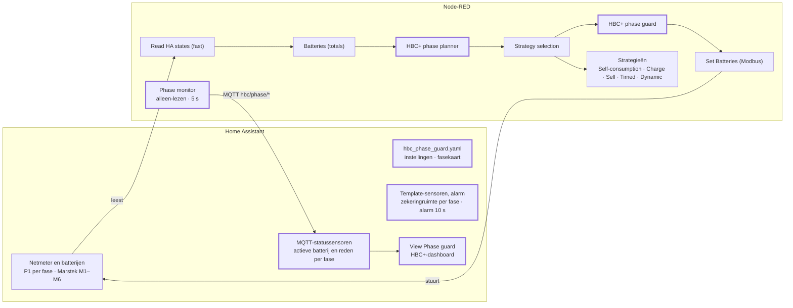

# HBC+ v1.2 — Gebruikershandleiding

*16 november 2026* · 🇬🇧 [English version](user-guide.en.md)

## Wat HBC+ is

HBC+ (Home Battery Control Plus) v1.2 stuurt tot zes thuisbatterijen aan vanuit Home Assistant en Node-RED, en laat twee batterijen één fase delen zonder de hoofdzekering van die fase te overbelasten. Met de phase guard op *Off* of *Monitor* worden de batterijen aangestuurd zonder faseregels; alleen *Enforce* past ze toe.

Naast de fasebewaking brengt HBC+ verbeteringen op drie vlakken:

- **Veiligheid** — bewaking van de hoofdzekering per fase, een strikte regel van één batterij per fase als de fasebewaking op *Enforce* faalt, een HA-automatisering die naar *Full stop* schakelt als de batterijen een fase overbelast houden, een HA-alarm dat ook zonder Node-RED werkt, en een heartbeat die de batterijen teruggeeft aan hun firmware als de regellus stopt of niet meer werkt, en waarschuwingen en fouten die altijd in het Node-RED-log en `sensor.hbc_health` terechtkomen.
- **Performance** — één snelle leesnode in plaats van ~43 losse reads, PID-stap en Timed-periodekeuze samengevoegd met instellingencaches, en minder Modbus-writes per tick.
- **Stabiliteit** — bugfixes (o.a. totaal-helpers die na een herstart op 0 sprongen, een prijscache die na een bronwissel oude prijzen gebruikte, het debug board), batterijwaarden die nooit NaN worden (één onbeschikbare batterij legt de andere niet meer stil), en één consistente HA-servernode in alle flowbestanden.

Daarnaast voegt het twee functies toe:

- **Charge Deadline-strategie** — laadt vóór een deadline tot een doel (vol, SoC of energiereserve), in de goedkoopste kwartieren, met optionele PV-reserve en een vervolgstrategie zodra de deadline voorbij is. Zie [Charge Deadline](#charge-deadline).
- **GridClock als databron** — Dynamic en Charge Deadline kunnen prijzen lezen uit de [Grid Clock](https://gridclock.eu)-integratie (`sensor.grid_clock_<zone>_prices`). De prijzen verversen automatisch zodra de standaardzone wijzigt. Zie [Dynamic](#dynamic).

Alle wijzigingen staan uitgewerkt in de sectie [Verbeteringen in HBC+](#verbeteringen-in-hbc) hieronder; [Nieuw in HBC+ v1.1](#nieuw-in-hbc-v11) noemt wat er sinds v1.0 veranderde.

Wat de fasebewaking toevoegt:

- **Een fasekaart.** Elke batterij (M1–M6) hoort bij L1, L2, L3 of *Own circuit* (eigen groep).
- **Eén actieve batterij per fase** (standaard). De partner op die fase wacht op 1 W idle en stopt daarna, zoals HBC+ doet met batterijen die het niet nodig heeft.
- **Twee limieten per fase.** De actieve batterij krijgt alleen de ruimte die overblijft onder zowel de hoofdzekering (net), na de huislast op die fase, als de batterijgroep die de batterijen van die fase delen (standaard 16 A ≈ 3680 W elk), elke tick opnieuw berekend uit de P1-meter.
- **Juist plafond voor planners.** Het maximale vermogen dat HBC+ aan Charge Deadline doorgeeft is de som per fase, niet de som van alle batterijen. Zo plant die genoeg laaduren.
- **Een view Phase guard** in het dashboard en een onafhankelijk overbelastingsalarm in Home Assistant dat ook werkt als Node-RED stilstaat.
- **Een optionele modus *Shared headroom*** waarin beide batterijen op een fase tegelijk mogen draaien, zolang ze samen onder de zekering blijven.

Netto-effect met twee batterijen per fase (6 × Marstek Venus E, elk 5,12 kWh): de bruikbare capaciteit verdubbelt tot ongeveer 30,7 kWh, het piekvermogen blijft 7,5 kW (3 × 2500 W).

Waarom de fasebewaking zo werkt, staat in [Achtergrond en ontwerpkeuzes](#achtergrond-en-ontwerpkeuzes).

### Credits

HBC+ is een zelfstandige versie met een eigen ontwikkeling. Het is begonnen vanuit House Battery Control (HBC) v4.15.1 van **CodeBob** ([gitcodebob](https://github.com/gitcodebob/marstek-venus-rs485-node-red)), de founding father van HBC: de oorspronkelijke regellus, strategieën, het dashboard en de helpers zijn zijn werk, en alle credits voor dat fundament gaan naar hem. HBC+ heeft verder geen link meer met HBC.

Dynamic en Charge Deadline gebruiken de macro [Cheapest Energy Hours](https://github.com/TheFes/cheapest-energy-hours) van **TheFes**.

## Architectuur

HBC+ bestaat uit drie delen: Home Assistant-packages met de instellingen en een onafhankelijk alarm, de Node-RED-regellus die de begrenzing uitvoert, en een dashboard dat per fase laat zien wat er gebeurt.



*Dikke rand = fasebewaking.* De planner en guard draaien in *HBC+ Home Battery Start*, dus de begrenzing hangt nooit van een ander tabblad af. Het Phase monitor-tabblad rapporteert alleen; de template-sensoren en het overbelastingsalarm draaien in Home Assistant en blijven werken als Node-RED stilstaat.

## Functionaliteit

### De regellus

Bij elke update van `sensor.p1_meter_power` (met rate limit) draait *HBC+ Home Battery Start* één tick:

1. **Read HA states (fast)** leest alle batterijen (M1…M*n*, `input_number.house_battery_count`) en instellingen in één node uit de Home Assistant-states in de global context. Ontbreken die, dan valt het terug op de oorspronkelijke keten van current-state-nodes.
2. **Batteries (totals)** berekent totaal batterijvermogen, max laad-/ontlaadvermogen en bruikbare energie, en schrijft die naar de helpers `input_number.house_battery_total_*`. Een waarde die even onbeschikbaar is, wordt maximaal 5 min vastgehouden; ook de strategieën krijgen die waarde. Een batterij die langer geen bruikbare SoC of vermogenslimiet heeft, wordt niet aangestuurd (R7).
3. **Update battery order** roteert de batterijprioriteit.
4. **HBC+ phase planner** (nieuw) bepaalt per fase wie mag draaien en hoeveel ruimte er is.
5. **Strategy selection** roept het strategietabblad aan dat in `input_select.house_battery_strategy` staat. Dat geeft `msg.solutions` terug: één `{id, mode, power}` per batterij.
6. **HBC+ phase guard** (nieuw) controleert de solutions nog één keer.
7. **Write limiter → Set Batteries** schrijft per batterij eerst vermogen, dan modus, alleen als een waarde veranderde (awaited writes, 60 s keep-alive op de modus). Elke solution wordt eerst gecontroleerd: de modus moet stop, charge of discharge zijn en het vermogen een getal tussen 0 en max, anders *stop*; een batterij met RS485 uit krijgt geen writes (R6, R7).
8. **HBC+ heartbeat** publiceert de tijd naar MQTT `hbc/heartbeat`, hooguit eens per minuut en alleen na een goede cyclus: de strategie kwam zonder fout terug en minstens één batterij is zonder fout beschreven. Stopt die, dan geeft Home Assistant de batterijen terug aan hun firmware (zie F4, R5 en R6).

Naast de lus publiceert *HBC+ health* de waarschuwingen en fouten van de laatste 10 minuten naar `hbc/health` → `sensor.hbc_health` (R8).

### Guard-modi

`input_select.house_battery_phase_guard_mode` bepaalt of de faseregels iets doen.

| Modus | Wat HBC+ doet | Gebruik het voor |
| --- | --- | --- |
| Off | Planner en guard laten elk bericht ongemoeid door: geen faseregels. | Eén batterij per fase, of om HBC+ uit te sluiten bij debuggen |
| Monitor (standaard) | Berekent en publiceert wat het *zou* doen; de nodestatus toont `would: …`. Verandert niets. | In bedrijf nemen; de koppeling testen voordat batterijen een fase delen |
| Enforce | Past de faseregels toe in de planner, de strategieën, de guard en de master switch. | Normaal gebruik met twee batterijen op een fase |

Elke gewijzigde node is getest tegen het origineel met dezelfde invoer: Off en Monitor geven identieke uitvoer.

### Faseregels (Enforce)

1. **Fasekaart.** Elke batterij heeft een fase uit `input_select.marstek_mN_phase`: L1, L2, L3 of *Own circuit* (nooit gedeeld, geen faseregel).
2. **Eén actieve batterij per gedeelde fase.** De andere krijgen het idle-setpoint van 1 W (relais blijft in) en stoppen na de normale idle-tijd. Dit is hetzelfde soft-stop-pad dat HBC+ gebruikt voor batterijen die het niet nodig heeft.
3. **Ruimte per fase.** Huisnetto op een fase = P1-fasevermogen min batterijvermogen op die fase (import positief). Laadruimte = min(netzekering − marge − huisnetto, batterijgroep − marge); ontlaadruimte = min(netzekering − marge + huisnetto, batterijgroep − marge). De netzekering draagt huis en batterijen samen; de batterijgroep alleen de batterijen. Beide ruimtes zijn ook begrensd op het eigen maximum van de batterij en worden elke tick opnieuw berekend.
4. **Selectie.** Kandidaten zijn de batterijen op die fase met RS485 `enable`, verse waarden, en SoC boven het minimum (ontladen) of onder het maximum (laden).
   - *SoC balance* (standaard): ontladen uit de volste, laden in de leegste. De huidige batterij blijft actief tot het SoC-verschil de wisseldelta (5 %) bereikt **en** hij de minimale verblijftijd (15 min) heeft gedraaid. Bij een richtingswissel mag direct opnieuw gekozen worden.
   - *Fixed order*: laagste M-nummer eerst, de partner alleen als reserve.
   - *Rotate daily*: de primaire batterij wisselt om middernacht.
5. **Break-before-make-overdracht.** De oude batterij gaat eerst naar idle; de nieuwe wordt pas vrijgegeven als de oude onder 100 W meet. Ontbreekt de teruglezing van de oude batterij of is die verouderd, dan blijft de partner geblokkeerd: een Marstek die Modbus kwijt is, kan nog zijn laatste opdracht uitvoeren.
6. **Laatste controle.** Vlak voor het schrijven corrigeert de guard elke fase met meer dan één actieve batterij of een setpoint boven de zekeringruimte, en logt dat. Dit vangt ook toekomstige strategieën op die de regels negeren.

Voorbeeld: met netzekering en batterijgroep allebei op 3680 W en 1800 W huislast op L1 mag de actieve L1-batterij laden met 3680 − 200 − 1800 = 1680 W; met 3000 W PV-teruglevering op L1 mag hij maar 480 W ontladen. Met een netzekering van 7360 W laat dezelfde 1800 W nog 5360 W onder de netzekering over, dus beslist de batterijgroep: 3680 − 200 = 3480 W.

### Shared headroom (optie)

Met `input_select.house_battery_phase_sharing` = *Shared headroom* mogen beide batterijen op een fase tegelijk draaien, zolang ze samen binnen de zekeringruimte blijven. Regels 1, 3 en 6 blijven; regels 2 en 5 worden vervangen door:

- **Vulvolgorde** volgt de selectieregel: de eerste batterij krijgt min(eigen max, ruimte), de partner krijgt wat over is, tot zijn eigen max.
- **Minimaal aandeel:** de partner start pas als er minstens 300 W over is en stopt weer onder 100 W.
- **Onbekend telt als bezig:** een batterij met een verouderde teruglezing telt mee met zijn laatste setpoint.

Typische winst: 2500 + 1000 W laden op een fase zonder huislast. De fallback als HBC+ stilstaat geeft nog steeds maar één batterij per fase terug aan de firmware.

### Wat er per strategie verandert

| Tabblad | HBC+-wijziging (alleen Enforce) |
| --- | --- |
| Home Battery Start | Nieuwe *phase planner* en *phase guard*; *Batteries (totals)* telt max vermogen per fase |
| Self-consumption | *Load distribution* soft-stopt standby-batterijen en begrenst elke fase op zijn zekeringruimte; anti-windup gebruikt de begrensde capaciteit |
| Charge, Sell | *Max power solution* laat alleen de actieve batterij per fase draaien, op min(eigen max, zekeringruimte); de partner staat idle op 1 W |
| Master Switch | Bij teruggave aan de firmware krijgt alleen het laagste M-nummer op een gedeelde fase RS485 *disable*; de partner blijft RS485 *enable* + forcible *stop* |
| Charge Deadline | Logica ongewijzigd; plant met het max vermogen per fase uit *Batteries (totals)* |
| Partials, Timed, Dynamic (prijsophaling: zie hieronder), Full stop, PID presets, Oscillation Guard, Strategy arbiter | Geen wijziging; wat ze uitvoeren gaat via Self-consumption of Max power, die de regels toepassen |
| Phase monitor | **Nieuw**, alleen-lezen: publiceert `hbc/phase/*` voor het dashboard elke 5 s (opnieuw bij wijziging, anders hooguit elke 30 s) |

### Gedeelde prijsophaling (Dynamic)

De sectie *API call to Data Source* van *HBC+ Strategy Dynamic* is een link-call-subroutine, zodat elke flow de actuele prijslijst kan ophalen zonder eigen kopie van de databronlogica. Binnen het Dynamic-tabblad roept *Cache check* hem aan bij een cache miss; de prijzen komen terug en gaan door naar *Determine strategy*, net als bij een cache hit.

Gebruik hem vanuit een andere flow met een **link call**-node: kies *Dynamic Fetch from Data Source* en stel een timeout van minstens 30 s in. De eerste node van de sectie, *Prepare request*, vult aan wat de aanroeper weglaat.

| msg-property | In / uit | Betekenis |
| --- | --- | --- |
| `dynamic.data_source` | in, optioneel | Prijsbron; standaard = `input_select.house_battery_strategy_dynamic_data_source` |
| `dynamic_use_cache` | in, optioneel | `true` = geef de gecachte prijzen van het Dynamic-tabblad terug als ze nog geldig zijn (zelfde regel als *Cache check*: na 13:00 moeten ze morgen dekken), anders ophalen |
| `dynamic` | uit | `{data_source, data_all: {list, list_marked, average, min, max, start, …}, no_data?}` |
| `dynamic_from_cache` | uit | `true` als de cache antwoordde |
| `dynamic.stale` | uit | `true` als de bron faalde en de laatste geldige prijzen van die bron terugkwamen |
| `target` | in, optioneel | Alleen voor een link call met een dynamisch doel: `"Dynamic Fetch from Data Source"` |

- Bron *None*, of een bron die Node-RED niet kan lezen, komt direct terug met `dynamic.no_data = true` en een lege lijst, zodat de aanroeper nooit op de timeout wacht.
- Een geslaagde ophaling vanuit elke aanroeper ververst ook de cache van het Dynamic-tabblad.
- De rest van het bericht van de aanroeper komt ongewijzigd terug (`msg.template` wordt gebruikt en verwijderd).
- Levert een ophaling geen prijzen, dan komt de laatste geldige lijst van dezelfde bron terug met `dynamic.stale = true` zolang die het huidige interval nog dekt, anders `dynamic.no_data = true` (zie R3).
- Een fout binnen de sectie (bijvoorbeeld de template-render terwijl HA niet verbonden is, of een macrofout) wordt opgevangen door *Catch fetch errors* en afgehandeld als een ophaling zonder prijzen, zodat de aanroeper direct antwoord krijgt in plaats van een timeout. De node *Fetch error* logt de fout als waarschuwing en toont hem in zijn status.

#### Gebruik vanuit je eigen flow

De repo heeft een kant-en-klaar voorbeeld: `node-red/examples/price-fetch-example.json`. Importeer het (*Import → select a file to import → Import*), deploy, en klik op de knop van *Every 15 min*; de debug-zijbalk toont de actuele prijs.

Zelf bouwen:

1. **Trigger.** Een inject-node, bijvoorbeeld elke 15 minuten.
2. **Verzoek.** Een function- of change-node. Begin met een nieuwe `msg.dynamic` (`msg.dynamic = {}`): de sectie leest een bestaande `msg.dynamic` als verzoek en vervangt hem door het antwoord. Zet `msg.dynamic.data_source` alleen voor een andere bron dan die van het Dynamic-tabblad, en `msg.dynamic_use_cache = true` om de prijzen van het Dynamic-tabblad te hergebruiken in plaats van opnieuw op te halen.
3. **Link call** met een timeout van 30 s, op een van twee manieren:
   - *Statisch:* kies *Dynamic Fetch from Data Source* in de lijst van de node. Kies hem opnieuw na een herimport van het Dynamic-tabblad met nieuwe node-id's.
   - *Dynamisch:* zet het linktype op *Dynamic target* en zet `msg.target = "Dynamic Fetch from Data Source"` in het verzoek. Dit blijft werken na een herimport. Gebruik het niet op een bericht dat HBC+ ook voor de aansturing gebruikt (binnen een strategietabblad), want daar noemt `msg.target` de strategie.
4. **Lees het antwoord** in de volgende node. Controleer eerst `msg.dynamic.no_data`: dan is de lijst leeg. Met `msg.dynamic.stale` is de lijst de laatste geldige van die bron, bewaard zolang de bron faalt.

Velden van `msg.dynamic.data_all`:

| Veld | Betekenis |
| --- | --- |
| `list` | Eén prijs per interval in ct/kWh, vanaf `start` |
| `start` | Begintijd van het eerste interval |
| `hours` | Aantal uren dat de lijst dekt |
| `datapoints` | Aantal intervallen in `list` |
| `average`, `weighted_average`, `min`, `max` | In ct/kWh, naar beneden afgerond op hele centen |

Een interval duurt `hours × 60 / datapoints` minuten (15 bij kwartierprijzen). De prijs van nu is:

```js
const a = msg.dynamic.data_all;
const slotMs = (a.hours / a.datapoints) * 3600000;
const priceNow = a.list[Math.floor((Date.now() - new Date(a.start).getTime()) / slotMs)]; // ct/kWh
```

### Effect op planners

Omdat *Batteries (totals)* het effectieve maximum in de bestaande helpers schrijft, hebben Charge Deadline en de PID-anti-windup geen codewijziging nodig.

| Waarde | 3 batterijen (nu) | 6 batterijen, geen faseregel | 6 batterijen, Enforce |
| --- | --- | --- | --- |
| `house_battery_total_max_charge_power` | 7500 W | 15000 W | 7500 W |
| Bruikbare energie | ~15,4 kWh | ~30,7 kWh | ~30,7 kWh |
| Uren om 0→100 % te laden op max | ~2 u | ~2 u (maar zekering springt) | ~4 u |

De plannerwaarde volgt de zekeringruimte. Op *Enforce* trekt *Batteries (totals)* de gemiddelde huislast per fase (exponentieel gemiddelde over ongeveer 15 minuten) af van de zekeringruimte, rondt af op 100 W en past de waarde alleen aan als die 250 W of meer verschuift. Een warmtepomp die een half uur draait verlaagt de plannerwaarde; een waterkoker van een paar seconden niet. Voorbeeld: met een uur lang 2 kW huislast op L1 zakt het laadplafond naar ongeveer 6200 W in plaats van 7500 W, zodat Charge Deadline extra goedkope kwartieren boekt. Stopt de last, dan is de waarde binnen ongeveer 15 minuten terug.

### Ingebouwde veiligheid

- **Fail-safe op Enforce.** Planner, guard en totalen draaien in try/catch. Op *Off* en *Monitor* geeft een fout het bericht ongewijzigd door. Op *Enforce* past *Set Batteries* dan de strikte regel toe: per gedeelde fase draait alleen het laagste M-nummer, hooguit batterijgroep − marge (R9).
- **Geen afhankelijkheid van andere tabbladen** in de regellus: planner en guard zitten in *Home Battery Start*. Het Phase monitor-tabblad uitschakelen verandert niets.
- **Onafhankelijke alarmen.** `binary_sensor.hbc_phase_limit_exceeded` gaat aan als het netvermogen op een fase 10 s boven de netzekering ligt; `binary_sensor.hbc_phase_circuit_limit_exceeded` als de batterijen op een fase 10 s meer trekken dan de batterijgroep. Beide zijn puur Home Assistant en werken ook als Node-RED stilstaat. Zijn de batterijen meeveroorzaker, dan schakelt HA naar *Full stop* (R10).
- **Een heartbeat die *werkt* betekent.** De heartbeat volgt alleen op een goede regelcyclus (R6). Raakt hij verouderd, dan zet Home Assistant elke batterij die het aan de firmware teruggeeft eerst stil, en wacht de Master Switch-flow op een verse heartbeat voordat hij RS485 weer aanzet (R5).
- **Geen NaN richting de batterijen.** Eén onbeschikbare batterijwaarde verspreidt zich niet meer naar de andere batterijen, en *Set Batteries* controleert elk setpoint voordat het geschreven wordt (R7).
- **Fouten zijn zichtbaar.** Waarschuwingen en fouten komen altijd in het Node-RED-log en in `sensor.hbc_health`, ook met *Insights mode* uit; HA meldt het als fouten blijven komen (R8).
- **Wijzigingen worden gemeld.** Elke wijziging van een veiligheidsinstelling van de fasebewaking geeft een melding die noemt wie hem deed (S2). Hoe je de Node-RED-editor, MQTT en het dashboard afschermt: zie *Je installatie beveiligen*.

## Strategieën en instellingen

Deze sectie legt uit wat elke strategie doet en met welke instellingen je hem stuurt. De ⓘ-links in het dashboard wijzen hierheen.

### Mastermodus

`input_select.marstek_master_battery_mode` bepaalt wie de Marsteks aanstuurt. HBC+ stuurt de batterijen alleen in **Full control**.

| Mastermodus | RS485-besturing | Wie stuurt |
| --- | --- | --- |
| Full control | enable | HBC+ (forcible charge / discharge) |
| Marstek control | disable | De Marstek-firmware, in de werkmodus die je in de Marstek-app koos |
| Manual control | disable | De Marstek-firmware, handmatige modus |

### Een strategie kiezen

Kies de strategie in `input_select.house_battery_strategy`. De *Strategy arbiter* is de enige die die helper schrijft: de Battery Oscillation Guard, en eigen flows (bijvoorbeeld een PV-limiter), kunnen tijdelijk een andere strategie vasthouden en geven je keuze daarna terug (zie *Installatie*, stap 3).

| Strategie | Wat het doet |
| --- | --- |
| Self-consumption | Houdt het netvermogen op 0 W door te laden uit PV-overschot en te ontladen naar het huisverbruik (PID-regeling) |
| Charge PV | Self-consumption zonder ontladen: laadt alleen uit PV-overschot |
| Zero import | Self-consumption zonder laden: ontlaadt om de netafname op 0 W te houden |
| Standby / peak shave | Batterijen staan stil (geen relaisklikken); met peak shaving aan grijpen ze toch in boven de netgrenzen |
| Charge | Laadt van het net tot een doel, en schakelt dan over |
| Sell | Ontlaadt naar het net tot een doel, en schakelt dan over |
| Charge Deadline | Laadt tot een doel vóór een deadline, in de goedkoopste kwartieren |
| Timed | Een andere strategie per tijdvak (A t/m E) |
| Dynamic | Een andere strategie voor goedkope, dure en normale prijsperiodes |
| Full stop | Alle batterijen op stop, 0 W; het relais gaat open, dus geen sluimerverbruik |
| Helios | Gereserveerd voor een toekomstige HELIOS-integratie (hoort niet bij HBC+). Tot die flow geïnstalleerd is, draait een placeholder-tabblad *Full stop* en logt een waarschuwing |

**EV-stoptrigger.** Zet het entity-id van een "EV laadt"-sensor of -boolean in `input_text.house_battery_strategy_ev_sensor_entity_id`. Zolang die `on` is, draait HBC+ de strategie uit `input_select.house_battery_strategy_ev_stop_trigger_strategy` (*Full stop* of *Standby / peak shave*), zodat de batterijen niet in de auto ontladen.

### Self-consumption en PID-afstelling

Self-consumption is de PID-regelaar van HBC+, en de meeste andere strategieën laten hem het eigenlijke werk doen. Elke tick neemt hij het verschil tussen netvermogen en doel (standaard 0 W), negeert verschillen onder 15 W, en berekent een batterijvermogen uit drie termen:

- **P (Kp)** reageert op het verschil van nu;
- **I (Ki)** werkt het verschil weg dat over tijd blijft staan;
- **D (Kd)** dempt snelle veranderingen.

*Load distribution* verdeelt dat vermogen daarna over de batterijen in volgorde van prioriteit, elk tot zijn eigen maximum. Bijna vol wordt het laden beperkt tot 1500 W vanaf 95 % en 1000 W vanaf 99 %.

Afstellen gaat het makkelijkst met een preset in `input_select.house_battery_control_pid_presets`:

| Preset | Kp | Ki | Kd | Ingangsdemping | Uitgangsdemping | Wanneer |
| --- | --- | --- | --- | --- | --- | --- |
| Very safe | 0.1 | 0.1 | 0 | 0 % | 10 % | Een systeem dat met elke andere preset gaat slingeren |
| Safe | 0.3 | 0.3 | 0.1 | 20 % | 0 % | Goed startpunt voor de meesten |
| Regular | 0.3 | 0.4 | 0.8 | 50 % | 10 % | Snellere reactie; vraagt een stabiele meter |
| Custom | — | — | — | — | — | Je eigen waarden in de PID-helpers |

Begin met *Safe*. Slingert het netvermogen heen en weer rond 0 W, dan is de regeling te scherp: ga een preset omlaag, of verlaag Kp en Ki. Komt het na een belastingsstap traag terug naar 0 W, dan is hij te zacht: ga een preset omhoog. Verander één ding tegelijk en kijk een paar minuten. De *Battery Oscillation Guard* zet de batterijen stil als ze toch gaan slingeren.

Andere instellingen (demping op de view PID Control, hysterese op de view Batteries):

- **Hysterese** (`input_number.house_battery_control_hysteresis_in_w`, 0–200 W): de PID-uitgang moet dit voorbij voordat de batterijen wisselen tussen laden en ontladen.
- **Fout- en uitgangsdemping** (`…_error_signal_dampening`, `…_pid_output_dampening`, 0–90 %): voortschrijdende gemiddelden op in- en uitgang; meer demping is rustiger maar trager.

### Charge en Sell

**Charge** laadt van het net tot het doel in `input_select.house_battery_strategy_charge_goal` bereikt is:

| Doel | Bereikt als |
| --- | --- |
| batteries are full | Elke batterij op zijn maximale SoC staat |
| state of charge | De gemiddelde SoC `input_number.house_battery_strategy_charge_target_soc` bereikt |
| energy reserve | De bruikbare energie `input_number.house_battery_strategy_charge_target_energy` bereikt |
| solar forecast | De bruikbare energie het maximum min het verwachte PV-overschot van vandaag bereikt (de verwachting min `input_number.house_battery_solar_reserved_for_house`) |

**Sell** ontlaadt naar het net tot `input_select.house_battery_strategy_sell_goal` bereikt is: *batteries are empty*, *state of charge* (`…_sell_target_soc`) of *energy reserve* (`…_sell_target_energy`).

Is het doel bereikt, dan draait de strategie bij *Then use* (`…_charge_goal_reached` / `…_sell_goal_reached`, standaard *Charge PV*).

**Vermogen.** Zonder netgrens laadt of ontlaadt elke batterij op zijn maximum. Staat peak shaving voor afname (Charge) of teruglevering (Sell) aan, dan regelt HBC+ in plaats daarvan op die netgrens (zie [Geavanceerde instellingen](#geavanceerde-instellingen); de grenzen staan op de view Phase guard). Op *Enforce* draait per gedeelde fase alleen de actieve batterij, binnen de zekeringruimte van die fase.

**Zonneverwachting.** Voor het doel *solar forecast* zet je de entity-id's van je verwachtingssensoren (kWh vandaag en kWh morgen, bijvoorbeeld van Forecast.Solar of Solcast) in `input_text.house_battery_strategy_solar_forecast_entity_id` en `…_solar_forecast_tomorrow_entity_id`. Zet `input_number.house_battery_solar_reserved_for_house` op wat het huis op een gewone dag zelf van de PV gebruikt.

### Charge Deadline

Laadt tot een doel vóór een deadline (`input_datetime.house_battery_deadline_start` / `_end`). Het doel staat in `input_select.house_battery_deadline_goal`: *batteries are full*, *state of charge* of *energy reserve*. Het kiest bij voorkeur de goedkoopste kwartieren uit de Dynamic-prijslijst, en doseert het vermogen naar prijs (`input_number.house_battery_deadline_price_ratio`: hoeveel harder het goedkoopste kwartier laadt dan het duurste dat het gebruikt). Het rekent ook op verwachte PV als `input_boolean.house_battery_deadline_reserve_pv` aan staat, en houdt het doel vast tot de deadline als `…_hold_after_target` aan staat. Na de deadline draait de strategie bij *Then use* (`input_select.house_battery_deadline_reached`). De planning wordt elke tick opnieuw berekend uit de resterende energie en tijd. Het heeft een werkende prijsbron nodig (zie *Dynamic*).

### Batterijkalibratie

*Nieuw in v1.3.* In de winter haalt een batterij soms wekenlang zijn laadgrens niet, en dan wijkt de laadstand die het BMS meldt steeds verder af. Is een batterij *Calibrate after* dagen (standaard 14) niet vol geweest, dan laadt HBC+ hem één keer tot 100 % (`packages/hbc_calibration.yaml`, view *Batteries*):

1. **15:05**, zodra de prijzen van morgen er zijn: welke batterijen zijn aan de beurt? Op *Notify* krijg je alleen een melding.
2. **Eerst de zon.** Op *Auto*: dekt het voorspelde PV-overschot van morgen (`sensor.solar_forecast_surplus_tomorrow`) de ontbrekende energie, dan plant HBC+ niets; een zonnige dag kalibreert vanzelf.
3. **Plannen.** Anders kiest HBC+ het goedkoopste blok tussen 00:00 en *Full by* (standaard 07:00), lang genoeg om de ontbrekende energie te laden op 60 % van het laadvermogen. Je krijgt een melding met het blok.
4. **Laden.** Bij het begin van het blok bewaart HBC+ de Charge Deadline-instellingen en de laadgrenzen, zet hij de laadgrens van elke betrokken batterij op 100 %, zet hij het Charge Deadline-venster op het blok met doel *batteries are full*, en houdt hij via de Strategy arbiter *Charge Deadline* vast (aanvrager `calibration`, prioriteit 40).
5. **Afronden.** Staat elke betrokken batterij 5 minuten op 99 % of meer, is het blok 15 minuten voorbij, kies je zelf een andere strategie, of is HA herstart: dan wordt de hold vrijgegeven, gaan de instellingen en laadgrenzen terug en krijg je een melding.
6. **Opgeven.** Na drie nachten zonder succes stopt de kalibratie voor die batterijen, met een melding. Hij begint opnieuw zodra de batterij vol is geweest.

Charge Deadline houdt zijn venster binnen de huidige dag, dus een kalibratie loopt altijd tussen 00:00 en *Full by*. *Full stop*, een handmatige keuze en de EV-stoptrigger winnen altijd; fase- en prijsbewaking blijven werken. De status staat in `sensor.hbc_calibration_status`; het aantal dagen sinds vol per batterij in de attributen van `sensor.hbc_calibration_due`.

### Besparing en rendement

*Nieuw in v1.3* (`packages/hbc_savings.yaml`, view *Savings*). Elk kwartier rekent HBC+ twee rekeningen uit, met de inkoop- en terugleverprijs van dat kwartier: wat je energie kostte **met** de batterijen, en wat hij **zonder** had gekost. Het verschil is je besparing.

- **Met:** netafname × inkoopprijs − teruglevering × terugleverprijs.
- **Zonder:** hetzelfde, maar voor de netenergie die je zonder batterijen had gehad: (afname − teruglevering) − (laden − ontladen). Verlies in de batterijen telt vanzelf mee.
- **Opgeslagen PV** is energie die werd geladen terwijl het huis anders had teruggeleverd; de rest is **van het net geladen**. In kWh per maand.
- Tot 1 januari 2027 (saldering) en met elke andere tariefbron dan de Grid Clock-feed is de terugleverprijs gelijk aan de inkoopprijs.
- Vaste kosten (vastrecht, netbeheer per maand, heffingskorting) tellen niet mee: die zijn met en zonder batterijen gelijk. Een kwartier met een gat (HA langer dan 20 minuten uit, geen prijs) wordt overgeslagen en geteld in `quarters_missing`.

De energie komt uit `sensor.p1_meter_power` en `sensor.marstek_mN_battery_power` (per batterij gesplitst, zodat de ene batterij die laadt en de andere die ontlaadt niet tegen elkaar wegvallen), geteld door vier `integration`-sensoren. Dag, maand en jaar komen uit utility meters.

**Rendement.** Eén keer per dag (00:05) bewaart HBC+ de energietellers van de batterijen en de opgeslagen energie. Over 7 dagen: (energie eruit + verschil in opgeslagen energie) / energie erin, gemeten aan de AC-kant van de batterij. Is er minder dan 5 kWh geladen, dan blijft de waarde *unknown*; boven 100 % of onder 50 % wijst een waarschuwing op de tekens van de vermogenssensoren.

**Voorgestelde Minimum spread.** Een laad-/ontlaadcyclus loont als de dure prijs min de goedkope prijs minstens (1 − rendement) × dure prijs + slijtagekosten is. HBC+ vult het gemiddelde in van de kwartieren die Dynamic als *high* markeert (of het duurste kwart van de lijst) en `input_number.house_battery_wear_cost` (standaard 0), naar boven afgerond op hele centen. Het voorstel wordt nooit automatisch toegepast: *Use the suggestion* op de view *Savings* zet *Minimum spread*.

**Dynamic uses measured efficiency** (`input_boolean.house_battery_dynamic_use_efficiency`, standaard uit). Dynamic koppelt normaal een goedkoop en een duur kwartier als het prijsverschil minstens *Minimum spread* is. Met deze schakelaar aan haalt hij eerst de verliezen eraf: een paar telt als rendement × dure prijs − goedkope prijs minstens *Minimum spread* is, en dat betekent dan de winst die je per kWh na verliezen wilt. Het verlies groeit met het prijsniveau: bij hetzelfde verschil van 15 ct levert een paar van 10/25 ct bij 85 % rendement nog 11,25 ct per kWh op, een paar van 30/45 ct maar 8,25 ct. *Grid cycle profit today* toont dan ook het resultaat na verliezen. Omdat het verlies al meetelt, is de voorgestelde spread dan alleen de slijtagekosten. Zolang het rendement nog *unknown* is, of met de schakelaar uit, koppelt Dynamic precies zoals in v1.2. Zet hem aan als het rendement een week of twee data heeft.

### Timed

Draait een andere strategie per tijdvak. Tijdvak A staat altijd aan; B t/m E zet je één voor één aan (`input_boolean.house_battery_strategy_timed_has_period_b` … `_e`). Elk tijdvak heeft een start, een einde (`input_datetime.house_battery_strategy_timed_period_a1` / `_a2` …) en een strategie (`input_select.house_battery_strategy_timed_strat_a` …). Het eerste ingeschakelde tijdvak waar de huidige tijd in valt, wint; een tijdvak met een einde vóór de start loopt door over middernacht. Buiten alle tijdvakken draait de basisstrategie (`…_timed_strat_0`). Het actieve tijdvak staat in `input_text.house_battery_strategy_timed_period_selected`.

### Dynamic

Kiest een strategie op basis van de energieprijzen van vandaag en morgen.

**Instellen.**

1. Installeer de macro [Cheapest Energy Hours](https://github.com/TheFes/cheapest-energy-hours) (HACS).
2. Installeer een prijsintegratie en kies die bij **Tariff data source** (`input_select.house_battery_strategy_dynamic_data_source`).
3. Heb je meer dan één prijsintegratie, leg de sensor dan vast in `input_text.house_battery_strategy_dynamic_price_sensor` (zie R4).
4. Controleer de grafiek *Price intervals* op de view Prices.

**Hoe het beslist.** Per dag koppelt HBC+ de goedkoopste en de duurste intervallen, van de uitersten naar binnen. Een paar telt alleen mee als het prijsverschil minstens **Minimum spread** is (`input_number.house_battery_strategy_dynamic_threshold_delta`, in centen). Zet die zo dat hij je laad-/ontlaadverliezen dekt. **Cheapest hours** en **Expensive hours** begrenzen het aantal gemarkeerde uren per dag (0 = geen grens). Het huidige interval bepaalt dan de strategie:

| Interval | Strategie (helper) | Keuzes |
| --- | --- | --- |
| Goedkoop | `…_dynamic_cheapest` | Charge, Charge PV, Charge Deadline, Standby / peak shave |
| Duur | `…_dynamic_expensive` | Self-consumption, Sell, Zero import, Standby / peak shave |
| Normaal | `…_dynamic_default` (*Default to*) | Charge PV, Self-consumption, Zero import, Standby / peak shave, Full stop |

De prijzen worden ververst om middernacht, om 13:15 en 15:00, na een bronwissel, en tot de prijzen van morgen binnen zijn. Valt de bron uit, dan houdt Dynamic de laatste geldige prijzen aan of valt terug op *Default to* (zie R3). Andere flows kunnen dezelfde prijzen ophalen via de link call (zie *Gedeelde prijsophaling*).

### Grid Clock-feed

*Tariefbron* **Grid Clock** (de Grid Clock-feed, nieuw in v1.2) leest all-in inkoop- en terugleverprijzen per kwartier voor je eigen leverancier uit de openbare bestanden van [Grid Clock](https://gridclock.eu). Grid Clock rekent ze uit met de formule van de leverancier, btw en de energiebelasting van het land. In Nederland schakelt hij op 1 januari 2027, als salderen stopt, zelf over op aparte terugleverprijzen. HBC+ heeft zelf geen instellingen voor belasting of opslag.

**Instellen.**

1. Controleer dat **Tariff data source** (view Prices) op *Grid Clock* staat. Dat is de standaard bij een nieuwe installatie; na een update vanaf v1.1 blijft je eerdere keuze staan.
2. Kies je **Zone** (NL of BE) en je **Supplier** (leverancier). Zolang je er geen kiest, gebruikt HBC+ de marktprijs, met terugleverprijs = inkoopprijs.
3. België: kies je **Grid operator** (netbeheerder). Zijn distributie- en transportkosten per kWh komen bij de inkoopprijs.
4. Kijk naar de regel **Grid Clock feed** onder de bron: `ok` of `not modified` is goed; `error` toont de reden.

**Wat er verstuurd wordt.** Geen account, token of registratie. HBC+ haalt `v1/hbc/<zone>/index.json` en `v1/hbc/<zone>/<leverancier>/latest.json` op van `cdn.gridclock.eu`; de zone en de korte naam van de leverancier (de *slug*, zoals `frank-energie`) staan in het adres, verder niets. Zoals elk webverzoek gaat het via Cloudflare, dat je IP-adres ziet. Grid Clock bewaart niets over HBC+-gebruikers. De gekozen leverancier staat in `input_text.house_battery_gridclock_provider_slug`.

**Wanneer.** Op dezelfde momenten als elke andere bron: na middernacht, om 13:15 en 15:00, elk kwartier tot de prijzen van morgen er zijn, en meteen na het wijzigen van zone of leverancier. Een ongewijzigd bestand kost een `304`. Lukt het ophalen niet, dan houdt Dynamic de laatste geldige prijzen aan, zoals bij elke bron (R3). De leverancierslijst wordt bij de start, na elke herstart van Home Assistant en dagelijks om 00:10 ververst.

**Na een herstart.** Zone, leverancier en netbeheerder blijven onthouden. Vlak na een herstart van Home Assistant kan het dashboard even *Market price (no supplier)* en *None* tonen; zodra Node-RED de leverancierslijst opnieuw heeft geladen (meestal binnen enkele seconden) staat je keuze er weer. De prijzen gebruiken intussen gewoon je leverancier.

Testen tegen de staging-bestanden van Grid Clock: zet de omgevingsvariabele `GRIDCLOCK_FEED_URL` op het tabblad *HBC+ Strategy Dynamic* (standaard `https://cdn.gridclock.eu/v1/hbc`).

### Inkoop- en terugleverprijs

Vanaf v1.2 heeft elk kwartier een **inkoopprijs** (wat een afgenomen kWh kost) en een **terugleverprijs** (wat een teruggeleverde kWh oplevert). Met de Grid Clock-feed verschillen ze zodra salderen gestopt is; bij elke andere bron is terugleverprijs = inkoopprijs, precies zoals v1.1 een kWh waardeerde.

- Dynamic koppelt goedkope en dure kwartieren zoals voorheen. Staat *Strategy during expensive period* op **Sell**, dan telt een duur kwartier met zijn terugleverprijs. Dynamic markeert dus alleen een Sell-periode als de terugleverprijs de inkoopprijs van een goedkoop kwartier met minstens *Minimum spread* verslaat. Zonder salderen gebeurt dat zelden; het dashboard raadt dan *Self-consumption* aan. Met elke andere strategie voor dure periodes verandert er niets.
- `sensor.hbc_energy_price_now` blijft de inkoopprijs; `sensor.hbc_energy_export_price_now` is de terugleverprijs van nu. Elke regel in het attribuut `marks` van `sensor.hbc_energy_prices_data` heeft naast `price` ook `sell` en `neg` (`import`, `export` of leeg).
- De grafiek *Price intervals* toont de terugleverprijs als grijze lijn over de inkoopstaven. Paarse staven zijn kwartieren waarin terugleveren geld kost; donkerpaars als je betaald krijgt voor afnemen.

### Prijsbewaking (price guard)

De prijsbewaking verandert wat de batterijen doen bij negatieve prijzen. Standaard staat hij **Off**; **Monitor** laat alleen zien wat hij zou doen; **On** grijpt in.

| Toestand (`sensor.hbc_price_state`) | Wanneer | Wat de prijsbewaking doet |
| --- | --- | --- |
| `export_negative` | Terugleverprijs onder *Export threshold* (standaard 0 ct) | Sell → Charge PV, Zero import → Self-consumption, Standby / peak shave → Charge PV: overschot van de panelen gaat de batterijen in in plaats van het net op |
| `import_negative` | Inkoopprijs onder *Import threshold* (standaard 0 ct) | Elke strategie behalve Full stop → Charge, tot de batterijen vol zijn |
| `normal` | Anders | Niets |

De prijsbewaking werkt op de strategie die echt draait: de substrategie van Dynamic of Timed, en de vervolgstrategie na een doel van Charge of Sell. Je eigen keuze in `input_select.house_battery_strategy` verandert nooit, en de wissel stopt bij het eerste kwartier met normale prijzen. `sensor.hbc_price_guard` laat zien wat hij deed (`override`, `would` of `none`) en waarom.

**Veiligheid.**

1. **On** grijpt alleen in met *Tariff data source* = *Grid Clock*: alleen de feed heeft de echte all-in prijzen. Bij een andere bron lijkt een marktprijs onder nul negatief terwijl je nog energiebelasting betaalt; dan blijft de prijsbewaking op Monitor.
2. **Full stop** wordt nooit veranderd (Oscillation Guard, overbelastingsalarm, handmatige stop), en er verandert niets zolang de EV-stoptrigger aan staat.
3. **Import** op vol vermogen alleen met de fasebewaking op *Enforce*, of als geen enkele fase twee batterijen heeft (`binary_sensor.hbc_phase_shared`). Anders blijft dat deel op Monitor, zodat twee batterijen op één groep van 16 A nooit samen op vol vermogen laden.
4. Ontbreekt een entiteit van de prijsbewaking, dan is er geen prijsbewaking: de regellus werkt dan zoals in v1.1.

**Voor een PV-begrenzer.** `binary_sensor.hbc_export_price_negative`, `binary_sensor.hbc_import_price_negative` en `binary_sensor.hbc_pv_curtail_advised` (terugleveren kost geld en de batterijen zijn vol). HBC+ zelf knijpt de panelen nooit af. Het zijn gewone Home Assistant-sensoren, die ook werken als Node-RED uit ligt.

**Dashboard.** De sectie *Price guard* op de view Prices bevat modus, drempels, toestand en actie; de view Overview toont een melding zolang de prijsbewaking een strategie wisselt. Begin een paar dagen met **Monitor**.

### Geavanceerde instellingen

Deze instellingen staan op de view **Batteries**; peak shaving staat op de view **Phase guard**.

- **Batterijprioriteit** (`input_select.house_battery_control_priority_change_interval`): Self-consumption gebruikt de batterijen in volgorde van prioriteit, te beginnen met `input_number.house_battery_control_prioritize_battery`. De prioriteit schuift door naar de volgende batterij elke 30 minuten (*Auto balance*), dagelijks om 02:00 (*Daily*), op zondag om 02:00 (*Weekly*), of helemaal niet (*Never*). Behalve bij *Auto balance* ontlaadt HBC+ in omgekeerde volgorde, zodat de batterij die als eerste laadt als laatste ontlaadt.
- **Stop na stilstand** (`input_number.house_battery_control_idle_time`, 0–60 min): een batterij die niet nodig is houdt zo lang 1 W (relais dicht) voordat hij *stop* krijgt. Dat scheelt relaisklikken als het verbruik op en neer gaat.
- **Peak shaving** (`input_boolean.house_battery_control_has_power_limit_import` / `_export` met `input_number.house_battery_control_power_limit_import` / `_export`): de batterijen houden netafname of teruglevering onder de grens, bijvoorbeeld voor een capaciteitstarief. Charge en Sell regelen op deze grenzen in plaats van op vol vermogen.
- **Cutoff-capaciteiten** (`input_number.marstek_mN_charging_cutoff_capacity` 80–100 %, `…_discharging_cutoff_capacity` 11–80 %): de SoC-grenzen die naar elke Marstek geschreven worden. HBC+ behandelt een batterij op zijn grens als vol of leeg.
- **Fase** (`input_select.marstek_mN_phase`: L1 · L2 · L3 · Own circuit): de fase waarop elke batterij fysiek is aangesloten, gebruikt door de fasebewaking (zie [Stap 5 — Fasekaart en zekering instellen](#stap-5--fasekaart-en-zekering-instellen)).

## Achtergrond en ontwerpkeuzes

### Waarom fasebewaking nodig is

Zonder fasebewaking kent de regeling geen fasen. Dat ging alleen goed zolang M1, M2 en M3 elk op een eigen fase zaten. *Max power solution* (Charge en Sell) zet elke batterij op zijn maximum, en *Load distribution* (Self-consumption) vult de batterijen in prioriteitsvolgorde, elk tot zijn eigen maximum. Met twee Marsteks op L1 komt er dan 2 × 2500 = 5000 W op die fase, ruim boven een zekering van 16 A (3680 W).

Daarnaast zou het plannerplafond de som van alle batterijen zijn (6 × 2500 = 15000 W) in plaats van wat er per fase echt kan (3 × 2500 = 7500 W). Charge Deadline zou dan maar de helft van de benodigde goedkope kwartieren boeken. En de heartbeat-fallback zou bij een storing elke batterij in firmware-anti-feed zetten, waarna twee batterijen op één fase elk 2500 W kunnen leveren.

### Randgevallen

| Situatie | Gedrag |
| --- | --- |
| HBC+ stilgevallen (heartbeat verouderd) | Per gedeelde fase gaat alleen de batterij met het laagste M-nummer naar firmware-anti-feed. De partner blijft RS485 *enable* + forcible *stop* en doet dus niets, ook niet als Node-RED of HA uitvalt. Elke batterij die teruggaat krijgt eerst forcible *stop*, en de Master Switch-flow zet RS485 pas weer aan als de heartbeat vers is. |
| SoC of vermogenslimiet van een batterij langer dan 5 minuten onbeschikbaar | Die batterij wordt niet aangestuurd (limieten 0 W, `data_ok = false`); de andere batterijen werken gewoon door (R7). |
| Actieve batterij RS485 uit, offline of op zijn SoC-limiet | De partner neemt direct over (zonder verblijftijd), na break-before-make. |
| Actieve batterij onbereikbaar terwijl hij draaide | De partner blijft geblokkeerd, want de oude batterij kan nog zijn laatste opdracht uitvoeren. De fase staat stil en er gaat een melding uit. |
| Grote last schakelt in terwijl de fase op vol vermogen laadt | De zekering zit kort boven 16 A tot de volgende tick plus de reactietijd van de Marstek (enkele seconden). Zekeringen verdragen dat; de marge dekt meetfouten, geen grote stappen. Duurt het 10 s, dan gaat het alarm af. |
| Beide batterijen op een fase vol of leeg | De fase staat stil; de andere fasen merken niets. |
| Een strategie geeft twee actieve batterijen op een fase | De phase guard corrigeert het en logt het (regel 6). |
| Iemand wijzigt een batterij in de Marstek-app | De teruglezing wijkt af van het setpoint; *Set Batteries* schrijft opnieuw; het HA-alarm vangt een overbelasting binnen 10 s. |
| Guard-modus *Off* | Geen faseregels; alleen veilig met één batterij per fase. |
| Fout in planner of guard op *Enforce* | *Set Batteries* past de strikte regel toe: per gedeelde fase draait alleen het laagste M-nummer, hooguit batterijgroep − marge (R9). |
| Een fase blijft 10 s overbelast met de batterijen als meeveroorzaker | HA zet de strategie op *Full stop* en stuurt een melding; draait HBC niet, dan zet HA de batterijen op die fase zelf stil (R10). |

### Ontwerpkeuzes

- **Limieten:** een netzekering en een batterijgroep per fase, elk gelijk voor L1–L3 (standaard 16 A, 3680 W). De netruimte volgt de huislast op die fase; de batterijgroep telt alleen de batterijen.
- **Eén batterij per fase is de standaard.** *Shared headroom* (beide tegelijk binnen de zekeringruimte) is een optie in de instellingen.
- **Uitbreiding met drie Marsteks (M4–M6).** Standaard fasekaart M1/M4 L1, M2/M5 L2, M3/M6 L3, per batterij aan te passen.
- **Veiligheid boven snelheid.** De overdracht is break-before-make, en een batterij zonder verse teruglezing telt als bezig.
- **Fail-safe op Enforce, elders fail-open.** Op *Off* en *Monitor* verandert een fout in een nieuwe stap niets; op *Enforce* valt hij terug op de strikte regel van één batterij per fase (R9). Het HA-alarm werkt los van Node-RED en schakelt naar *Full stop* als de batterijen een fase overbelast houden (R10).
- **Tekens:** batterijvermogen is positief bij laden, P1-fasevermogen is positief bij import.
- **Eerst Monitor.** De fasebewaking kan al draaien met één batterij per fase; dan verandert er niets en test je de koppeling gratis, voordat er een tweede batterij op een fase komt.

## Nieuw in HBC+ v1.3

*In ontwikkeling — release gepland op 22 december 2026*

- **F3 — Eén meldingsinstelling.** Elke HBC+-melding gaat via `script.hbc_notify`. Waar ze heen gaan stel je één keer in, bij *Notify targets* op de view *Settings*: één of meer notify-acties, met komma's gescheiden; leeg betekent `notify.notify`. Ernaast staat een knop *Send a test notification*. Eerder stelde je dit op zes plekken in.
- **F5 — Strategie-aanvragen vanuit Home Assistant.** Met `script.hbc_strategy_hold` en `script.hbc_strategy_release` kunnen automatiseringen en andere projecten via de Strategy arbiter een strategie vasthouden, met een time-out, zonder Node-RED (zie [Strategie-aanvragen vanuit Home Assistant](#strategie-aanvragen-vanuit-home-assistant)). Ook via MQTT (`hbc/arbiter/request`); actieve holds staan op de Overview (`sensor.hbc_strategy_holds`).
- **F4 — Batterijkalibratie.** Een batterij die 14 dagen niet vol is geweest, laadt HBC+ één keer tot 100 % in het goedkoopste blok na middernacht, met Charge Deadline; de laadgrens gaat die nacht naar 100 % en daarna terug (zie [Batterijkalibratie](#batterijkalibratie)). Standaard aan (*Auto*).
- **F1 — Besparing.** Een nieuwe view *Savings*: wat je energie kostte met de batterijen vergeleken met zonder, per dag, maand en jaar, gesplitst in opgeslagen PV en laden van het net (zie [Besparing en rendement](#besparing-en-rendement)).
- **Dashboard.** Een nieuwe view *Savings*; *Battery calibration* op de view Batteries, *Notifications* op de view Settings, en *Held by* op de Overview zolang een hold actief is.
- **F2 — Gemeten rendement.** `sensor.hbc_round_trip_efficiency` over 7 dagen, en een voorgestelde *Minimum spread* die je met één knop overneemt. Optioneel koppelt Dynamic op wat een kWh na verliezen echt oplevert (*Dynamic uses measured efficiency*, standaard uit).
- **Fix: Node-RED-stap bij een nieuwe installatie.** Het dashboard kon *Step 3 — Setup Node-RED* blijven tonen terwijl de flows gedeployed waren, omdat Node-RED 2 seconden na de eerste deploy nog niet met Home Assistant verbonden was. HBC+ meldt Node-RED nu als klaar telkens wanneer het met Home Assistant verbindt.

### Bijwerken vanaf v1.2

1. **Back-up maken** zoals in [Stap 1](#stap-1--back-up-maken).
2. **Packages:** kopieer alle bestanden uit `packages/` behalve `hbc_config.yaml` (dat is van jou). `hbc_notify.yaml` is nieuw en verplicht: zonder dat bestand stuurt HBC+ geen meldingen. `hbc_calibration.yaml` (batterijkalibratie) en `hbc_savings.yaml` (besparing en rendement) zijn nieuw. `hbc_heartbeat.yaml`, `hbc_control.yaml`, `hbc_phase_guard.yaml` en `hbc_strategy_arbiter.yaml` zijn gewijzigd. *Configuratie controleren* en HA herstarten.
3. **Flows:** verwijder elk tabblad waarvan de naam met *HBC+* begint, importeer `node-red/hbc-plus-all-flows.json` en deploy, zoals in [HBC+ bijwerken](#hbc-bijwerken).
4. **Dashboard:** plak `dashboards/hbc_plus.yaml` opnieuw in de raw-configuratie-editor.
5. **Meldingen:** had je een eigen notify-actie ingesteld (bijvoorbeeld `notify.mobile_app_<telefoon>`)? Zet die bij *Notify targets* op de view *Settings* en druk op *Send a test notification*.

## Nieuw in HBC+ v1.2

*In ontwikkeling — release gepland op 10 december 2026*

v1.2 maakt HBC+ klaar voor het einde van salderen in Nederland op 1 januari 2027: vanaf dan levert een teruggeleverde kWh minder op dan een afgenomen kWh kost.

- **F6 — Grid Clock-feed.** De *Tariff data source* *Grid Clock* leest nu all-in inkoop- en terugleverprijzen per kwartier voor je eigen leverancier uit een openbare feed, zonder token (zie [Grid Clock-feed](#grid-clock-feed)).
- **F7 — Inkoop- en terugleverprijs.** Elk kwartier heeft naast de inkoopprijs een terugleverprijs; Dynamic waardeert *Sell* met de terugleverprijs; nieuw zijn `sensor.hbc_energy_export_price_now` en een terugleverlijn in de grafiek (zie [Inkoop- en terugleverprijs](#inkoop--en-terugleverprijs)).
- **Grid Clock-integratie niet meer nodig.** De optie *Grid Clock* leest niet meer uit de Grid Clock-integratie; ze gebruikt nu de Grid Clock-feed.
- **F8 — Prijsbewaking.** Stopt met terugleveren en laadt juist bij negatieve prijzen, met signalen voor een PV-begrenzer (zie [Prijsbewaking (price guard)](#prijsbewaking-price-guard)).
- **Nieuwe indeling van het dashboard.** Negen views in de volgorde waarin je ze gebruikt: Overview, Prices, Charge & Sell, Timed & Dynamic, Phase guard, PID Control, Batteries, Settings en Logging (zie [Dashboard](#dashboard)). De adressen van de views blijven gelijk, dus links en bladwijzers blijven werken.
- **Logo.** HBC+ heeft een logo, in de kop van het dashboard en bovenaan de README. Kopieer `www/hbc-plus/` naar de map `www/` van HA (zie [Stap 2](#stap-2--home-assistant-packages)); alle logobestanden staan in `assets/logo/`.

Met de standaardinstellingen werkt v1.2 precies als v1.1. Offline gecontroleerd: met terugleverprijs = inkoopprijs geeft Dynamic in 96 prijslijsten dezelfde markeringen, strategie en spreads, en met de prijsbewaking op Off is de strategiekeuze voor elke strategie gelijk.

### Bijwerken vanaf v1.1

1. **Back-up maken** zoals in [Stap 1](#stap-1--back-up-maken).
2. **Packages:** kopieer alle bestanden uit `packages/` behalve `hbc_config.yaml` (dat is van jou). Twee zijn nieuw (`hbc_gridclock.yaml`, `hbc_price_guard.yaml`); `hbc_control.yaml` is gewijzigd. Nieuw: kopieer `www/hbc-plus/` naar de map `www/` van HA (het logo in de dashboardkop). *Configuratie controleren* en HA herstarten.
3. **Flows:** verwijder elk tabblad waarvan de naam met *HBC+* begint, importeer `node-red/hbc-plus-all-flows.json` en deploy, zoals in [HBC+ bijwerken](#hbc-bijwerken).
4. **Dashboard:** plak `dashboards/hbc_plus.yaml` opnieuw in de raw-configuratie-editor. De views zijn nieuw (zie [Dashboard](#dashboard)); je instellingen blijven staan.
5. **Gebruikte je *Grid Clock* als tariefbron?** Die blijft gekozen en leest nu de Grid Clock-feed. Kies je leverancier. De Grid Clock-integratie is niet meer nodig.
6. **Optioneel:** kies *Grid Clock* en je leverancier, en laat de prijsbewaking eerst op *Monitor* draaien.

## Nieuw in HBC+ v1.1

*16 november 2026*

v1.1 maakt HBC+ veiliger als er iets misgaat: de heartbeat bewijst nu dat de aansturing werkt, fouten zijn altijd zichtbaar, en Home Assistant grijpt in als de batterijen een fase overbelasten. Daarnaast is de beveiliging aangescherpt, wordt Home Assistant minder belast, zijn de dashboardlinks consistent en klopt de uitleg over het bijwerken van de flows. Er zijn geen instellingen toegevoegd of hernoemd, dus die van jou blijven zoals ze zijn.

**Veiligheid en robuustheid** (volledig beschreven onder [Verbeteringen in HBC+](#verbeteringen-in-hbc)):

- **R5, R6** — de heartbeat-fallback kan niet meer ongedaan worden gemaakt, en de heartbeat volgt alleen op een goede regelcyclus.
- **R7** — één onbeschikbare batterijwaarde legt niet meer alle batterijen stil; elk setpoint wordt gecontroleerd voordat het geschreven wordt.
- **R8** — waarschuwingen en fouten komen altijd in het Node-RED-log en in de nieuwe `sensor.hbc_health`, die alarm slaat.
- **R9** — op *Enforce* valt een fout in de phase guard terug op één batterij per fase in plaats van geen faseregels.
- **R10** — Home Assistant schakelt naar *Full stop* als de batterijen een fase overbelast houden.
- **R11, R12** — een batterij die opdrachten blijft negeren wordt gemeld; fixes voor de drempels van Charge en Sell, de logger en de link-call-timeouts; `node-red-node-smooth` is niet meer nodig.

**Beveiliging.** **S1** — de heartbeat wordt beoordeeld op het moment dat Home Assistant hem ontving. **S2** — een melding als een veiligheidsinstelling van de phase guard verandert. **S3** — testknoppen verwijderd uit de live flows. De nieuwe sectie [Je installatie beveiligen](#je-installatie-beveiligen) legt uit hoe je de Node-RED-editor, MQTT en het dashboard afschermt voor anderen.

**Performance.** **P5** — drukke fasesensoren uit de HA-database. **P6** — de output-failsafe waarschuwt één keer in plaats van elke tick. **P7** — een lichtere regellus. **P8** — Dynamic rekent één keer opnieuw, 3 s na de laatste wijziging van een instelling.

**Dashboard.** Elke knop die een andere view opent linkt nu naar `/home-battery-control-plus/<view>`, en elke view heeft een vast pad (`self-consumption`, `charge-sell`, `timed-dynamic`, `phases`, `problem-solver`, `advanced-settings`). Eerst gebruikten de links viewnummers, die verschuiven als er een view bijkomt, en twee verschillende dashboardadressen. De waarschuwingen *No energy prices* en *Dynamic strategy: Full Stop* openden *Self-consumption*; ze openen nu *Timed/Dynamic*, waar je de tariefbron instelt.

**Flows.** Elke tabbladnaam eindigt op v1.1. Een aantal tabbladen is opgeruimd en Charge en Sell zijn een overbodige junction kwijt, zonder verschil in gedrag. De *How this flow works*-teksten van Dynamic, Start, Full stop en Self-consumption zijn bijgewerkt.

**Bijwerken.** Node-RED kan bij een import geen flow-tabblad vervangen: een flow die al bestaat slaat het over, of het importeert een kopie. [HBC+ bijwerken](#hbc-bijwerken) verwijdert daarom nu eerst de oude HBC+-tabbladen.

### Bijwerken vanaf v1.0

1. **Maak een back-up** zoals in [stap 1](#stap-1--back-up-maken).
2. **Packages:** kopieer alle bestanden uit `packages/` over de oude heen, behalve `hbc_config.yaml` (dat is van jou); `hbc_control.yaml`, `hbc_heartbeat.yaml` en `hbc_phase_guard.yaml` zijn gewijzigd. *Configuratie controleren* en HA herstarten.
3. **Meldingen:** drie nieuwe automatiseringen sturen een melding: fouten in de regellus, een gewijzigde veiligheidsinstelling, en *Full stop* na een fase-overbelasting. Sinds v1.3 gaan ze via `script.hbc_notify` (zie [stap 6](#stap-6--eerste-start)).
4. **Flows:** verwijder elk tabblad waarvan de naam met *HBC+* begint, importeer `node-red/hbc-plus-all-flows.json` en deploy, zoals in [HBC+ bijwerken](#hbc-bijwerken). Draai je een echte HELIOS-flow in een eigen tabblad? Houd dat tabblad, en verwijder na de import de Helios-placeholder.
5. **Palette:** `node-red-node-smooth` wordt niet meer gebruikt; je kunt hem verwijderen via *Manage palette*.
6. **Dashboard:** plak `dashboards/hbc_plus.yaml` opnieuw in de ruwe configuratie-editor. De links erin hebben de dashboard-URL `home-battery-control-plus` nodig (zie [stap 4](#stap-4--dashboard)). Toont de adresbalk een andere URL voor je dashboard? Een URL kun je achteraf niet wijzigen, dus voeg een nieuw dashboard *Home Battery Control Plus* toe, plak de YAML daarin en verwijder het oude.

## Verbeteringen in HBC+

Naast de fasebewaking bevat HBC+ de wijzigingen hieronder: B1–B8, R1–R4, P1–P4, F1–F5 en E1–E4 kwamen met v1.0, R5–R12, S1–S3 en P5–P8 met v1.1. Acht lossen bugs op, twaalf maken het systeem robuuster, acht maken de regellus sneller of lichter voor Modbus en de HA-database, vijf zijn features en drie verbeteren de beveiliging. Alles draait in de praktijk op een opstelling met drie batterijen (twee via RS485, één via Modbus TCP).

| # | Wijziging | Waar | Type |
| --- | --- | --- | --- |
| B1 | Geen `initial: 0` op de vijf totaal-helpers | `hbc_control.yaml` | Bugfix |
| B2 | Batterijvermogen-template leest het echte entity-id | `hbc_control.yaml` | Bugfix |
| B3 | Dynamic-prijscache gekoppeld aan de databron | Dynamic – *Cache check* | Bugfix |
| B4 | Dynamic-cache haalt opnieuw op tot morgen binnen is | Dynamic – *Cache check* | Bugfix |
| B5 | "Nu"-balk in prijsgrafiek op basis van start/eind | Dashboard | Bugfix |
| B6 | Prijsgrafiek tekent opnieuw bij een bronwissel | Dashboard + template-sensor | Bugfix |
| B7 | Debug board toont weer de trace | Start – *Set Batteries* | Bugfix |
| B8 | Dynamic *User input* luistert naar de sub-strategiekeuzes | Dynamic – *User input* | Bugfix |
| R1 | *Batteries (totals)* stuurt nooit NaN naar HA | Start – *Batteries (totals)* | Robuustheid |
| R2 | Eén consistente HA-servernode in elk bestand | Alle flows | Robuustheid |
| R3 | Mislukte prijsophaling: laatste geldige prijzen blijven, terugval op basisstrategie, melding | Dynamic + `hbc_control.yaml` + dashboard | Robuustheid |
| R4 | Prijssensor vast te leggen | Dynamic – *Data source settings* + helper | Robuustheid |
| R5 | Heartbeat-fallback wordt niet meer ongedaan gemaakt door de Master Switch | Master Switch + `hbc_heartbeat.yaml` | Robuustheid |
| R6 | Heartbeat alleen na een goede regelcyclus | Start – *HBC+ heartbeat*, *Set Batteries* | Robuustheid |
| R7 | Eén onbeschikbare batterijwaarde legt niet meer alle batterijen stil | Start – *Batteries (totals)*, *Set Batteries*; Self-consumption – *Load distribution* | Robuustheid |
| R8 | Waarschuwingen en fouten altijd gelogd, `sensor.hbc_health` met melding | Start, arbiter, Oscillation Guard, Phase monitor + `hbc_heartbeat.yaml` | Robuustheid |
| R9 | Fail-safe op *Enforce*: strikte regel van één batterij per fase na een fout | Start – planner, guard, *Set Batteries* | Robuustheid |
| R10 | HA schakelt naar *Full stop* als de batterijen een fase overbelast houden | `hbc_phase_guard.yaml` | Robuustheid |
| R11 | Waarschuwing als een batterij opdrachten blijft negeren | Start – *Set Batteries* | Robuustheid |
| R12 | Drempels Charge/Sell, terugval logger, timeouts link calls, geen *smooth*-palet | Charge, Sell, alle tabbladen | Robuustheid |
| S1 | Heartbeat beoordeeld op het moment dat HA hem ontving | `hbc_heartbeat.yaml` | Beveiliging |
| S2 | Melding als een veiligheidsinstelling van de fasebewaking verandert | `hbc_phase_guard.yaml` | Beveiliging |
| S3 | Testknoppen uit de live flows verwijderd | Dynamic, Timed, Oscillation Guard | Beveiliging |
| P1 | *Read HA states (fast)*: één node in plaats van ~43 reads | Start | Performance |
| P2 | *PID step*: 13 nodes in één, cache voor PID-instellingen | Self-consumption | Performance |
| P3 | *Pick period*: snel pad voor Timed met instellingencache | Timed | Performance |
| P4 | Minder Modbus-writes, per batterij op volgorde | Start – *Set Batteries* | Performance |
| P5 | Drukke fasesensoren uit de HA-database, PID-termen er weer in | `hbc_phase_guard.yaml`, `hbc_control.yaml` | Performance |
| P6 | Output failsafe waarschuwt één keer in plaats van elke tick | Self-consumption – *PID step* | Performance |
| P7 | *Trace* overal in JavaScript; één node schrijft de totalen | Strategietabbladen; Start – *Totals to HA (on change)* | Performance |
| P8 | Dynamic wacht 3 s na de laatste wijziging van een instelling | Dynamic – *User input* | Performance |
| F1 | Feed-forward-start voor geregeld laden | Charge – *Regulated power* | Feature |
| F2 | Grid Clock als Dynamic-databron | Dynamic + selector | Feature |
| F3 | Charge Deadline-strategie | Eigen tabblad + package | Feature |
| F4 | Heartbeat van de regellus met fallback in HA | Start + package | Feature |
| F5 | Recorder-uitsluitingen voor drukke entiteiten | Packages | Onderhoud |
| E1–E4 | Strategy arbiter, Battery Oscillation Guard, Modbus TCP-batterij, P1-alias | Eigen tabbladen en packages | Uitbreiding |

### Bugfixes

**B1 — Totaal-helpers sprongen na een HA-herstart terug naar 0.**

- *Probleem:* de vijf totaal-helpers (`house_battery_total_available_energy`, `_max_available_energy`, `_battery_power`, `_max_charge_power`, `_max_discharge_power`) hadden `initial: 0`. HA past `initial` bij elke herstart opnieuw toe. De flow schrijft deze waarden via een *on change*-filter, dus statische waarden zoals de maximale energie werden nooit opnieuw geschreven en bleven op 0 staan. Alles wat erdoor deelt ging stuk; *Required average power to deadline* gaf bijvoorbeeld 0 W.
- *Oplossing:* `initial:` is weggehaald uit die vijf helpers, met een commentaar waarom. `house_target_grid_consumption_in_w` houdt zijn `initial: 0`.

**B2 — Batterijvermogen-template las een entiteit die niet bestaat.**

- *Probleem:* een template las `sensor.house_total_battery_power_in_w`, maar het entity-id komt van de `name:` van de sensor (*House total battery power*) en is dus `sensor.house_total_battery_power`. De `unique_id` bepaalt het entity-id niet, dus de template las altijd `unknown`.
- *Oplossing:* de template probeert beide id's en gebruikt de eerste die een waarde heeft.

**B3 — Na een bronwissel bleven de oude prijzen in gebruik.**

- *Probleem:* *Cache check* in Dynamic zag elke gecachte prijslijst als geldig, ongeacht de bron. Na het wisselen van *Tariff data source* werden de prijzen van de oude bron gebruikt tot de volgende geplande leegmaak (00:01, 13:15 of 15:00), terwijl het dashboard al de nieuwe bron toonde.
- *Oplossing:* *Cache data source* slaat `data_source` op bij de gecachte data; *Cache check* vergelijkt die met `msg.dynamic.data_source` en gooit de cache weg als ze verschillen.

**B4 — Geen prijzen voor morgen tot 15:01.**

- *Probleem:* een lijst die om 13:16 was opgehaald, vóór publicatie van de day-ahead-prijzen, werd hergebruikt tot de leegmaak van 15:01 of 00:01. De Timed- en Dynamic-weergaven toonden dan geen prijzen voor morgen, hoewel de bron ze al had.
- *Oplossing:* na 13:00 telt *Cache check* de cache alleen als hit als `data_all.start + data_all.hours` voorbij middernacht reikt. Anders haalt hij bij elke run opnieuw op tot morgen binnen is. De nodestatus toont dan *Waiting for tomorrow (bron)*.

**B5 — De "nu"-balk bleef op een oud interval hangen.**

- *Probleem:* de prijsgrafiek kleurde het huidige interval op basis van de opgeslagen vlag `is_now`, die maar zo vers is als de laatste sensorupdate.
- *Oplossing:* de `data_generator` van de grafiek vergelijkt bij het tekenen `start` en `end` van elk interval met `Date.now()`; de markering volgt de klok.

**B6 — De prijsgrafiek tekende niet opnieuw bij een bronwissel.**

- *Probleem:* met `update_interval` ingesteld stopt apexcharts-card met hertekenen bij statuswijzigingen. De prijzen van een nieuwe bron verschenen pas na een browser-refresh.
- *Oplossing:* `update_interval` is weg uit de kaart *Price intervals*, en de trigger-sensor `update_energy_prices` heeft een attribuut `updated: "{{ now().isoformat() }}"` dat elke keer verandert. De kaart tekent dan opnieuw bij een bronwissel en bij elke Dynamic-run van 15 minuten; de "nu"-balk beweegt mee. De sensor is uitgesloten van de recorder (F5), dus dit geeft geen extra databaseregels.

**B7 — Het debug board toonde een setpoint in plaats van de trace.**

- *Probleem:* het awaited-write-pad stuurt het laatste schrijfbericht door naar het debug board. *Show on debug board* behandelt `msg.payload.data` als override voor zijn eventdata, dus HA kreeg het laatste setpoint (bijvoorbeeld `{value: 1733}`) in plaats van de trace en het log.
- *Oplossing:* de schrijfberichten dragen de `strategy.trace` en `log` van de cyclus mee, en achtergebleven `payload.data` wordt vóór de board-update verwijderd.

**B8 — Een Dynamic-sub-strategie wijzigen duurde tot 15 minuten.**

- *Probleem:* de Dynamic-trigger *User input* luisterde niet naar de drie sub-strategiekeuzes. Een wijziging in *Default to*, *Cheap periods* of *Expensive periods* werkte pas bij de volgende run van 15 minuten.
- *Oplossing:* `input_select.house_battery_strategy_dynamic_default`, `_cheapest` en `_expensive` staan nu in de entiteitenlijst van die trigger; een wijziging werkt binnen een paar seconden (prijzen komen uit de cache).

### Robuustheid

**R1 — Eén onbeschikbare batterijwaarde brak de totalen.**

- *Probleem:* *Batteries (totals)* telde `Number(battery.x)` op voor elke batterij. Was één entiteit `unavailable` of `unknown` (herverbinden, Modbus-hapering, HA-herstart), dan werd het totaal NaN. Dat kwam bij HA aan als `null` en gaf bij elke cyclus `HomeAssistantError: expected float at 'value'`; strategieën die met deze totalen vergelijken kregen ook NaN, en vergelijkingen met NaN zijn altijd false.
- *Oplossing:* een bewaking per batterij en per waarde. Een geldig getal wordt gebruikt en onthouden; een ontbrekende waarde gebruikt maximaal 5 minuten de laatste goede; daarna telt de batterij als 0, want een offline batterij levert niets. `msg.batteries` zelf bleef ongewijzigd; sinds R7 krijgen ook de strategieën de vastgehouden waarden. De nodestatus is groen als alles OK is, geel zolang een waarde wordt vastgehouden en rood zodra een batterij als 0 telt. Met geldige data geeft dit exact dezelfde totalen als voorheen (14 testgevallen).

**R2 — De HA-servernode verschilde per bestand.**

- *Probleem:* elk flowbestand heeft een eigen kopie van servernode `176d29a.6f648d6`, en het laatst geïmporteerde bestand overschrijft de live node. Zo kon het importeren van één strategiebestand heartbeat en connection delay uitzetten.
- *Oplossing:* elk HBC+-bestand bevat dezelfde servernode (*HA System*) met *Expose to global context* aan (nodig voor P1), heartbeat (30 s) en connection delay aan.

**R3 — Een mislukte prijsophaling bleef onopgemerkt en hield de laatste strategie aan.**

- *Probleem:* leverde de tariefbron geen prijzen, dan gooide *Cache data source* de gecachte lijst weg, kwam *Determine dynamic strategy* zonder nieuwe beslissing terug, en bleef Dynamic draaien wat het het laatst koos, ook *Charge* van het net. Niets meldde dat.
- *Oplossing:* vier lagen.
  - *Laatste geldige prijzen blijven:* mislukt een ophaling terwijl de gecachte lijst van dezelfde bron is en het huidige interval nog dekt, dan geeft *Cache data source* die lijst door (`dynamic.stale = true`) en bewaart hem; de volgende run probeert de bron opnieuw.
  - *Terugval:* zijn er helemaal geen geldige prijzen, dan draait Dynamic zijn basisstrategie (*Default to*) in plaats van de laatste.
  - *Melding:* `sensor.hbc_energy_prices_data` heeft een attribuut `status` (`ok`, `stale`, `no_data`). `binary_sensor.hbc_price_data_missing` gaat aan bij `no_data`; het dashboard toont een waarschuwing, en na 30 minuten maakt de automatisering *HBC+: alert when the tariff source delivers no prices* een persistente melding en stuurt een melding (`script.hbc_notify`). De melding verdwijnt zodra er weer prijzen zijn.
  - *Fouten opgevangen:* een fout binnen *API call to Data Source* gaat via *Catch fetch errors* en *Fetch error* naar *Cache data source*, zodat hij wordt afgehandeld als een ophaling zonder prijzen en een link call altijd antwoord krijgt.

**R4 — De prijssensor kon verkeerd geraden worden.**

- *Probleem:* voor EasyEnergy/EnergyZero, ENTSO-E, GE-Spot, Tibber en Nordpool (custom), Amber, Octopus, PVPC en Omie noemt *Data source settings* geen sensor, dus raadt de Cheapest Energy Hours-macro hem zelf. Met twee prijsintegraties kan hij de verkeerde kiezen.
- *Oplossing:* de optionele helper `input_text.house_battery_strategy_dynamic_price_sensor` (in te stellen via *Instellingen* → *Apparaten & diensten* → *Helpers*) legt de sensor vast, bijvoorbeeld `sensor.nordpool_kwh_nl_eur_3_10_021`. Hij overschrijft ook de ingebouwde sensor voor Nordpool en Tibber (core) en Frank Energie. Bronnen die hun eigen lijst doorgeven (Zonneplan, Grid Clock) negeren hem. De status van *Data source settings* toont welke sensor gebruikt wordt, *auto-detected*, of *not found* als de entiteit niet bestaat.

**R5 — De heartbeat-fallback werd binnen 5 minuten ongedaan gemaakt.**

- *Probleem:* de fallback in `hbc_heartbeat.yaml` zette RS485 uit, maar liet de forcible laad-/ontlaadopdracht in de batterij staan. De Master Switch-flow past elke 5 minuten *Full control* opnieuw toe en zette RS485 weer aan zonder naar de heartbeat te kijken. De batterij hervatte dan de laatste opdracht van HBC (bijvoorbeeld 2500 W ontladen) zonder dat er een regellus draaide. De fallback ging niet opnieuw af, want `binary_sensor.hbc_heartbeat_stale` bleef aan. Een waarschijnlijke aanleiding: de P1-meter valt van de wifi terwijl Node-RED gewoon doordraait.
- *Oplossing:* twee delen. De fallback zet elke batterij die hij teruggeeft eerst op forcible *stop*, dan op anti-feed en dan RS485 uit; gaat RS485 ooit weer aan zonder dat HBC draait, dan blijft de batterij stil. En de periodieke controle van de Master Switch-flow slaat *Full control* over zolang de heartbeat verouderd is (*Skip while HBC heartbeat is stale*); *HBC heartbeat back* past de mastermodus opnieuw toe zodra de heartbeat weer vers is. Een wijziging van de mastermodus zelf wordt altijd toegepast.

**R6 — De heartbeat bewees alleen dat er P1-updates binnenkwamen.**

- *Probleem:* de heartbeat werd gevoed vanuit elke P1-tick, vóór de strategieën en de writes. Faalde een strategie bij elke tick, liep de link call in een timeout of mislukte elke Modbus-write, dan bleef de heartbeat vers en hielden de batterijen hun laatste opdracht.
- *Oplossing:* de heartbeat wordt nu aan het eind van een cyclus gevoed, via de link *HBC+ cycle result*: vanuit *Write latency* als een write-cyclus klaar is en minstens één batterij zonder fout is beschreven, en vanuit *solutions present* als de strategie zonder setpoints (een deadband-stop) en zonder fout terugkwam. Eén onbereikbare batterij alleen stopt de heartbeat niet, want de HA-fallback kan hem ook niet bereiken; zijn fouten verschijnen in `sensor.hbc_health` (R8). *Set Batteries* schrijft niets naar een batterij met RS485 uit (dan regelt zijn firmware); die cyclus telt wel als goed, zodat na een fallback de heartbeat terug kan komen en de Master Switch de batterijen aan HBC kan teruggeven.

**R7 — Eén onbeschikbare batterijwaarde kon alle batterijen stilleggen.**

- *Probleem:* R1 beschermde de totalen, maar niet de waarden per batterij die de strategieën gebruiken. In *Load distribution* maakte één batterij met een onbeschikbaar maximaal vermogen het nog te verdelen vermogen NaN, en daarmee het setpoint van elke batterij erna. HA weigerde al die writes bij elke tick, dus hield de hele vloot zijn vorige opdracht, en de PID verloor zijn integraalterm.
- *Oplossing:* drie lagen. *Batteries (totals)* schrijft de vastgehouden waarde nu ook in `msg.batteries` (maximaal 5 minuten, zoals in R1), en een batterij die daarna nog geen bruikbare SoC of vermogenslimiet heeft, krijgt limieten van 0 W en `data_ok = false`: hij wordt niet aangestuurd, de phase planner kiest hem niet en *Load distribution* zet hem zacht stil. *Load distribution* telt een limiet of PID-output die geen getal is als 0 W. *Set Batteries*, waar elke write doorheen gaat, controleert elke solution: de modus moet *stop*, *charge* of *discharge* zijn en het vermogen een getal, anders krijgt de batterij *stop*; het vermogen wordt begrensd op 0 … het maximum van de batterij. Met geldige data is de uitkomst gelijk aan voorheen (2000 willekeurige gevallen vergeleken).

**R8 — Fouten lieten geen spoor na.**

- *Probleem:* de HBC+-logger deed niets zolang *Insight mode* uit stond (die gaat na 5 minuten vanzelf uit), ook niet bij fouten. Node-RED logt geen fouten die een Catch-node opvangt, en elk HBC+-tabblad heeft er een. Mislukte Modbus-writes en fouten in strategieën waren dus onzichtbaar.
- *Oplossing:* de logger telt waarschuwingen en fouten altijd en schrijft ze naar het Node-RED-log, hetzelfde bericht hooguit eens per minuut (met het aantal herhalingen); *info*-regels hebben nog steeds *Insight mode* nodig. De Catch-nodes van de tabbladen Strategy arbiter, Battery Oscillation Guard en Phase monitor geven hun fouten ook aan de logger. *HBC+ health* in de Start-flow publiceert `hbc/health` (retained JSON) naar `sensor.hbc_health`: `ok`, `warning` (een waarschuwing of 1–2 fouten in 10 minuten) of `error` (3 of meer fouten in 10 minuten), met de aantallen en de laatste fout als attributen. De automatisering *HBC+: alert when the control loop keeps logging errors* in `hbc_heartbeat.yaml` maakt een persistente melding en stuurt een melding (`script.hbc_notify`) als de status 5 minuten op `error` blijft, en ruimt die op zodra de status weer `ok` is.

**R9 — Op Enforce haalde een fout in de fasebewaking de faseregels weg.**

- *Probleem:* planner, guard en totalen waren fail-open: bij een fout gaven ze het bericht ongewijzigd door, dus aansturing zonder faseregels. Op *Enforce* met twee batterijen op één fase konden die dan allebei op vol vermogen draaien (2 × 2500 W op een batterijgroep van 3680 W) tot de fout verdween.
- *Oplossing:* op *Off* en *Monitor* verandert een fout nog steeds niets. Op *Enforce* is het nu fail-safe: planner en guard markeren de tick (`msg.phase_plus_failed`, `msg.phase_guard_failed`), en *Set Batteries*, de laatste stap vóór elke write, past de strikte regel toe die ook de heartbeat-fallback gebruikt: per gedeelde fase mag alleen het laagste M-nummer draaien, hooguit batterijgroep − marge; de partner wacht op 1 W. De regel heeft alleen de fasekaart en de limieten nodig, geen P1. Hij geldt ook als er op *Enforce* helemaal geen plan is. Elke correctie wordt als waarschuwing gelogd (Node-RED-log en `sensor.hbc_health`).

**R10 — De overbelastingsalarmen sloegen alleen alarm.**

- *Probleem:* `binary_sensor.hbc_phase_limit_exceeded` en `binary_sensor.hbc_phase_circuit_limit_exceeded` gingen na 10 s overbelasting aan, maar niets deed er iets mee.
- *Oplossing:* de automatisering *HBC+: Full stop when a phase stays overloaded by the batteries* in `hbc_phase_guard.yaml` zet de strategie op *Full stop* als een van beide aangaat en de batterijen op die fase meeveroorzaker zijn: boven de batterijgroep, of de fase boven de netzekering terwijl de batterijen dezelfde kant op duwen (laden bij afname, ontladen bij teruglevering). Een huisbelasting alleen, terwijl de batterijen ontladen, wordt niet gestopt: dan helpen de batterijen juist. De Strategy arbiter ziet de wijziging als een handmatige keuze, dus HBC zet de batterijen zelf stil. Draait HBC niet (heartbeat verouderd), dan zet HA de batterijen op die fase ook zelf op RS485 *enable* + forcible *stop*. Hij schrijft naar het logboek, maakt een persistente melding en stuurt een melding (`script.hbc_notify`). Hij grijpt alleen in bij *Full control* en met de guard op *Monitor* of *Enforce* (de limieten zijn ingesteld). Kies je strategie opnieuw zodra de oorzaak duidelijk is.

**R11 — Een batterij die opdrachten negeerde, viel niet op.**

- *Probleem:* negeerde een batterij steeds zijn opdrachten (bijvoorbeeld omdat RS485 in de Marstek-app is uitgezet), dan schreef *Set Batteries* modus en vermogen elke 20 s opnieuw, eindeloos, zonder iemand te waarschuwen.
- *Oplossing:* na 5 keer achter elkaar opnieuw schrijven door de teruglezing logt *Set Batteries* een waarschuwing met de batterij en zijn teruggelezen waarde; die verschijnt in het Node-RED-log en `sensor.hbc_health`. Een kloppende teruglezing zet de teller terug.

**R12 — Kleinere robuustheidsfixes.**

- *Drempels van Charge en Sell:* de controles `Number(x) === undefined` waren nooit waar, dus een onbeschikbare doelhelper gaf NaN en het doel werd nooit bereikt (laden of verkopen ging door). De terugvalwaarden werken nu (Charge: volle energie of 100 %, Sell: 0 kWh of 11 %), de gemiddelde SoC telt alleen batterijen met geldige data, en zonder enige geldige SoC telt het doel als bereikt. *Check if low* (Sell, SoC) vergeleek met `msg.payload` en gebruikt nu de drempel zelf (dezelfde waarde). *Check if full* negeert een batterij zonder data.
- *Terugval voor de logger:* de 47 plekken die de HBC+-logger gebruiken, vallen terug op een functie die niets doet als hij nog niet klaarstaat, in plaats van een fout te geven (bijvoorbeeld direct na een herstart).
- *Timeouts van link calls:* de regellus wacht 1 s op een strategie; de link calls binnen de strategieën wachtten 3–30 s, wat nooit gebruikt kon worden. Ze staan nu ook op 1 s, zodat een trage strategie in zijn eigen tabblad faalt met een duidelijke fout. De prijsophaling en de aanroepen van de Strategy arbiter, die buiten de regellus draaien, houden 30 s.
- *Palet:* de twee uitgeschakelde *smooth*-nodes en hun helper-writes zijn weg, dus `node-red-node-smooth` is niet meer nodig.

### Beveiliging

**S1 — De heartbeat vertrouwde de tijd in het bericht.**

- *Probleem:* `binary_sensor.hbc_heartbeat_stale` vergeleek de tijd in het `hbc/heartbeat`-bericht met de klok van HA. Eén retained bericht met een tijd in de toekomst, of een Node-RED-klok die voorloopt, hield de fallback voorgoed uit; een Node-RED-klok die achterloopt liet hem zonder reden afgaan.
- *Oplossing:* de sensor gebruikt nu het moment waarop Home Assistant de heartbeat het laatst *ontving* (`last_reported`). Verouderd betekent: meer dan 5 minuten niets ontvangen, of de sensor is onbekend. Wie op `hbc/#` mag publiceren, regel je in je MQTT-broker; zie *Je installatie beveiligen*.

**S2 — Veiligheidsinstellingen konden ongemerkt veranderen.**

- *Probleem:* guard-modus, sharing, netzekering, batterijgroep, marge en de fasekaart zijn gewone helpers. Elke HA-gebruiker, ook een niet-beheerder, en elke automatisering kan ze wijzigen, bijvoorbeeld de guard op *Off* zetten.
- *Oplossing:* de automatisering *HBC+: notify when a phase guard safety setting changes* in `hbc_phase_guard.yaml` maakt na elke wijziging een persistente melding en stuurt een melding (`script.hbc_notify`), met de oude en nieuwe waarde, wie de wijziging deed (de persoon die aan de HA-gebruiker gekoppeld is, of *an automation or script*) en de huidige instellingen. Een reeks wijzigingen, zoals het script met standaardwaarden, geeft één melding.

**S3 — Testknoppen in de live flows.**

- *Probleem:* er stonden nog een paar inject-nodes om te testen in de live tabbladen: *TEST: simulate oscillation* (houdt *Full stop* vast en stuurt een melding), *Test* in Dynamic (zet *Insight mode* aan en wist de prijscache), *Test* en *Fetch* in Dynamic (lezen een vaste Zonneplan-sensor en vuren `update_energy_prices`) en *Test* in Timed. Eén klik in de editor veranderde het live gedrag.
- *Oplossing:* verwijderd, met de nodes die alleen door hen gevoed werden (17 nodes en de twee Dynamic-groepen *Test area* en *All data*). *Restore now (end pause)* in de Oscillation Guard blijft: dat is een echte bedieningsknop.

### Performance

Op een drukke Node-RED gaat elke extra node-hop opnieuw door de berichtenwachtrij, en de Start-flow overschreed regelmatig zijn link-call-timeout van 1 s. Elke wijziging hieronder behoudt de oorspronkelijke logica en uitvoer, en valt terug op de oorspronkelijke nodes als het snelle pad niet kan draaien.

**P1 — Read HA states (fast).** Was: ongeveer 43 *current state*-nodes achter elkaar (10 per batterij + 13 instellingen), daarna *Mapping*. Nu: één functie leest alles uit de HA-states in de global context en bouwt `msg.batteries` precies zoals *Mapping* deed. Ontbreken de globale states (optie uit, HA nog niet verbonden), dan stuurt output 2 het bericht door de oorspronkelijke keten en toont de node geel *fallback to old reads (reden) xN*. Vereist *Expose to global context* aan (R2).

**P2 — PID step in Self-consumption.** Was: 13 nodes achter elkaar plus 7 reads van PID-instellingen. Nu: één *PID step*-functie; zeven van de oorspronkelijke bodies zijn letterlijk overgenomen, *Calculate corrections* verschilt alleen door het feed-forward-blok (F1). Een template leest Kp, Ki, Kd, idle time, hysterese en beide dempingswaarden elke 60 s in de flow-context, bij het starten en zodra een helper wijzigt; is de cache ouder dan 10 minuten, dan leest *PID step* direct uit HA. Verder: vijf *Max 1 per 10 s*-delays vóór de writes naar de PID-helpers, en *Trace* is een functienode in plaats van JSONata.

**P3 — Pick period in Timed.** Was: 20 reads, 5 configfuncties, 5 tijdvak-switches en ~15 change- en switch-nodes. Nu: één *Pick period*-functie met dezelfde logica (periodes A t/m E, het eerste passende venster wint, een venster mag over middernacht lopen, start = eind is een lege periode). Gebruikt de tijd van HA, dus de tijdzone van Node-RED doet er niet toe. *Timed settings cache* rendert alle periode-instellingen elke 30 s en bij elke wijziging; is de snapshot ouder dan 5 minuten, dan draait de oude keten.

**P4 — Minder Modbus-writes.** Het schrijfontwerp blijft (awaited writes, *Write limiter*, failsafe van 30 s, *Collect completions*, *Write latency*). Daarbovenop: de **modus** wordt alleen geschreven als die verandert, als de teruglezing langer dan 20 s afwijkt, of als keep-alive elke 60 s (voorheen bij elke tick); van het **vermogen** wordt alleen het register van de huidige modus geschreven, en in `stop` niets; *Next write* voert de writes per batterij één voor één uit, eerst vermogen dan modus. Getest met 13 gesimuleerde scenario's.

**P5 — De fasesensoren vulden de HA-database.** De zes sensoren `sensor.hbc_phase_lN_charge/discharge_headroom` volgen de P1-fasesensoren, dus met een meter die elke seconde rapporteert schreven ze tot zo'n 500.000 rijen per dag; de drie sensoren `sensor.hbc_phase_lN_battery_power` kwamen daar nog bij. De Phases-view toont alleen hun huidige waarde, dus alle negen zijn nu uitgesloten van de recorder (daarmee vervallen ook hun langetermijnstatistieken, die niets gebruikte). Ook `input_number.house_battery_total_battery_power` is uitgesloten; `sensor.house_total_battery_power` bewaart de geschiedenis van het totale batterijvermogen. Omgekeerd worden de P-, I- en D-termen (`input_number.house_battery_control_*_term`) weer vastgelegd: de grafiek *PID analysis* in de Self-consumption-view tekent ze, en Node-RED schrijft ze hooguit eens per 10 s.

**P6 — De output failsafe overspoelde het log.** *PID step* zag een echte limiet van 0 W (geen ruimte meer op *Enforce*, of alle batterijen langer dan 5 minuten offline) als "onbekend" en schreef bij elke tick *Output Failsafe is INACTIVE*. Nu waarschuwt hij één keer per periode; het gedrag zelf is ongewijzigd.

**P7 — Een lichtere regellus.** De acht overgebleven *Trace*-change-nodes (Charge, Charge Deadline, Dynamic, Full stop, Helios, Partials, Sell, Timed) gebruikten bij elke tick JSONata; het is nu dezelfde JavaScript-functie die Self-consumption al gebruikte (vergeleken met de JSONata-uitkomst in 40 gevallen). In de Start-flow vervangt *Totals to HA (on change)* vijf *On change*-nodes die elk een volledige kopie van het tick-bericht kregen: hij stuurt een klein bericht naar een helper alleen als de waarde veranderde, plus elke 30 minuten ter verversing, zodat een helper na een HA-herstart niet meer op een oude waarde blijft staan (zie B1).

**P8 — Dynamic rekende bij elke stap van een schuifregelaar.** Elke wijziging van een Dynamic-instelling liet de Cheapest Energy Hours-prijsberekening in Home Assistant opnieuw draaien, dus het verslepen van een schuifregelaar deed dat vele keren. *wait 3 s after the last change* laat hem nu één keer draaien, 3 seconden na de laatste wijziging.

### Features

**F1 — Feed-forward-start voor geregeld laden.** Bij de start van geregeld laden bereikte de PID de importlimiet alleen via de integrator, wat met een kleine Ki een minuut of langer duurde. Nu springt het vermogen direct naar huidig batterijvermogen + (importlimiet − netvermogen) − 150 W, begrensd op het max laadvermogen. Die waarde wordt 10 s vastgehouden, daarna neemt de PID het over zonder sprong (de integrator wordt ermee gevuld). Een pauze van meer dan 30 s telt als nieuwe sessie. Uitzetten: `FF_ENABLED = false` in *Regulated power*.

**F2 — Grid Clock als Dynamic-databron.** *Tariff data source* heeft Grid Clock-opties die `sensor.grid_clock_<zone>_prices` van de Grid Clock-integratie (gridclock.eu) lezen; het attribuut `prices` bevat `startsAt` en `total` in ct/kWh. Een `template_prefix` zet de lijst om naar `{start, price}` in EUR/kWh voor de Cheapest Energy Hours-macro. Een HA-automatisering in `hbc_config.yaml` ververst de prijzen zodra de standaardzone van Grid Clock wijzigt. Vereist de Grid Clock-integratie.

**F3 — Charge Deadline-strategie.** Laadt tot een doel-SoC of doelenergie vóór een deadline, met voorkeur voor de goedkoopste vensters uit de Dynamic-prijslijst en bijladen van het net als PV tekortschiet. Bestaat uit het tabblad *HBC+ Strategy Charge Deadline*, het package `hbc_deadline_charge.yaml` en een dashboardsectie (doel, schatting, geplande vensters, vervolgstrategie). *Charge Deadline* is ook kiesbaar als hoofdstrategie, in de Timed-lijst, als Dynamic-*cheapest* en als vervolgstap na *charge/sell goal reached*.

**F4 — Heartbeat met fallback in HA.** *HBC+ heartbeat (max every 60 s)* in de Start-flow publiceert naar MQTT `hbc/heartbeat` (retained), wat `sensor.hbc_last_run` voedt. Is die sensor ouder dan 5 minuten terwijl de mastermodus op *Full control* staat, dan geeft een HA-automatisering elke Marstek terug aan zijn firmware (forcible stop, anti-feed, RS485 uit) en stuurt een melding. Is de heartbeat weer vers, dan zet de master switch RS485 weer aan. Sinds R5 en R6 volgt de heartbeat alleen op een goede regelcyclus, en zet de master switch RS485 niet meer aan zolang de heartbeat verouderd is. Zonder dit blijven batterijen op hun laatste setpoint staan als Node-RED stopt. De fallback kent de fasen: op *Enforce* gaat per gedeelde fase alleen de batterij met het laagste M-nummer terug naar de firmware; zijn partner wordt eerst op RS485 *enable* + forcible *stop* gezet, zodat twee batterijen in firmware-anti-feed nooit samen één fase overbelasten. Batterijen alleen op hun fase of op *Own circuit*, en alle batterijen bij *Off* / *Monitor*, gaan terug zoals voorheen. De automatisering controleert ook opnieuw 5 minuten na een HA-herstart, schrijft naar het logboek en meldt via `script.hbc_notify`.

**F5 — Recorder-uitsluitingen.** `sensor.deadline_charged_at`, `sensor.deadline_window`, `sensor.deadline_cheap_blocks`, `sensor.deadline_goal_progress`, `sensor.hbc_energy_prices_data` en `input_number.house_battery_deadline_*_power` worden niet opgeslagen: ze renderen elke minuut opnieuw of dupliceren andere statistieken. Vooral `sensor.hbc_energy_prices_data` scheelt veel, omdat elke update van 15 minuten anders de hele prijslijst opnieuw opslaat.

### Uitbreidingen

| # | Onderdeel | Wat het doet |
| --- | --- | --- |
| E1 | *Strategy arbiter* + `hbc_strategy_arbiter.yaml` | Enige schrijver van `input_select.house_battery_strategy`; arbitreert tussen je eigen keuze, eigen flows (zoals een PV-limiter) en de Oscillation Guard (zie *Functionaliteit*) |
| E2 | *Battery Oscillation Guard* | Detecteert laad/ontlaad-golven en houdt via de arbiter *Full stop* vast; drempels via de omgevingsvariabelen van het tabblad, melding via de node *Notify phone* |
| E3 | Marstek via Modbus TCP | Een batterij via Modbus TCP werkt ongewijzigd met HBC+, zolang de entiteiten het patroon `marstek_mN_*` volgen |
| E4 | P1-alias uitgeschakeld in `hbc_config.yaml` | Niet nodig als je meter al `sensor.p1_meter_power` levert (bijv. HomeWizard); zet hem aan bij een andere meter |

### Bekende open punten

1. **`value_conversion` bereikt alleen *Convert price*.** De macro rangschikt prijzen in de eenheid van de bron; Zonneplan converteert daarom in `template_prefix`.

## Vereisten

HBC+ is een complete, zelfstandige installatie: alle packages, flows en het dashboard staan in deze repository. Je hebt alleen de onderdelen hieronder nodig.

| Onderdeel | Vereiste | Waarom |
| --- | --- | --- |
| Home Assistant | Packages aan (`homeassistant: packages: !include_dir_named packages`) | Alle HBC+-helpers komen als packages |
| Node-RED | Add-on of standalone, met `node-red-contrib-home-assistant-websocket` 0.80 of nieuwer | Draait de regellus |
| Node-RED-palet | `node-red-contrib-time-range-switch` | Gebruikt door het Timed-tabblad (terugvalpad) |
| MQTT | MQTT-integratie in HA met een broker | Status van de Phase monitor (`hbc/phase/*`), de HBC+-heartbeat (`hbc/heartbeat`) en HBC+ health (`hbc/health`) |
| Batterijen | Marstek Venus E, maximaal 6, entiteiten `marstek_mN_*` (RS485 of Modbus TCP) | HBC+ leest SoC, vermogen, limieten en RS485-modus per batterij |
| Netmeter | Totaalvermogen `sensor.p1_meter_power` **en** vermogen per fase `sensor.p1_meter_power_phase_1` … `_3`, positief bij import | De zekeringruimte wordt per fase uit P1 berekend |
| Dashboard | `custom:apexcharts-card` en `card-mod` (beide HACS) | Prijs- en historiegrafieken; card-mod geeft het dashboard zijn opmaak (kaders rond de grafieken, de rand van de badge *Health*) |
| Prijzen | [Cheapest Energy Hours](https://github.com/TheFes/cheapest-energy-hours)-macro (HACS) en een prijsintegratie | Nodig voor Dynamic en Charge Deadline |

De tekenconventies moeten kloppen: `sensor.marstek_mN_battery_power` is positief tijdens **laden**, `sensor.p1_meter_power_phase_N` is positief bij **import**. Gebruikt je meter het omgekeerde teken, corrigeer dat dan met een template-sensor vóór de installatie, anders wordt de zekeringruimte verkeerd berekend.

Beide limieten staan standaard op 16 A per fase (3680 W): de hoofdzekering (net) en de batterijgroep, de groep die de batterijen van één fase delen. Stel na de installatie je eigen waarden in (bijvoorbeeld een aansluiting van 3 × 32 A ≈ 7360 W met de batterijen op een groep van 16 A per fase ≈ 3680 W).

## Installatie

Download de nieuwste release van de [Releases-pagina](https://github.com/CodeRubbere/HASS-HBC-Plus/releases/latest): kies onder *Assets* voor *Source code (zip)* en pak het uit. Elke release is een geteste versie; de bestanden op de hoofdpagina van de repository (*Code* → *Download ZIP*) kunnen werk bevatten dat nog niet is uitgebracht. De installatie duurt ongeveer 30 minuten en verandert niets aan het gedrag van de batterijen tot je de guard op *Enforce* zet.

### Wat er in de repository staat

**Hoofdmap**

| Bestand | Inhoud |
| --- | --- |
| `README.md` | Korte introductie, snelstart en credits |
| `LICENSE` | GPL-3.0-licentie |
| `.gitattributes` | Git-instelling: normaliseert de regeleinden van tekstbestanden |
| `.gitignore` | Houdt macOS- en editorbestanden buiten de repository |

**packages/** — Home Assistant-packages; kopieer ze alle acht naar de map `packages/` van HA.

| Bestand | Inhoud |
| --- | --- |
| `hbc_control.yaml` | Kernhelpers en -sensoren: batterijaantal, totalen, PID-instellingen, strategiekeuze, Timed- en Dynamic-instellingen, prijsmelding |
| `hbc_config.yaml` | Configuratie van jouw installatie: P1-aliassen om aan te zetten als je meter andere sensornamen gebruikt (optie A: andere namen, optie B: afname en teruglevering per fase); een update vervangt dit bestand nooit |
| `hbc_deadline_charge.yaml` | Helpers en sensoren van Charge Deadline: doel, deadline, planning en goedkope vensters |
| `hbc_strategy_arbiter.yaml` | `input_text.hbc_strategy_arbiter`: de status van de Strategy arbiter, bewaard over herstarts heen; `script.hbc_strategy_hold` / `_release` voor aanvragen vanuit HA (v1.3) |
| `hbc_heartbeat.yaml` | Fasebewuste HA-fallback als HBC+ stopt: `sensor.hbc_last_run`, `binary_sensor.hbc_heartbeat_stale`, de automatisering die de batterijen teruggeeft aan hun firmware, en `sensor.hbc_health` met de foutmelding |
| `hbc_phase_guard.yaml` | Fasebewaking: instellingen, fasekaart M1–M6, vermogen en zekeringruimte per fase, overbelastingsalarm, MQTT-statussensoren, het script met standaardwaarden en de melding als een veiligheidsinstelling verandert |
| `hbc_gridclock.yaml` | Grid Clock-feed (v1.2): keuze van zone, leverancier en netbeheerder, status van de feed, terugleverprijs nu |
| `hbc_price_guard.yaml` | Prijsbewaking (v1.2): modus, drempels, prijstoestand, signalen voor een PV-begrenzer, controle op gedeelde fase |
| `hbc_notify.yaml` | Meldingen (v1.3): *Notify targets* en `script.hbc_notify`, gebruikt door elke HBC+-melding. Verplicht |
| `hbc_calibration.yaml` | Batterijkalibratie (v1.3): instellingen, laatste volle lading per batterij, automatiseringen voor plannen, starten en afronden |
| `hbc_savings.yaml` | Besparing en rendement (v1.3): gesplitst vermogen, energietellers, afrekening per kwartier, utility meters, rendement en voorgestelde spread |

**dashboards/**

| Bestand | Inhoud |
| --- | --- |
| `hbc_plus.yaml` | Het dashboard *Home Battery Control Plus* met de views Overview, Prices, Charge & Sell, Timed & Dynamic, Phase guard, PID Control, Batteries, Settings en Logging |

**node-red/** — importeer `hbc-plus-all-flows.json` (alles in één keer) of de losse bestanden.

| Bestand | Tabblad | Wat het doet |
| --- | --- | --- |
| `hbc-plus-all-flows.json` | Alle 15 hieronder | Eén importbestand met alle tabbladen en de HA-servernode |
| `00 master-switch-flow (HBC+).json` | HBC+ Home Battery Master Switch v1.2 | Bepaalt wie de Marsteks aanstuurt (RS485, werkmodus); geeft per gedeelde fase maar één batterij terug aan de firmware |
| `00 presets-switch-flow (HBC+).json` | HBC+ Home Battery PID presets v1.2 | Zet een PID-preset (Very safe, Safe, Regular) op de PID-helpers |
| `01 start-flow (HBC+).json` | HBC+ Home Battery Start v1.2 | De regellus: leest de batterijen, telt de totalen, draait phase planner, strategie en phase guard, schrijft de setpoints, en publiceert de heartbeat |
| `02 strategy-charge (HBC+).json` | HBC+ Strategy Charge v1.2 | Laadt van het net tot een doel (vol, SoC, energie of zonneverwachting) |
| `02 strategy-charge-deadline (HBC+).json` | HBC+ Strategy Charge Deadline v1.2 | Laadt tot een doel vóór een deadline, in de goedkoopste kwartieren |
| `02 strategy-dynamic (HBC+).json` | HBC+ Strategy Dynamic v1.2 | Kiest een strategie per prijsperiode (goedkoop, duur, normaal); bevat de gedeelde prijsophaling |
| `02 strategy-full-stop (HBC+).json` | HBC+ Strategy Full stop v1.2 | Zet alle batterijen op stop |
| `02 strategy-helios-placeholder (HBC+).json` | HBC+ Strategy Helios (placeholder) v1.2 | Draait *Full stop* als *Helios* gekozen is; verwijder het vóór je een echte HELIOS-flow importeert |
| `02 strategy-partials (HBC+).json` | HBC+ Strategy Partials v1.2 | Charge PV, Zero import en Standby / peak shave |
| `02 strategy-self-consumption (HBC+).json` | HBC+ Strategy Self-consumption v1.2 | PID-regelaar die het netvermogen op het doel houdt; verdeelt het vermogen over de batterijen |
| `02 strategy-sell (HBC+).json` | HBC+ Strategy Sell v1.2 | Ontlaadt naar het net tot een doel |
| `02 strategy-timed (HBC+).json` | HBC+ Strategy Timed v1.2 | Draait een strategie per tijdvak (A t/m E) |
| `03 battery-oscillation-guard (HBC+).json` | HBC+ Battery Oscillation Guard v1.2 | Herkent laad/ontlaad-golven en houdt via de arbiter Full stop vast |
| `03 phase-monitor (HBC+).json` | HBC+ Phase monitor v1.2 | Alleen-lezen: publiceert de fasestatus via MQTT voor het dashboard |
| `03 strategy-arbiter (HBC+).json` | HBC+ Strategy arbiter v1.2 | Enige schrijver van de strategiekeuze; kiest tussen je eigen keuze, eigen flows en de Oscillation Guard |
| `README.md` | — | Overzicht van de Node-RED-bestanden en installatie |
| `examples/price-fetch-example.json` | HBC+ Example: price fetch | Voorbeeld van de gedeelde prijsophaling; zit niet in het all-flows-bestand |

**www/hbc-plus/** — kopieer naar de map `www/` van Home Assistant.

| Bestand | Inhoud |
| --- | --- |
| `hbc-plus-dashboard.svg` | Het logo in de kop van het dashboard, als `/local/hbc-plus/hbc-plus-dashboard.svg` |

**assets/logo/** — het HBC+-logo voor de README, GitHub en eigen gebruik (SVG en PNG): op licht, op donker, in één kleur, app-icoon en GitHub-preview.

**docs/**

| Bestand | Inhoud |
| --- | --- |
| `user-guide.en.md` | Deze handleiding in het Engels |
| `gebruikershandleiding.nl.md` | Deze handleiding in het Nederlands |

### Voor je begint — installeren via HACS

Installeer deze drie via HACS (*HACS* → zoeken → *Download*) vóór Stap 1. Zonder deze krijgen Dynamic en Charge Deadline geen prijsperiodes en toont het Prices-tabblad geen grafieken.

1. **Cheapest Energy Hours** ([TheFes/cheapest-energy-hours](https://github.com/TheFes/cheapest-energy-hours)), type *Template*: de macro waarmee Dynamic en Charge Deadline de goedkope en dure periodes bepalen. Herstart daarna Home Assistant, zodat de macro geladen wordt.
2. **card-mod** ([thomasloven/lovelace-card-mod](https://github.com/thomasloven/lovelace-card-mod)), type *Dashboard*: geeft het dashboard zijn opmaak, zoals de kaders rond de grafieken en de groene of rode rand van de badge *Health*.
3. **apexcharts-card** ([RomRider/apexcharts-card](https://github.com/RomRider/apexcharts-card)), type *Dashboard*: tekent de prijs- en historiegrafieken.

Herlaad na het installeren van card-mod en apexcharts-card de browser (in de Home Assistant-app: sluit en open hem opnieuw), zodat het dashboard ze vindt.

### Stap 1 — Back-up maken

1. Node-RED: menu → *Export* → *All flows* → *Download*.
2. Home Assistant: maak een volledige back-up, of kopieer minstens je map `packages/` en de dashboard-YAML.
3. Draai je een eerdere versie en heb je een tabblad in Node-RED gewijzigd sinds je het laatst exporteerde, exporteer dat tabblad dan eerst: bij het bijwerken verwijder je de oude HBC+-tabbladen (zie [HBC+ bijwerken](#hbc-bijwerken)).

### Stap 2 — Home Assistant-packages

1. Kopieer alle acht bestanden uit `packages/` naar de map `packages/` van HA (vervang oudere kopieën, maar houd je eigen `hbc_config.yaml` als je die al hebt). Kom je van een eerdere versie? Verwijder dan de oude bestanden die HBC+ v1.0 hernoemde: `house_battery_control.yaml` (nu `hbc_control.yaml`), `house_battery_control_config.yaml` (nu `hbc_config.yaml`), `house_battery_deadline_charge.yaml` (nu `hbc_deadline_charge.yaml`) en `nodered_heartbeat.yaml` (nu `hbc_heartbeat.yaml`). Met beide versies ziet HA dubbele ids en weigert hij ze. Kopieer ook de map `www/hbc-plus/` naar de map `www/` van HA (maak `www/` naast `packages/` aan als die er nog niet is): daarin staat het logo voor de dashboardkop, dat Home Assistant aanbiedt als `/local/hbc-plus/…`.
2. Controleer of de namen van je P1-sensoren kloppen (`sensor.p1_meter_power`, `sensor.p1_meter_power_phase_1` … `_3`). Zo niet, haal dan het commentaar weg bij optie A of B in `hbc_config.yaml` en vervang de sensoren met `<< YOUR` (de uitleg staat in het bestand).
3. *Ontwikkelhulpmiddelen* → *Configuratie controleren*, en herstart Home Assistant.
4. Voer het script **HBC+ phase guard: apply defaults** één keer uit (*Instellingen* → *Automatiseringen & scènes* → *Scripts*). Nieuwe helpers zonder `initial:` starten op hun minimum of eerste optie; het script zet guard-modus *Monitor*, *One battery per phase*, *SoC balance*, 3680 W netzekering, 3680 W batterijgroep, 200 W marge, 5 % wisseldelta, 15 min verblijftijd, en de fasekaart M1/M4 = L1, M2/M5 = L2, M3/M6 = L3. HA herstelt de waarden na elke volgende herstart.

### Stap 3 — Node-RED-flows

1. Open na de import de Home Assistant-serverconfig-node (*HA System*, id `176d29a.6f648d6`) en controleer of het serveradres en het toegangstoken kloppen voor jouw opstelling.
2. Menu → *Import* → kies `hbc-plus-all-flows.json` → *Import*. Heb je al HBC+-tabbladen van een eerdere installatie? Verwijder die dan eerst, zoals in [HBC+ bijwerken](#hbc-bijwerken): Node-RED kan bij een import geen flow-tabblad vervangen, het slaat het over of importeert een kopie. Meldt Node-RED dat de servernode *HA System* al bestaat, laat die dan uitgevinkt, zodat je eigen servernode met zijn toegangstoken blijft.
3. Controleer of de servernode **Expose to global context** aan heeft. *Read HA states (fast)*, de HBC+-planner en -guard en *Prepare request* in Dynamic hebben het nodig. Alle HBC+-bestanden bevatten de juiste kopie.
4. *Deploy* → *Modified flows*, op een rustig moment. HBC+ schrijft na een deploy één keer modus en vermogen opnieuw naar de batterijen; dat is normaal.
5. Voor meldingen hoef je hier niets in te stellen: de node *Notify phone* van *HBC+ Battery Oscillation Guard* roept `script.hbc_notify` aan. Stap 6 zegt waar je het doel instelt.

**Eigen flows** kunnen een strategie aanvragen via de *Strategy arbiter*: een link call naar *Strategy request* met `msg.arbiter = {requester, action: 'hold' | 'release', strategy, reason}`. Geef de aanvrager een prioriteit in de node *Arbitrate*; de Battery Oscillation Guard heeft 100, elke andere naam voor de aanvrager krijgt 50, en bij gelijke prioriteit wint de hold die het eerst kwam. Een handmatige keuze wint altijd en wordt de nieuwe basis.

### Strategie-aanvragen vanuit Home Assistant

*Nieuw in v1.3.* Automatiseringen en andere projecten (een PV-begrenzer, een laadpaal) kunnen zonder Node-RED een strategie vasthouden:

```yaml
- action: script.hbc_strategy_hold
  data:
    requester: hpvc
    strategy: Charge PV
    reason: Negatieve terugleverprijs
    timeout_min: 60
  response_variable: result
- action: script.hbc_strategy_release
  data:
    requester: hpvc
```

De scripts vuren de HA-gebeurtenis `hbc_arbiter_request`; de groep *Requests from Home Assistant* in het tabblad Strategy arbiter controleert die en antwoordt met `hbc_arbiter_result`, dat het script teruggeeft (`ok`, `result`). Regels: `requester` is 1–32 tekens a–z, 0–9 of _ (`guard` en `manual` zijn gereserveerd); `strategy` moet een optie van de strategiekeuze zijn; elke hold vervalt na `timeout_min` (standaard 120, maximaal 1440), zodat een gecrashte automatisering nooit eindeloos een strategie vasthoudt. Aanvragen vanuit HA krijgen prioriteit 50. Draait HBC+ niet (`binary_sensor.hbc_heartbeat_stale` aan), dan stopt het script met een fout in plaats van stil te falen.

**Via MQTT.** Publiceer dezelfde aanvraag als JSON op `hbc/arbiter/request` (niet retained), bijvoorbeeld `{"requester": "hpvc", "action": "hold", "strategy": "Charge PV", "reason": "Negatieve terugleverprijs", "timeout_min": 60}`. Elk antwoord van de arbiter verschijnt op `hbc/arbiter/result`. Beperk in je broker wie op `hbc/#` mag publiceren (zie *Je installatie beveiligen*).

**Welke holds actief zijn.** `sensor.hbc_strategy_holds` telt de actieve holds; de attributen tonen je eigen keuze (`base`) en elke hold met aanvrager, strategie, actief en vervaltijd. Zolang een hold actief is, toont de Overview *Held by* onder de strategiekeuze.

### Stap 4 — Dashboard

1. *Instellingen* → *Dashboards* → *Dashboard toevoegen* → *Nieuw dashboard vanaf nul*, noem het *Home Battery Control Plus*. Laat de URL staan die Home Assistant invult: `home-battery-control-plus`. De knoppen die een andere view openen linken naar dat adres, en een URL kun je later niet meer wijzigen.
2. Open het → ⋮ → *Dashboard bewerken* → ⋮ → *Ruwe configuratie-editor*, plak de inhoud van `dashboards/hbc_plus.yaml` en sla op.
3. Open de view **Phase guard** en controleer of elke kaart waarden toont.

### Stap 5 — Fasekaart en zekering instellen

Zet op de view **Batteries**, onder elke *Marstek M1…M6*, *Connected to phase* op de fase waarop de batterij fysiek is aangesloten. Zet op de view **Settings**, onder *Phase guard settings*, *Grid fuse per phase* op je hoofdzekering en *Battery circuit per phase* op de groep die de batterijen van één fase delen (A × 230 V; 16 A → 3680 W, voor beide de standaardwaarde). Geen aparte batterijgroep? Zet beide op de hoofdzekering. Ga daarna verder met het in bedrijf nemen hieronder.

### Stap 6 — Eerste start

1. **Setup.** Op de view **Settings** staat de checklist *Setup*; zolang je die niet afrondt, toont de Overview hoeveel stappen klaar zijn, met een link ernaartoe. Zet **Number of batteries** (`input_number.house_battery_count`, 1–6). Controleer dat *Grid Power Sensor* op *Configured* staat en *Node-RED* op *Configured and script deployed* (de Start-flow zet `input_boolean.house_battery_control_has_node_red` aan). Verberg de checklist daarna met *Hide onboarding*; *Show/Hide onboarding* op de view Settings haalt hem terug.
2. **Batterij-entiteiten.** Elke batterij heeft zijn entiteiten `marstek_mN_*` nodig, van M1 tot het aantal dat je instelde. Controleer op de view Overview, onder *Batteries*, dat elke batterij SoC en vermogen toont.
3. **PID-preset.** Kies op de view PID Control *Safe* (zie *Self-consumption en PID-afstelling*).
4. **Strategie.** Kies een eerste strategie; *Self-consumption* of *Charge PV* is een veilige start.
5. **Mastermodus.** Zet *Master Battery Mode* (*Control Mode* op de Overview) op **Full control**. Pas nu stuurt HBC+ de batterijen. Wil je ze teruggeven aan hun eigen firmware, kies dan *Marstek control*.
6. **Meldingen.** Zet op de view *Settings*, onder *Notifications*, je notify-actie bij *Notify targets* (bijv. `notify.mobile_app_<telefoon>`; meerdere met komma's gescheiden; leeg = `notify.notify`) en druk op *Send a test notification*. Een typfout in de naam geeft geen melding, alleen een fout in het HA-log. Alle zes de plekken hieronder sturen via `script.hbc_notify` (`packages/hbc_notify.yaml`).

| Waar | Stuurt een melding als |
| --- | --- |
| Node-RED, *HBC+ Battery Oscillation Guard v1.2*, node *Notify phone* | De batterijen slingeren en op *Full stop* worden gehouden |
| `packages/hbc_heartbeat.yaml`, automatisering *hand batteries back to firmware when the HBC heartbeat is stale* | De regellus stopte of niet meer werkte, en de batterijen teruggingen naar hun firmware |
| `packages/hbc_heartbeat.yaml`, automatisering *alert when the control loop keeps logging errors* | HBC+ 5 minuten lang 3 of meer fouten in 10 minuten logde |
| `packages/hbc_control.yaml`, automatisering *alert when the tariff source delivers no prices* | De tariefbron 30 minuten geen geldige prijzen leverde |
| `packages/hbc_phase_guard.yaml`, automatisering *notify when a phase guard safety setting changes* | Iemand of iets de guard-modus, sharing, een zekeringlimiet, de marge of de fasekaart wijzigde |
| `packages/hbc_phase_guard.yaml`, automatisering *Full stop when a phase stays overloaded by the batteries* | Een fase 10 s overbelast bleef met de batterijen als meeveroorzaker, en HBC+ naar *Full stop* schakelde |

### Je installatie beveiligen

HBC+ stuurt batterijen die per fase kilowatts kunnen trekken of leveren. Behandel alles wat HBC+ kan aansturen dus als een veiligheidszaak.

**Node-RED-editor.** Wie de Node-RED-editor kan openen, bestuurt Home Assistant en de batterijen: hij kan elke flow wijzigen of opnieuw deployen, en het HA-toegangstoken zit in de servernode *HA System*. De Node-RED-add-on is beschermd door de Home Assistant-login; zet zijn directe poort niet open zonder login. Met Node-RED in Docker of los geïnstalleerd: zet `adminAuth` aan in `settings.js`, stel een `credentialSecret` in (die versleutelt het opgeslagen token), en stel poort 1880 niet open buiten je thuisnetwerk (gebruik een VPN of een reverse proxy met HTTPS en een login).

**MQTT.** De HA-fallback vertrouwt de heartbeat op `hbc/heartbeat`. Sinds S1 telt het moment waarop Home Assistant hem *ontving*, dus één nepbericht zet de fallback niet meer voorgoed uit, maar een apparaat dat blijft publiceren op `hbc/heartbeat` kan dat nog wel. Laat alleen de eigen MQTT-gebruiker van Home Assistant naar `hbc/#` schrijven: HBC+ publiceert via HA (`mqtt.publish`), dus niets anders hoeft dat. Met de Mosquitto-add-on: zet *customize* in de configuratie op `active: true, folder: mosquitto` en zet twee bestanden in `/share/mosquitto/` (zie de [add-on-documentatie](https://github.com/home-assistant/addons/blob/master/mosquitto/DOCS.md)). Voorbeeld, pas de gebruikersnamen aan:

```text
# /share/mosquitto/acl.conf
acl_file /share/mosquitto/accesscontrollist
```

```text
# /share/mosquitto/accesscontrollist
# Home Assistant's own MQTT user: HBC+ publishes hbc/* through HA (mqtt.publish)
user homeassistant
topic readwrite #

# every other MQTT user gets only what it needs, and can only READ hbc/
user zigbee2mqtt
topic readwrite zigbee2mqtt/#
topic readwrite homeassistant/#
topic read hbc/#
```

Een ACL-bestand geldt voor **elke** MQTT-gebruiker: geef elke gebruiker die inlogt (Zigbee2MQTT, Tasmota-apparaten, andere add-ons) eigen regels, anders verliest die zijn toegang. Herstart de add-on en controleer of je apparaten nog rapporteren.

**Home Assistant-gebruikers.** Home Assistant kent geen rechten per entiteit: elke gebruiker, ook een niet-beheerder, kan de guard-modus, de zekeringlimieten en de fasekaart wijzigen. Zet *Alleen beheerder* aan voor het HBC+-dashboard (*Instellingen* → *Dashboards* → het HBC+-dashboard). Dat verbergt het voor niet-beheerders, maar beschermt de helpers niet. Wat elke wijziging wel zichtbaar maakt, is de automatisering *HBC+: notify when a phase guard safety setting changes* (S2), die noemt wie de wijziging deed.

### HBC+ bijwerken

Een nieuwe HBC+-versie komt als nieuwe release op de [Releases-pagina](https://github.com/CodeRubbere/HASS-HBC-Plus/releases); download die zoals bij [Installatie](#installatie). Je instellingen blijven behouden: ze staan in de helpers, en Home Assistant zet ze na een herstart terug.

1. **Maak een back-up** zoals in stap 1.
2. **Lees de release notes** op hernoemde of verwijderde bestanden, en verwijder die uit de map `packages/` van HA (in v1.0 werden `house_battery_control.yaml`, `house_battery_control_config.yaml`, `house_battery_deadline_charge.yaml` en `nodered_heartbeat.yaml` hernoemd naar `hbc_control.yaml`, `hbc_config.yaml`, `hbc_deadline_charge.yaml` en `hbc_heartbeat.yaml`).
3. **Packages:** kopieer de nieuwe `packages/*.yaml` over de oude heen, behalve `hbc_config.yaml`: dat bestand is van jou en wordt nooit vervangen. Heb je zelf een ander package aangepast, neem die wijziging dan over in het nieuwe bestand. Daarna *Configuratie controleren* en HA herstarten.
4. **Flows:** Node-RED kan bij een import geen flow-tabblad vervangen (het slaat het over of importeert een kopie), dus verwijder eerst de oude tabbladen. Dubbelklik in de Node-RED-editor op elk tabblad waarvan de naam met *HBC+* begint en kies *Delete*; laat je eigen flows staan en deploy nog niet. *Importeer* daarna `node-red/hbc-plus-all-flows.json`; meldt Node-RED dat de servernode *HA System* al bestaat, laat die dan uitgevinkt. Daarna *Deploy*. De tabbladen komen terug met dezelfde node-id's; linkt een eigen flow naar een HBC+-tabblad, open dan de link-node en controleer of die nog naar het juiste doel wijst. Wijzigingen die je in HBC+-tabbladen maakte zijn weg, dus zet je notify-actie in *Notify phone* opnieuw.
5. **Dashboard:** heeft de release `dashboards/hbc_plus.yaml` gewijzigd, plak hem dan opnieuw in de ruwe configuratie-editor. Kopieer ook `www/hbc-plus/` opnieuw als de release die map heeft gewijzigd.
6. **Nieuwe instellingen:** een helper die nieuw is in een release start op zijn minimum. Stel hem direct na het bijwerken in; de release notes noemen hem (bijvoorbeeld *Battery circuit per phase*). *HBC+ phase guard: apply defaults* zet hem ook, maar zet ook de fasekaart terug.

## Configuratiereferentie

De fasebewakingsentiteiten hieronder komen uit `packages/hbc_phase_guard.yaml`; hun instellingen staan onder *Phase guard settings* op de view Settings, hun status op de view Phase guard, en de standaardwaarden zijn wat *HBC+ phase guard: apply defaults* instelt. De overige HBC+-entiteiten staan onder *Overige HBC+-entiteiten*; de strategie-instellingen staan in *Strategieën en instellingen*.

### Instellingen

| Entiteit | Opties / bereik | Standaard | Wat het doet |
| --- | --- | --- | --- |
| `input_select.house_battery_phase_guard_mode` | Off · Monitor · Enforce | Monitor | Of de faseregels werken |
| `input_select.house_battery_phase_sharing` | One battery per phase · Shared headroom | One battery per phase | Eén batterij per fase, of beide binnen de zekeringruimte |
| `input_select.house_battery_phase_selection` | SoC balance · Fixed order · Rotate daily | SoC balance | Hoe de actieve batterij gekozen wordt |
| `input_number.house_battery_phase_limit_w` | 1000–17250 W | 3680 W | Netzekering per fase (hoofdzekering): huis en batterijen samen, import en export, gelijk voor L1–L3 |
| `input_number.house_battery_phase_circuit_limit_w` | 500–17250 W | 3680 W | Batterijgroep per fase: de groep die de batterijen van één fase delen; alleen de batterijen tellen |
| `input_number.house_battery_phase_margin_w` | 0–1000 W | 200 W | Phase limit margin: blijft vrij onder zowel de netzekering als de batterijgroep, voor meetfouten en laststappen |
| `input_number.house_battery_phase_switch_soc_delta` | 1–30 % | 5 % | SoC-verschil nodig om de actieve batterij te wisselen |
| `input_number.house_battery_phase_min_dwell` | 1–120 min | 15 min | Minimale tijd dat een batterij actief blijft vóór een SoC-wissel |
| `input_select.marstek_m1_phase` … `m6_phase` | L1 · L2 · L3 · Own circuit | M1/M4 L1, M2/M5 L2, M3/M6 L3 | Op welke fase elke batterij zit |

Het aantal batterijen komt nog steeds uit `input_number.house_battery_count` (max 6).

### Sensoren

| Entiteit | Bron | Wat het toont |
| --- | --- | --- |
| `sensor.hbc_phase_l1_active` … `l3` | MQTT `hbc/phase/L1` … `L3` | Actieve batterij (M1, M4 of none); attributen standby, mode, room, setpoint, would, reason, since |
| `sensor.hbc_phase_findings` | MQTT `hbc/phase/summary` | Aantal fasen waar HBC+ zou ingrijpen |
| `sensor.hbc_phase_l1_battery_power` … `l3` | Template | Gemeten som van het batterijvermogen op die fase |
| `sensor.hbc_phase_l1_charge_headroom` … `l3` | Template | Laadruimte onder de netzekering en de batterijgroep (zelfde formule als Node-RED) |
| `sensor.hbc_phase_l1_discharge_headroom` … `l3` | Template | Ontlaadruimte onder de netzekering en de batterijgroep |
| `sensor.hbc_phase_l1_grid_load` … `l3` | Template | Netvermogen van de fase in % van de netzekering, voor de meter |
| `sensor.hbc_phase_l1_circuit_load` … `l3` | Template | Batterijvermogen op de fase in % van de batterijgroep, voor de meter |
| `sensor.house_battery_installed_max_charge_power` | Template | Gewone som van het max laadvermogen van alle batterijen, ter vergelijking |
| `binary_sensor.hbc_phase_limit_exceeded` | Template | Aan als het netvermogen op een fase 10 s boven de netzekering ligt |
| `binary_sensor.hbc_phase_circuit_limit_exceeded` | Template | Aan als de batterijen op een fase 10 s meer trekken dan de batterijgroep |
| `script.hbc_phase_guard_defaults` | Script | Zet alle HBC+-instellingen en de fasekaart terug op de standaardwaarden |

De template-sensoren en het alarm draaien alleen in Home Assistant en blijven dus werken als Node-RED stilstaat. De MQTT-statussensoren zijn alleen voor weergave en uitgesloten van de recorder, net als de sensoren voor batterijvermogen en ruimte per fase: de view Phase guard toont alleen hun huidige waarde (P5).

### Overige HBC+-entiteiten

| Entiteit | Package | Wat het is |
| --- | --- | --- |
| `sensor.hbc_last_run` | `hbc_heartbeat.yaml` | Tijd van de laatste HBC+-heartbeat (MQTT `hbc/heartbeat`) |
| `binary_sensor.hbc_heartbeat_stale` | `hbc_heartbeat.yaml` | Aan als er meer dan 5 minuten geen heartbeat (geen goede regelcyclus) was; in *Full control* geeft dit de batterijen terug aan hun firmware |
| `sensor.hbc_health` | `hbc_heartbeat.yaml` | Gezondheid van de regellus via MQTT `hbc/health`: `ok`, `warning` of `error` (3+ fouten in 10 minuten); attributen `errors_10m`, `warnings_10m`, totalen, `last_error`, `last_warning` |
| `sensor.hbc_energy_prices_data` | `hbc_control.yaml` | De huidige prijslijst voor het dashboard; attribuut `status` is `ok`, `stale` of `no_data` |
| `binary_sensor.hbc_price_data_missing` | `hbc_control.yaml` | Aan als er een tariefbron gekozen is maar geen geldige prijzen beschikbaar zijn |
| `input_text.house_battery_strategy_dynamic_price_sensor` | `hbc_control.yaml` | Optioneel: legt de prijssensor voor Dynamic vast (zie R4) |
| `input_text.hbc_strategy_arbiter` | `hbc_strategy_arbiter.yaml` | Status van de Strategy arbiter, teruggezet na een herstart |
| `input_boolean.house_battery_control_has_node_red` | `hbc_control.yaml` | Wordt aangezet door de Start-flow zodra die draait; gebruikt door de checklist *Setup* |
| `sensor.hbc_time` | `hbc_control.yaml` | Lokale tijd (UU:MM) voor de badge *Time* op de dashboardviews |

### Grid Clock-feed en prijsbewaking (v1.2)

| Entiteit | Package | Wat het is |
| --- | --- | --- |
| `input_select.house_battery_gridclock_zone` | `hbc_gridclock.yaml` | Zone van de Grid Clock-feed (NL, BE) |
| `input_select.house_battery_gridclock_provider` | `hbc_gridclock.yaml` | Leverancier; de keuzes vult Node-RED uit `index.json` |
| `input_select.house_battery_gridclock_grid_operator` | `hbc_gridclock.yaml` | Netbeheerder (BE); zijn ct/kWh komt bij de inkoopprijs |
| `input_text.house_battery_gridclock_provider_slug`, `…_grid_operator_name` | `hbc_gridclock.yaml` | De onthouden keuzes (geschreven door Node-RED) |
| `sensor.hbc_grid_clock_feed` | `hbc_gridclock.yaml` | Laatste ophaalpoging: `ok`, `not modified` of `error`; attributen reden, leverancier, einde salderen, prijzen tot |
| `sensor.hbc_energy_export_price_now` | `hbc_gridclock.yaml` | Terugleverprijs van het huidige kwartier |
| `binary_sensor.hbc_sell_prices_separate` | `hbc_gridclock.yaml` | Aan als de prijslijst terugleverprijzen heeft die van de inkoopprijzen verschillen |
| `input_select.house_battery_price_guard_mode` | `hbc_price_guard.yaml` | Off (standaard) · Monitor · On |
| `input_number.house_battery_price_guard_import_threshold`, `…_export_threshold` | `hbc_price_guard.yaml` | Drempels in ct/kWh (0–20, standaard 0) |
| `sensor.hbc_price_state` | `hbc_price_guard.yaml` | `normal`, `export_negative` of `import_negative`; attributen `until`, `next_negative`, `buy`, `sell` |
| `sensor.hbc_price_guard` | `hbc_price_guard.yaml` | Wat de prijsbewaking de laatste cyclus deed: `override`, `would` of `none`; attributen `action`, `reason` |
| `binary_sensor.hbc_export_price_negative`, `binary_sensor.hbc_import_price_negative` | `hbc_price_guard.yaml` | Prijstoestand als aan/uit, voor automatiseringen en PV-begrenzers |
| `binary_sensor.hbc_pv_curtail_advised` | `hbc_price_guard.yaml` | Terugleveren kost geld en de batterijen zijn vol |
| `binary_sensor.hbc_phase_shared` | `hbc_price_guard.yaml` | Een fase heeft twee batterijen in de fasekaart |
| `input_text.house_battery_notify_targets` | `hbc_notify.yaml` | Waar HBC+-meldingen heen gaan: notify-acties, met komma's gescheiden; leeg = `notify.notify` (v1.3) |
| `script.hbc_notify` | `hbc_notify.yaml` | Stuurt een HBC+-melding (`title`, `message`) naar elk doel; gebruikt door alle HBC+-automatiseringen en de Oscillation Guard (v1.3) |
| `script.hbc_strategy_hold`, `script.hbc_strategy_release` | `hbc_strategy_arbiter.yaml` | Een strategie vasthouden of vrijgeven via de Strategy arbiter vanuit HA (v1.3); hetzelfde via MQTT `hbc/arbiter/request`, antwoord op `hbc/arbiter/result` |
| `sensor.hbc_strategy_holds` | `hbc_strategy_arbiter.yaml` | Aantal actieve holds; attributen `base` en `holds` (aanvrager, strategie, actief, vervaltijd) (v1.3) |
| `input_select.house_battery_calibration_mode` | `hbc_calibration.yaml` | Off · Notify · Auto (standaard) |
| `input_number.house_battery_calibration_days`, `input_datetime.house_battery_calibration_deadline` | `hbc_calibration.yaml` | Kalibreren na (standaard 14 dagen), vol om (standaard 07:00) |
| `sensor.hbc_m1_last_full` … `_m6_` | `hbc_calibration.yaml` | Wanneer de batterij voor het laatst zijn laadgrens haalde |
| `sensor.hbc_calibration_due`, `sensor.hbc_calibration_status` | `hbc_calibration.yaml` | Aantal batterijen aan de beurt (attributen `batteries`, `days`); leesbare status |
| `input_text.hbc_calibration_state`, `…_saved` | `hbc_calibration.yaml` | Planning en bewaarde instellingen, geschreven door de automatiseringen |
| `sensor.hbc_savings_total` | `hbc_savings.yaml` | Besparing sinds installatie (EUR); attributen `cost_with`, `cost_without`, `pv_stored_kwh`, `grid_charged_kwh`, `last_quarter`, `quarters_missing` |
| `sensor.hbc_savings_today`, `_month`, `_year` | `hbc_savings.yaml` | Besparing per dag, maand, jaar (utility meters) |
| `sensor.hbc_cost_with_battery_today` / `_month`, `sensor.hbc_cost_without_battery_today` / `_month` | `hbc_savings.yaml` | Energiekosten met en zonder batterijen |
| `sensor.hbc_pv_stored_energy_month`, `sensor.hbc_grid_charged_energy_month` | `hbc_savings.yaml` | Opgeslagen PV en laden van het net per maand (kWh) |
| `sensor.hbc_grid_import_energy`, `…_grid_export_energy`, `sensor.hbc_battery_charge_energy`, `…_discharge_energy` | `hbc_savings.yaml` | Energietellers (kWh) |
| `sensor.hbc_round_trip_efficiency` | `hbc_savings.yaml` | Rendement over 7 dagen (%), met `warning` |
| `sensor.hbc_suggested_minimum_spread`, `input_number.house_battery_wear_cost`, `script.hbc_apply_suggested_spread` | `hbc_savings.yaml` | Voorgestelde *Minimum spread* (attribuut `basis`: `loss_in_spread` of `wear_only`), slijtagekosten en het script dat het voorstel toepast |
| `input_boolean.house_battery_dynamic_use_efficiency` | `hbc_savings.yaml` | Dynamic koppelt op rendement × hoog − laag (standaard uit) |

### Waarden kiezen

- **Netzekering:** je hoofdzekering per fase in A × 230 V (3 × 16 A → 3680 W, de standaardwaarde; 3 × 25 A → 5750 W; 3 × 32 A → 7360 W). Een aansluiting heeft op elke fase dezelfde zekering, dus één waarde geldt voor L1–L3.
- **Batterijgroep:** de automaat van de groep die de batterijen van één fase delen (16 A → 3680 W). Andere verbruikers op die groep worden niet gemeten; verhoog dan de marge. Geen aparte batterijgroep? Gebruik de waarde van de netzekering.
- **Marge:** 200 W dekt meetfouten en kleine stappen; hij geldt voor beide limieten. Verhoog hem als een van de alarmen afgaat terwijl batterijen op vol vermogen draaien.
- **Wisseldelta en verblijftijd:** lagere waarden houden de SoC strakker in balans, maar geven meer wissels (relaisklikken). De standaardwaarden geven hooguit één wissel per 15 min per fase.
- **Own circuit:** gebruik dit voor een batterij op een eigen groep die zijn fase niet met een partner deelt achter de hoofdzekering. Hij wordt nooit door de faseregels begrensd.

## In bedrijf nemen: van Monitor naar Enforce

Laat HBC+ een paar dagen op *Monitor* draaien voordat twee batterijen een fase delen. Met één batterij per fase verandert ook Enforce niets, dus je kunt de koppeling kosteloos testen.

1. **Controleer de metingen.** Op de view Phase guard moet *Batteries* per fase overeenkomen met de eigen vermogenssensor van elke batterij, en *Grid vs fuse* × de zekering moet kloppen met je meter (bijvoorbeeld 10 % van 7360 W = 736 W). Controleer de tekens: laden geeft positief batterijvermogen, import geeft positief netvermogen.
2. **Kijk een paar dagen naar Monitor.** In Node-RED toont de status van *HBC+ phase planner* en *HBC+ phase guard* `would: …`. Met één batterij per fase moet de actieve batterij altijd die batterij zijn en hoort `sensor.hbc_phase_findings` op 0 te blijven, behalve als de zekeringruimte begrenst.
3. **Zet op Enforce** onder *Phase guard settings* op de view Settings. Zolang elke fase één batterij heeft, hoort er niets te veranderen.
4. **Voeg de tweede batterij op een fase toe** (bijvoorbeeld Marstek M4 op L1): maak zijn entiteiten `marstek_m4_*` aan, verhoog `input_number.house_battery_count` en zet `input_select.marstek_m4_phase` = L1.
5. **Test in deze volgorde**, terwijl je de view Phase guard bekijkt:
   - [ ] Charge op max vermogen: één batterij per fase laadt, de partner staat op 1 W idle en stopt daarna
   - [ ] Sell op max vermogen: de volste batterij ontlaadt
   - [ ] Self-consumption met 4 kW last op één fase
   - [ ] Laden met 2 kW last op L1: de grens moet zakken naar ongeveer 1480 W
   - [ ] Full stop
   - [ ] RS485 uit op de actieve batterij: de partner neemt over na break-before-make
   - [ ] Netwerk van de actieve batterij loskoppelen: de partner moet geblokkeerd blijven en de fase staat stil
6. **Na batterij 5 en 6**: controleer 's nachts of Charge Deadline genoeg goedkope slots boekt voor het max vermogen per fase.

Houd tijdens het testen altijd het dashboard en de HA-alarmen in de gaten: `binary_sensor.hbc_phase_limit_exceeded` en `binary_sensor.hbc_phase_circuit_limit_exceeded` tonen na 10 s boven hun limiet een rode melding op de view Phase guard en de Overview.

## Dashboard

Het dashboard *Home Battery Control Plus* heeft tien views, in de volgorde waarin je ze gebruikt: wat er nu gebeurt, de strategieën, dan de hardware en de instellingen. Elke view toont de badge *Health* (`sensor.hbc_health`: groene rand bij *ok*, anders rood) en *Time*; alle views behalve de Overview tonen ook *Choose strategy* en *Executing* (de actieve sub-strategie).

| View | Waarvoor |
| --- | --- |
| Overview | Status en bediening: meldingen, *Control Mode* (mastermodus), strategiekeuze, net- en batterijvermogen nu, de laatste 24 uur, en per batterij SoC, vermogen, maximaal vermogen en fase |
| Prices | Grafiek met prijsintervallen, inkoop- en terugleverprijs nu, *Tariff data source* (met Grid Clock: zone, leverancier en, in België, netbeheerder), prijsmarkeringen (met *Insights mode* aan) en de prijsbewaking |
| Charge & Sell | Doelen en vervolgstrategie voor Charge, Sell en Charge Deadline |
| Timed & Dynamic | De tijdvakken van Timed, en de strategieën die Dynamic gebruikt in gewone, goedkope en dure periodes |
| Savings | Besparing vandaag, deze maand en dit jaar, kosten per dag, opgeslagen PV en laden van het net per maand, rendement en de voorgestelde *Minimum spread* |
| Phase guard | Status van de fasebewaking, de kaarten L1 · L2 · L3, netvermogensgrenzen en peak shaving |
| PID Control | PID-preset en -afstelling, en de PID-historie |
| Batteries | Batterijlevensduur (batterijkalibratie, batterijprioriteit, stoppen na inactiviteit, hysterese), en per batterij: fase, cutoff-capaciteiten en maximaal vermogen |
| Settings | De checklist *Setup*, de instellingen van de fasebewaking, *Notify targets* met een testknop, en de EV-stoptrigger |
| Logging (spinnen-icoon) | *Flow trace* en *Insights*: de route van de laatste tick en de uitleg van elke node; zet *Insights mode* aan (gaat na 5 min vanzelf uit) |

Op de Overview verschijnen meldingen alleen als er iets aandacht nodig heeft:

- **Setup: N of 5 steps done** — tot je de checklist *Setup* afrondt; de link opent de view Settings.
- **HBC+ is not steering the batteries** — geen goede regelcyclus terwijl *Control Mode* op *Full control* staat: Home Assistant heeft de batterijen teruggegeven aan hun eigen firmware.
- **HBC+ logged a problem** of **HBC+ keeps logging errors** — `sensor.hbc_health` staat op *warning* of *error*; de melding toont de aantallen van de laatste 10 minuten en het laatste bericht.
- **Phase fuse overloaded** en **Battery circuit overloaded** — dezelfde alarmen als op de view Phase guard.
- **EV is charging** — de EV-stoptrigger is actief en gaat boven de strategie.
- **No energy prices** — `binary_sensor.hbc_price_data_missing` staat aan; Dynamic draait zijn basisstrategie (zie R3).
- **Dynamic strategy: Full Stop** — Dynamic is gekozen terwijl *Tariff data source* op *None* staat.
- **Price guard** — de prijsbewaking overschrijft een strategie; de melding noemt de actie.
- **Held by** — er is een hold in de Strategy arbiter actief: wie welke strategie vasthoudt, en tot wanneer.

De view **Phase guard** beantwoordt drie vragen in één oogopslag: welke batterij werkt er op elke fase, hoe dicht zit elke fase bij zijn zekering, en waarom. Van boven naar beneden:

- **Badges** — *Health*, *Insights mode*, *Choose strategy*, *Executing* en *Time*.
- **Phase guard** — rode alarmen, alleen zichtbaar zolang `binary_sensor.hbc_phase_limit_exceeded` (netzekering) of `binary_sensor.hbc_phase_circuit_limit_exceeded` (batterijgroep) aan staat; een melding zolang de fasebewaking niet op *Enforce* staat; de tegel *Guard* en *Phase findings*: het aantal fasen waar de batterijen afwijken van de faseregels (in *Monitor*: wat *Enforce* zou corrigeren; in *Enforce* hoort het 0 te blijven). De kop *Phase guard settings* opent de view Settings.
- **L1 · L2 · L3** — per fase: meters van het netvermogen tegen de zekering en van het batterijvermogen tegen de batterijgroep, de actieve batterij, het gemeten batterijvermogen op de fase, laadruimte en ontlaadruimte, plus de standby-batterij, het setpoint en de reden van de planner. Een tabel toont elke batterij op de fase met SoC, vermogen en rol: *active · charge*, *active · discharge*, *active · idle* of *standby*.
- **Grid power limits & peak shaving** — de netvermogensgrens bij afname (capaciteitstarief) en bij teruglevering, en *Home Energy Control*: houd de batterijen beschikbaar voor peak shaving terwijl de EV-stoptrigger actief is.

De instellingen van de fasebewaking zelf staan op de view Settings: guard-modus, sharing, netzekering, batterijgroep, limietmarge, batterijkeuze, SoC-verschil, verblijftijd, het geïnstalleerde maximale laadvermogen en het maximale laadvermogen dat HBC+ aan planners meldt. De fase van elke batterij stel je in op de view Batteries, onder *Marstek M1…M6* (alleen de batterijen die meetellen in *Number of batteries* zijn zichtbaar).

Twee meters per fase volgen vanzelf de instellingen van de fasebewaking, in % van de grens: **Grid vs fuse** toont het netvermogen van de fase tegen *Grid fuse per phase* (`sensor.hbc_phase_lN_grid_load`; afname positief, teruglevering negatief), en **Batteries vs circuit** toont de batterijen op de fase tegen *Battery circuit per phase* (`sensor.hbc_phase_lN_circuit_load`; laden positief, ontladen negatief). Oranje vanaf ±95 %, rood vanaf ±100 %: bij rood is de zekering of de batterijgroep overbelast. De fasebewaking grijpt zelf al in bij de grens min *Phase limit margin*.

## Problemen oplossen

| Symptoom | Waarschijnlijke oorzaak | Oplossing |
| --- | --- | --- |
| View Phase guard toont *unknown* bij de actieve batterij | MQTT niet ingesteld, of Phase monitor-tabblad uitgeschakeld | Controleer de MQTT-integratie; schakel *HBC+ Phase monitor v1.2* in |
| *Read HA states (fast)* geel: `fallback to old reads` | *Expose to global context* staat uit op de servernode | Zet het aan in *HA System*, Deploy |
| Plannerstatus toont niets of `guard off` | Guard-modus staat op Off | Zet Monitor of Enforce |
| Laadruimte altijd 0 of veel te laag | Verkeerd teken op de P1-fasesensoren of het batterijvermogen | Maak import en laden positief (Vereisten) |
| Beide batterijen op een fase draaien tegelijk bij *One battery per phase* | Guard op Off of Monitor, of de fasekaart klopt niet | Zet Enforce; controleer `input_select.marstek_mN_phase` |
| Partner neemt nooit over | Teruglezing van de oude batterij verouderd (break-before-make blokkeert bewust) | Herstel de Modbus-verbinding van de oude batterij |
| Overbelastingsalarm gaat kort af bij het inschakelen van een grote last | Laststap vóór de volgende tick | Normaal voor enkele seconden; verhoog de marge als het 10 s duurt |
| Nieuwe instellingen staan na installatie op hun minimum | Standaardwaarden nooit toegepast | Voer *HBC+ phase guard: apply defaults* uit |
| Charge Deadline boekt te weinig uren | Guard niet op Enforce met 6 batterijen, dus het telt 15000 W | Zet Enforce |
| Na een update zijn de HBC+-tabbladen nog de oude versie, of staan ze er dubbel | De oude tabbladen zijn niet vóór de import verwijderd: Node-RED slaat een bestaande flow over, of importeert een kopie | Verwijder elk HBC+-tabblad, importeer `hbc-plus-all-flows.json` opnieuw en deploy ([HBC+ bijwerken](#hbc-bijwerken)) |
| Een dashboardknop opent niet de juiste view | De dashboard-URL is niet `home-battery-control-plus` | Voeg een nieuw dashboard *Home Battery Control Plus* toe, plak `dashboards/hbc_plus.yaml` en verwijder het oude (stap 4) |
| De dashboardkop toont een kapotte afbeelding in plaats van het logo | `www/hbc-plus/` staat niet in de map `www/` van HA, of die map is na de laatste herstart aangemaakt | Kopieer `www/hbc-plus/` naar de map `www/` van HA en herstart Home Assistant (stap 2) |
| Link call naar *Dynamic Fetch from Data Source* loopt in een timeout | Timeout korter dan de ophaling, of de link call wijst niet meer naar de sectie (bijvoorbeeld na een herimport) | Zet de timeout op minstens 30 s; open de link call en kies opnieuw *Dynamic Fetch from Data Source* |
| Dashboard: *No energy prices*, of `binary_sensor.hbc_price_data_missing` aan | De tariefbron levert geen prijzen (integratie offline, sensor hernoemd, verkeerde sensor geraden) | Controleer de prijsintegratie; zet `input_text.house_battery_strategy_dynamic_price_sensor` op de juiste sensor; de status van *Data source settings* in het Dynamic-tabblad toont welke sensor gebruikt wordt |
| Dynamic-status geel: *(last prices)* | De laatste ophaling mislukte; de vorige prijzen van dezelfde bron zijn nog in gebruik | Niets doen als het bij de volgende run verdwijnt; anders als hierboven |
| Batterijen draaien ineens op hun eigen firmware; melding *HBC stopped - batteries on firmware* | Er was 5 minuten geen goede regelcyclus (Node-RED offline, deployfout, HA-verbinding kwijt, P1-meter offline, een strategie die elke tick faalt, of elke batterij-write die mislukt), dus zette de heartbeat-fallback de batterijen stil en gaf ze terug | Zoek de oorzaak in het Node-RED-log en `sensor.hbc_health` en herstel die; zodra de heartbeat weer vers is, neemt de Master Switch-flow het in *Full control* weer over |
| Melding *HBC+: errors in the control loop*, of `sensor.hbc_health` op `error` | HBC+ logde 5 minuten lang 3 of meer fouten in 10 minuten | Het attribuut `last_error` en het Node-RED-log noemen flow en node; een herhaalde *Modbus write failed* wijst op de verbinding met de batterij |
| *Batteries (totals)* rood: `not driven: M2` | SoC of een vermogenslimiet van die batterij is langer dan 5 minuten onbeschikbaar | Herstel de Modbus-verbinding van de batterij; HBC+ stuurt hem weer aan zodra de waarden terug zijn |
| De checklist *Setup* toont *Setup Node-RED* | De Start-flow heeft nog niet gedraaid | Importeer en deploy de flows (stap 3); controleer de servernode *HA System* |
| De gekozen strategie blijft niet staan, of verandert vanzelf | Een hold in de Strategy arbiter (Oscillation Guard of een eigen flow) | Bekijk `input_text.hbc_strategy_arbiter` en het HA-logboek; een handmatige keuze wordt de nieuwe basis, de hold eindigt als de aanvrager hem loslaat |
| Strategie ineens *Full stop*; melding *HBC+: phase overload - Full stop* | Een fase bleef 10 s overbelast met de batterijen als meeveroorzaker (R10) | Controleer de view Phase guard en de limieten; kies daarna je strategie opnieuw |
| Waarschuwing *… keeps ignoring commands* | De batterij volgt HBC+ niet (RS485 uitgezet in de Marstek-app, firmwaremodus, Modbus-probleem) | Controleer RS485-besturing en de werkmodus van die batterij |
| *Grid Clock feed* toont `error`, reden `HTTP 404` | Geen feedbestand voor deze zone of leverancier (nog niet), of de leverancier is verwijderd | Kies een andere leverancier; de lijst ververst bij de start en dagelijks om 00:10 |
| De leverancierslijst toont alleen *Market price (no supplier)* | De leveranciersindex kon niet geladen worden (geen internet, of het Dynamic-tabblad is niet gedeployd) | Bekijk de status van de groep *Grid Clock suppliers* in het Dynamic-tabblad; hij probeert het bij de start en dagelijks opnieuw |
| Prijsbewaking op *On*, maar hij toont alleen *would* | De tariefbron is niet *Grid Clock*, of import bij een gedeelde fase terwijl de fasebewaking niet op *Enforce* staat | Zie de waarschuwingen in de sectie *Price guard* |
| Batterijkalibratie wordt nooit gepland | Modus *Off*/*Notify*, nog geen batterij aan de beurt, of het voorspelde PV-overschot van morgen is genoeg | Kijk naar `sensor.hbc_calibration_due` en de melding van 15:05 |
| Batterijkalibratie niet gestart: *HBC+ not running* | Heartbeat verouderd, of het tabblad Strategy arbiter niet gedeployd | Kijk naar `binary_sensor.hbc_heartbeat_stale` en de groep *Requests from Home Assistant* |
| Laadgrens blijft op 100 % | HA stopte tijdens een kalibratie en `input_text.hbc_calibration_saved` is leeg | Zet de laadgrens met de hand terug; een volgende afronding herstelt uit de bewaarde kopie |
| Besparing blijft 0 | Geen prijzen (`marks` leeg) of een energieteller onbeschikbaar | Kijk naar de tariefbron en `sensor.hbc_grid_import_energy` / `sensor.hbc_battery_charge_energy`; `last_quarter` op `sensor.hbc_savings_total` toont waarom een kwartier werd overgeslagen |
| Rendement boven 100 % of onder 50 % | Verkeerd teken op `sensor.p1_meter_power` of de batterijvermogens | Maak afname en laden positief (Vereisten) |

Wil je zien wat HBC+ besliste en waarom, open dan de view **Logging** (spinnen-icoon) en zet *Insights mode* aan. Voor waarschuwingen en fouten is *Insights mode* niet nodig: die staan altijd in het Node-RED-log (hetzelfde bericht hooguit eens per minuut) en in `sensor.hbc_health`.

Elk tabblad heeft een commentaar **📖 How this flow works – HBC+ v1.2**: open het en lees de Info-zijbalk. Het laatste guard-resultaat staat in de Node-RED global context als `hbcplus_guard_last`; correcties gaan ook naar het HBC+-debugboard.

## Hulp en feedback

Vragen, bugs en ideeën: open een issue in [de repository](https://github.com/CodeRubbere/HASS-HBC-Plus/issues). Noem de HBC+-versie, wat je verwachtte en wat er in plaats daarvan gebeurde. Voeg als het kan de status van de betrokken Node-RED-nodes toe en het HA-logboek rond dat moment.

## Gerelateerd

- [HASS-HBC-Plus op GitHub](https://github.com/CodeRubbere/HASS-HBC-Plus) — de repository.
- [Releases](https://github.com/CodeRubbere/HASS-HBC-Plus/releases) — elke versie met de release notes.
- [English user guide](user-guide.en.md) — de Engelse versie van deze handleiding.
- [node-red/README.md](../node-red/README.md) — overzicht per tabblad van de HBC+-wijzigingen.

