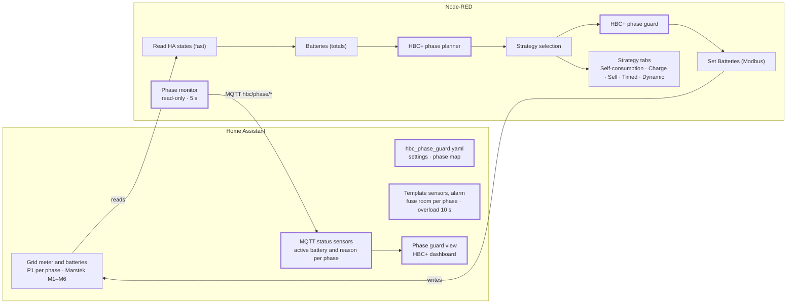

# HBC+ v1.2 — User guide

*16 November 2026* · 🇳🇱 [Nederlandse versie](gebruikershandleiding.nl.md)

## What HBC+ is

HBC+ (Home Battery Control Plus) v1.2 controls up to six home batteries from Home Assistant and Node-RED, and lets two batteries share one phase without overloading that phase's main fuse. With the phase guard in *Off* or *Monitor* the batteries are controlled without phase rules; only *Enforce* applies them.

Besides the phase guard, HBC+ brings improvements in three areas:

- **Safety and security** — per-phase main-fuse protection, a strict one-battery-per-phase rule when the phase guard fails on *Enforce*, an HA automation that switches to *Full stop* when the batteries keep a phase overloaded, an HA alarm that works without Node-RED, and a heartbeat that hands the batteries back to their firmware when the control loop stops or no longer works, and warnings and errors that always reach the Node-RED log and `sensor.hbc_health`.
- **Performance** — one fast read node instead of ~43 separate reads, the PID step and the Timed period choice merged with settings caches, and fewer Modbus writes per tick.
- **Stability** — bug fixes (among others: total helpers reset to 0 after a restart, a price cache that kept old prices after a source change, the debug board), battery values that never turn into NaN (one unavailable battery no longer stops the others), and one consistent HA server node in every flow file.

It also adds two features:

- **Charge Deadline strategy** — charges to a target (full, SoC or energy reserve) before a deadline, in the cheapest quarter-hours, with optional PV reserve and a follow-up strategy once the deadline has passed. See [Charge Deadline](#charge-deadline).
- **GridClock as data source** — Dynamic and Charge Deadline can read prices from the [Grid Clock](https://gridclock.eu) integration (`sensor.grid_clock_<zone>_prices`). Prices refresh automatically when the default zone changes. See [Dynamic](#dynamic).

All changes are described in full in the section [Improvements in HBC+](#improvements-in-hbc) below; [What's new in HBC+ v1.1](#whats-new-in-hbc-v11) lists what changed since v1.0.

What the phase guard adds:

- **A phase map.** Every battery (M1–M6) is assigned to L1, L2, L3 or *Own circuit*.
- **One active battery per phase** (default). The partner on that phase waits at 1 W idle and then stops, the same way HBC+ parks batteries it does not need.
- **Two limits per phase.** The active battery only gets the room left under both the main (grid) fuse, after the house load on that phase, and the battery circuit the batteries of that phase share (default 16 A ≈ 3680 W each), recomputed every tick from the P1 meter.
- **Correct planner ceiling.** The max power HBC+ reports to Charge Deadline is the sum per phase, not the sum of all batteries, so it books enough charge hours.
- **A Phase guard view** on the dashboard and an independent overload alarm in Home Assistant that works even when Node-RED is down.
- **An optional *Shared headroom* mode** in which both batteries on a phase may run at once, as long as together they stay under the fuse.

Net effect with two batteries per phase (6 × Marstek Venus E, 5.12 kWh each): usable capacity doubles to about 30.7 kWh, peak power stays 7.5 kW (3 × 2500 W).

Why the phase guard works the way it does is explained in [Design background and decisions](#design-background-and-decisions).

### Credits

HBC+ is a standalone version with its own development. It started from House Battery Control (HBC) v4.15.1 by **CodeBob** ([gitcodebob](https://github.com/gitcodebob/marstek-venus-rs485-node-red)), the founding father of HBC: the original control loop, strategies, dashboard and helpers are his work, and all credit for that foundation goes to him. HBC+ has no further link with HBC.

Dynamic and Charge Deadline use the [Cheapest Energy Hours](https://github.com/TheFes/cheapest-energy-hours) macro by **TheFes**.

## Architecture

HBC+ has three parts: Home Assistant packages that hold the settings and an independent alarm, the Node-RED control loop that does the limiting, and a dashboard that shows what happens per phase.



*Thick border = phase guard.* The planner and guard run inside *HBC+ Home Battery Start*, so the limiting never depends on another tab. The Phase monitor tab only reports; the template sensors and the overload alarm run in Home Assistant and keep working when Node-RED is down.

## Functionality

### The control loop

On every update of `sensor.p1_meter_power` (rate limited), *HBC+ Home Battery Start* runs one tick:

1. **Read HA states (fast)** reads all batteries (M1…M*n*, `input_number.house_battery_count`) and settings in one node from the Home Assistant states in global context. If those are missing it falls back to the original chain of current-state nodes.
2. **Batteries (totals)** computes total battery power, max charge/discharge power and usable energy, and writes them to the `input_number.house_battery_total_*` helpers. A briefly unavailable value is held for up to 5 min; the strategies get the held value too. A battery that has no usable SoC or power limit for longer is not driven (R7).
3. **Update battery order** rotates battery priority.
4. **HBC+ phase planner** (new) works out per phase who may run and how much room there is.
5. **Strategy selection** calls the strategy tab named in `input_select.house_battery_strategy`. It returns `msg.solutions`: one `{id, mode, power}` per battery.
6. **HBC+ phase guard** (new) checks the solutions one last time.
7. **Write limiter → Set Batteries** writes power, then mode, per battery, only when a value changed (awaited writes, 60 s keep-alive on mode). Each solution is checked first: the mode must be stop, charge or discharge and the power a number within 0 … max, otherwise *stop*; a battery whose RS485 is off gets no writes (R6, R7).
8. **HBC+ heartbeat** publishes the time to MQTT `hbc/heartbeat`, at most once a minute and only after a good cycle: the strategy returned without an error, and at least one battery was written without an error. If it stops, Home Assistant hands the batteries back to their firmware (see F4, R5 and R6).

Next to the loop, *HBC+ health* publishes the warnings and errors of the last 10 minutes to `hbc/health` → `sensor.hbc_health` (R8).

### Guard modes

`input_select.house_battery_phase_guard_mode` decides whether the phase rules do anything.

| Mode | What HBC+ does | Use it for |
| --- | --- | --- |
| Off | Planner and guard pass every message untouched: no phase rules. | One battery per phase, or to rule HBC+ out while debugging |
| Monitor (default) | Computes and publishes what it *would* do; node status shows `would: …`. Changes nothing. | Commissioning; checking the plumbing before batteries share a phase |
| Enforce | Applies the phase rules in the planner, the strategies, the guard and the master switch. | Normal operation with two batteries on a phase |

Every changed node was tested against the original with the same inputs: Off and Monitor give identical output.

### Phase rules (Enforce)

1. **Phase map.** Each battery has a phase from `input_select.marstek_mN_phase`: L1, L2, L3 or *Own circuit* (never shared, no phase rule).
2. **One active battery per shared phase.** The others get the 1 W idle setpoint (relay engaged) and, after the normal idle time, stop. This is the same soft-stop path HBC+ uses for batteries it does not need.
3. **Room per phase.** House net on a phase = P1 phase power minus battery power on that phase (import positive). Charge room = min(grid fuse − margin − house net, battery circuit − margin); discharge room = min(grid fuse − margin + house net, battery circuit − margin). The grid fuse carries house and batteries together; the battery circuit carries only the batteries. Both rooms are also capped at the battery's own max and recomputed every tick.
4. **Selection.** Candidates are batteries on that phase with RS485 `enable`, fresh values, and SoC above min (discharge) or below max (charge).
   - *SoC balance* (default): discharge from the fullest, charge into the emptiest. The current battery is kept until the SoC gap reaches the swap delta (5 %) **and** it has run for the minimum dwell (15 min). A change of direction may re-pick at once.
   - *Fixed order*: lowest M-number first, the partner only as backup.
   - *Rotate daily*: the primary swaps at midnight.
5. **Break-before-make handover.** The old battery goes to idle first; the new one is released only once the old one measures below 100 W. If the old battery's read-back is missing or stale, the partner stays blocked: a Marstek that lost Modbus may still be running its last command.
6. **Last-line guard.** Just before the writes, the guard corrects any phase with more than one active battery or a setpoint above the fuse room, and logs it. This also covers future strategies that ignore the rules.

Example: with grid fuse and battery circuit both at 3680 W and 1800 W of house load on L1, the active L1 battery may charge at 3680 − 200 − 1800 = 1680 W; with 3000 W of PV export on L1 it may discharge only 480 W. With a 7360 W grid fuse the same 1800 W leaves 5360 W under the grid fuse, so the battery circuit decides: 3680 − 200 = 3480 W.

### Shared headroom (option)

With `input_select.house_battery_phase_sharing` = *Shared headroom*, both batteries on a phase may run at once, as long as together they stay inside the fuse room. Rules 1, 3 and 6 stay; rules 2 and 5 are replaced by:

- **Fill order** follows the selection rule: the first battery gets min(its max, room), the partner gets what is left, up to its own max.
- **Minimum share:** the partner starts only when at least 300 W is left and stops again below 100 W.
- **Unknown counts as busy:** a battery with a stale read-back is counted at its last setpoint.

Typical gain: 2500 + 1000 W charging on a phase with no house load. The fallback when HBC+ is down still hands only one battery per phase to firmware.

### What changes per strategy

| Tab | HBC+ change (Enforce only) |
| --- | --- |
| Home Battery Start | New *phase planner* and *phase guard*; *Batteries (totals)* counts max power per phase |
| Self-consumption | *Load distribution* soft-stops standby batteries and caps each phase at its fuse room; anti-windup uses the capped capacity |
| Charge, Sell | *Max power solution* runs only the active battery per phase, at min(its max, fuse room); the partner idles at 1 W |
| Master Switch | On hand-back to firmware only the lowest M-number on a shared phase gets RS485 *disable*; the partner stays RS485 *enable* + forcible *stop* |
| Charge Deadline | Logic unchanged; it plans with the per-phase max power from *Batteries (totals)* |
| Partials, Timed, Dynamic (price fetch: see below), Full stop, PID presets, Oscillation Guard, Strategy arbiter | No change; whatever they run goes through Self-consumption or Max power, which apply the rules |
| Phase monitor | **New**, read-only: publishes `hbc/phase/*` for the dashboard every 5 s (republished on change, at most every 30 s otherwise) |

### Shared price fetch (Dynamic)

The *API call to Data Source* section of *HBC+ Strategy Dynamic* is a link-call subroutine, so any flow can fetch the current price list without its own copy of the data-source logic. Inside the Dynamic tab, *Cache check* calls it on a cache miss; the prices come back and go on to *Determine strategy*, as on a cache hit.

To use it from another flow, add a **link call** node, pick *Dynamic Fetch from Data Source*, and set a timeout of at least 30 s. The first node of the section, *Prepare request*, fills in what the caller leaves out.

| msg property | In / out | Meaning |
| --- | --- | --- |
| `dynamic.data_source` | in, optional | Price source; default = `input_select.house_battery_strategy_dynamic_data_source` |
| `dynamic_use_cache` | in, optional | `true` = return the Dynamic tab's cached prices if still valid (same rule as *Cache check*: after 13:00 they must cover tomorrow), else fetch |
| `dynamic` | out | `{data_source, data_all: {list, list_marked, average, min, max, start, …}, no_data?}` |
| `dynamic_from_cache` | out | `true` when the cache answered |
| `dynamic.stale` | out | `true` when the source failed and the last valid prices of that source came back |
| `target` | in, optional | Only for a link call with a dynamic target: `"Dynamic Fetch from Data Source"` |

- Source *None*, or a source Node-RED cannot read, returns at once with `dynamic.no_data = true` and an empty list, so the caller never waits for the timeout.
- A successful fetch from any caller also refreshes the Dynamic tab's cache.
- The rest of the caller's message comes back unchanged (`msg.template` is used and removed).
- A fetch that delivers no prices returns the last valid list of the same source with `dynamic.stale = true` while it still covers the current interval, otherwise `dynamic.no_data = true` (see R3).
- An error inside the section (for example the template render while HA is disconnected, or a macro error) is caught by *Catch fetch errors* and handled as a fetch without prices, so the caller gets its reply at once instead of a timeout. The *Fetch error* node logs the error as a warning and shows it in its status.

#### Using it from your own flow

The repo has a ready example: `node-red/examples/price-fetch-example.json`. Import it (*Import → select a file to import → Import*), deploy, and click the button of *Every 15 min*; the debug sidebar shows the current price.

To build it yourself:

1. **Trigger.** An inject node, for example every 15 minutes.
2. **Request.** A function or change node. Start with a fresh `msg.dynamic` (`msg.dynamic = {}`): the section reads an existing `msg.dynamic` as the request and replaces it with the reply. Add `msg.dynamic.data_source` only for another source than the Dynamic tab's, and `msg.dynamic_use_cache = true` to reuse the Dynamic tab's prices instead of fetching again.
3. **Link call** with a timeout of 30 s, in one of two ways:
   - *Static:* pick *Dynamic Fetch from Data Source* in the node's list. After a re-import of the Dynamic tab with new node ids, pick it again.
   - *Dynamic:* set the link type to *Dynamic target* and put `msg.target = "Dynamic Fetch from Data Source"` in the request. This keeps working after a re-import. Do not use it on a message HBC+ also uses for control (inside a strategy tab), because there `msg.target` names the strategy.
4. **Read the reply** in the next node. Check `msg.dynamic.no_data` first: then the list is empty. With `msg.dynamic.stale` the list is the last valid one of that source, kept while the source fails.

Fields of `msg.dynamic.data_all`:

| Field | Meaning |
| --- | --- |
| `list` | One price per interval in ct/kWh, from `start` onward |
| `start` | Start time of the first interval |
| `hours` | Number of hours the list covers |
| `datapoints` | Number of intervals in `list` |
| `average`, `weighted_average`, `min`, `max` | In ct/kWh, rounded down to whole cents |

An interval lasts `hours × 60 / datapoints` minutes (15 for quarter-hour prices). The price now is:

```js
const a = msg.dynamic.data_all;
const slotMs = (a.hours / a.datapoints) * 3600000;
const priceNow = a.list[Math.floor((Date.now() - new Date(a.start).getTime()) / slotMs)]; // ct/kWh
```

### Effect on planners

Because *Batteries (totals)* writes the effective max into the existing helpers, Charge Deadline and the PID anti-windup need no code change.

| Value | 3 batteries (today) | 6 batteries, no phase rule | 6 batteries, Enforce |
| --- | --- | --- | --- |
| `house_battery_total_max_charge_power` | 7500 W | 15000 W | 7500 W |
| Usable energy | ~15.4 kWh | ~30.7 kWh | ~30.7 kWh |
| Hours to charge 0→100 % at max | ~2 h | ~2 h (but trips a fuse) | ~4 h |

The planner value follows the fuse room. On *Enforce*, *Batteries (totals)* subtracts the average house load per phase (exponential average over about 15 minutes) from the fuse room, rounds the result to 100 W and only changes the value when it moves by 250 W or more. A heat pump that runs for half an hour lowers the planner value; a kettle for a few seconds does not. Example: with 2 kW of house load on L1 for an hour, the charge ceiling settles at about 6200 W instead of 7500 W, so Charge Deadline books extra cheap quarters. When the load stops, the value returns within about 15 minutes.

### Safety built in

- **Fail-safe on Enforce.** Planner, guard and totals run in try/catch. On *Off* and *Monitor* an error passes the message on unchanged. On *Enforce*, *Set Batteries* then applies the strict rule: per shared phase only the lowest M-number runs, at most battery circuit − margin (R9).
- **No cross-tab dependency** in the control loop: planner and guard live inside *Home Battery Start*. Disabling the Phase monitor tab changes nothing.
- **Independent alarms.** `binary_sensor.hbc_phase_limit_exceeded` turns on when grid power on any phase exceeds the grid fuse for 10 s; `binary_sensor.hbc_phase_circuit_limit_exceeded` when the batteries on any phase draw more than the battery circuit for 10 s. Both are pure Home Assistant and work when Node-RED is down. When the batteries are part of the cause, HA switches to *Full stop* (R10).
- **A heartbeat that means *working*.** The heartbeat only follows a good control cycle (R6). When it goes stale, Home Assistant stops every battery it hands back to its firmware, and the Master Switch flow waits for a fresh heartbeat before it turns RS485 on again (R5).
- **No NaN towards the batteries.** One unavailable battery value no longer spreads to the other batteries, and *Set Batteries* checks every setpoint before it is written (R7).
- **Errors are visible.** Warnings and errors always reach the Node-RED log and `sensor.hbc_health`, also with *Insights mode* off; HA notifies you when errors keep coming (R8).
- **Changes are announced.** Every change of a phase guard safety setting gives a notification naming who made it (S2). How to keep the Node-RED editor, MQTT and the dashboard closed to others: see *Securing your setup*.

## Strategies and settings

This section explains what each strategy does and which settings steer it. The dashboard's ⓘ links point here.

### Master mode

`input_select.marstek_master_battery_mode` decides who controls the Marsteks. HBC+ only steers the batteries in **Full control**.

| Master mode | RS485 control | Who controls |
| --- | --- | --- |
| Full control | enable | HBC+ (forcible charge / discharge) |
| Marstek control | disable | The Marstek firmware, in the work mode you chose in the Marstek app |
| Manual control | disable | The Marstek firmware, manual mode |

### Choosing a strategy

Pick the strategy in `input_select.house_battery_strategy`. The *Strategy arbiter* is the only writer of that helper: the Battery Oscillation Guard, and flows of your own (for example a PV limiter), can hold another strategy for a while and give your choice back afterwards (see *Installation*, Step 3).

| Strategy | What it does |
| --- | --- |
| Self-consumption | Keeps grid power at 0 W by charging from PV surplus and discharging into the house load (PID control) |
| Charge PV | Self-consumption without discharging: charges from PV surplus only |
| Zero import | Self-consumption without charging: discharges to keep grid import at 0 W |
| Standby / peak shave | Batteries idle (no relay clicks); with peak shaving on they still act above the grid limits |
| Charge | Charges from the grid until a goal, then hands over |
| Sell | Discharges to the grid until a goal, then hands over |
| Charge Deadline | Charges to a target before a deadline, in the cheapest quarter-hours |
| Timed | A different strategy per time period (A to E) |
| Dynamic | A different strategy for cheap, expensive and normal price periods |
| Full stop | Every battery on stop, 0 W; the relay opens, so no standby draw |
| Helios | Reserved for a future HELIOS integration (not part of HBC+). Until that flow is installed, a placeholder tab runs *Full stop* and logs a warning |

**EV stop trigger.** Put the entity id of an "EV is charging" sensor or boolean in `input_text.house_battery_strategy_ev_sensor_entity_id`. While it is `on`, HBC+ runs the strategy in `input_select.house_battery_strategy_ev_stop_trigger_strategy` (*Full stop* or *Standby / peak shave*), so the batteries do not discharge into the car.

### Self-consumption and PID tuning

Self-consumption is the PID controller of HBC+, and most other strategies use it to do the actual work. Each tick it takes the error between grid power and the target (0 W by default), ignores errors under 15 W, and computes a battery power from three terms:

- **P (Kp)** reacts to the error now;
- **I (Ki)** removes the error that remains over time;
- **D (Kd)** damps fast changes.

*Load distribution* then spreads that power over the batteries in priority order, each up to its own maximum. Near full, charging is limited to 1500 W from 95 % and 1000 W from 99 %.

The easiest way to tune is a preset in `input_select.house_battery_control_pid_presets`:

| Preset | Kp | Ki | Kd | Input smoothing | Output smoothing | When |
| --- | --- | --- | --- | --- | --- | --- |
| Very safe | 0.1 | 0.1 | 0 | 0 % | 10 % | A system that oscillates with every other preset |
| Safe | 0.3 | 0.3 | 0.1 | 20 % | 0 % | Good starting point for most |
| Regular | 0.3 | 0.4 | 0.8 | 50 % | 10 % | Faster response; needs a stable meter |
| Custom | — | — | — | — | — | Your own values in the PID helpers |

Start with *Safe*. Grid power that swings back and forth around 0 W means the control is too sharp: go one preset down, or lower Kp and Ki. A slow return to 0 W after a load step means it is too gentle: go one preset up. Change one thing at a time and watch for a few minutes. The *Battery Oscillation Guard* stops the batteries if they start to oscillate.

Other settings (smoothing on the PID Control view, hysteresis on the Batteries view):

- **Hysteresis** (`input_number.house_battery_control_hysteresis_in_w`, 0–200 W): the PID output must pass this before the batteries switch between charging and discharging.
- **Error and output smoothing** (`…_error_signal_dampening`, `…_pid_output_dampening`, 0–90 %): moving averages on the input and output; more smoothing is calmer but slower.

### Charge and Sell

**Charge** charges from the grid until the goal in `input_select.house_battery_strategy_charge_goal` is reached:

| Goal | Reached when |
| --- | --- |
| batteries are full | Every battery is at its maximum SoC |
| state of charge | The average SoC reaches `input_number.house_battery_strategy_charge_target_soc` |
| energy reserve | Usable energy reaches `input_number.house_battery_strategy_charge_target_energy` |
| solar forecast | Usable energy reaches the maximum minus today's expected PV surplus (the forecast minus `input_number.house_battery_solar_reserved_for_house`) |

**Sell** discharges to the grid until `input_select.house_battery_strategy_sell_goal` is reached: *batteries are empty*, *state of charge* (`…_sell_target_soc`) or *energy reserve* (`…_sell_target_energy`).

When the goal is reached, the strategy in *Then use* runs (`…_charge_goal_reached` / `…_sell_goal_reached`, default *Charge PV*).

**Power.** Without a grid limit, every battery charges or discharges at its maximum. With import (Charge) or export (Sell) peak shaving on, HBC+ regulates to that grid limit instead (see [Advanced settings](#advanced-settings); the limits are on the Phase guard view). On *Enforce* only the active battery per shared phase runs, within the phase's fuse room.

**Solar forecast.** For the *solar forecast* goal, put the entity ids of your forecast sensors (kWh today and kWh tomorrow, for example from Forecast.Solar or Solcast) in `input_text.house_battery_strategy_solar_forecast_entity_id` and `…_solar_forecast_tomorrow_entity_id`. Set `input_number.house_battery_solar_reserved_for_house` to what the house uses from PV on a typical day.

### Charge Deadline

Charges to a target before a deadline (`input_datetime.house_battery_deadline_start` / `_end`). The goal is in `input_select.house_battery_deadline_goal`: *batteries are full*, *state of charge* or *energy reserve*. It prefers the cheapest quarter-hours from the Dynamic price list, and paces the power by price (`input_number.house_battery_deadline_price_ratio`: how much harder the cheapest quarter charges than the most expensive one it uses). It also counts on expected PV when `input_boolean.house_battery_deadline_reserve_pv` is on, and keeps the target until the deadline when `…_hold_after_target` is on. After the deadline the strategy in *Then use* (`input_select.house_battery_deadline_reached`) runs. The plan is recomputed every tick from the remaining energy and time. It needs a working price source (see *Dynamic*).

### Timed

Runs a different strategy per time period. Period A is always on; B to E are switched on one after another (`input_boolean.house_battery_strategy_timed_has_period_b` … `_e`). Each period has a start, an end (`input_datetime.house_battery_strategy_timed_period_a1` / `_a2` …) and a strategy (`input_select.house_battery_strategy_timed_strat_a` …). The first enabled period that contains the current time wins; a period whose end is before its start runs past midnight. Outside all periods the baseline strategy (`…_timed_strat_0`) runs. The active period is shown in `input_text.house_battery_strategy_timed_period_selected`.

### Dynamic

Picks a strategy from the energy prices of today and tomorrow.

**Setup.**

1. Install the [Cheapest Energy Hours](https://github.com/TheFes/cheapest-energy-hours) macro (Marketplace).
2. Install a price integration and choose it in **Tariff data source** (`input_select.house_battery_strategy_dynamic_data_source`).
3. If you have more than one price integration, pin the sensor in `input_text.house_battery_strategy_dynamic_price_sensor` (see R4).
4. Check the *Price intervals* chart on the Prices view.

**How it decides.** Each day, HBC+ pairs the cheapest and the most expensive intervals, working inward from the extremes. A pair only counts when its price difference is at least **Minimum spread** (`input_number.house_battery_strategy_dynamic_threshold_delta`, in cents). Set that to cover your round-trip losses. **Cheapest hours** and **Expensive hours** cap the number of marked hours per day (0 = no cap). The current interval then decides the strategy:

| Interval | Strategy (helper) | Choices |
| --- | --- | --- |
| Cheap | `…_dynamic_cheapest` | Charge, Charge PV, Charge Deadline, Standby / peak shave |
| Expensive | `…_dynamic_expensive` | Self-consumption, Sell, Zero import, Standby / peak shave |
| Normal | `…_dynamic_default` (*Default to*) | Charge PV, Self-consumption, Zero import, Standby / peak shave, Full stop |

Prices are refreshed at midnight, at 13:15 and 15:00, after a change of source, and until tomorrow's prices are in. If the source fails, Dynamic keeps the last valid prices or falls back to *Default to* (see R3). Other flows can fetch the same prices through the link call (see *Shared price fetch*).

### Grid Clock feed

*Tariff data source* **Grid Clock** (the Grid Clock feed, new in v1.2) reads all-in buy and sell prices per quarter for your own supplier from the public files of [Grid Clock](https://gridclock.eu). Grid Clock computes them from the supplier's formula, VAT and the country's energy tax. In the Netherlands it switches to separate sell prices by itself on 1 January 2027, when net metering ends. HBC+ has no tax or markup settings of its own.

**Setup.**

1. Check that **Tariff data source** (Prices view) is set to *Grid Clock*. It is the default on a new install; after an update from v1.1 your earlier choice stays.
2. Choose your **Zone** (NL or BE) and your **Supplier**. Until you choose one, HBC+ uses the market price, with sell = buy.
3. Belgium: choose your **Grid operator**. Its distribution and transport cost per kWh is added to the buy price.
4. Check the line **Grid Clock feed** under the source: `ok` or `not modified` is good; `error` shows the reason.

**What is sent.** No account, token or registration. HBC+ downloads `v1/hbc/<zone>/index.json` and `v1/hbc/<zone>/<supplier>/latest.json` from `cdn.gridclock.eu`; the zone and the supplier's short name (its *slug*, such as `frank-energie`) are in the address, nothing else. Like any web request it passes Cloudflare, which sees your IP address. Grid Clock stores nothing about HBC+ users. The supplier choice is kept in `input_text.house_battery_gridclock_provider_slug`.

**When.** At the same moments as every other source: after midnight, at 13:15 and 15:00, every 15 minutes until tomorrow's prices are in, and straight after a change of zone or supplier. An unchanged file costs a `304`. If the feed fails, Dynamic keeps the last valid prices, as with every source (R3). The supplier list refreshes at start, after every restart of Home Assistant and daily at 00:10.

**After a restart.** Zone, supplier and grid operator are remembered. Right after a restart of Home Assistant the dashboard may show *Market price (no supplier)* and *None* for a moment; once Node-RED has reloaded the supplier list (usually within seconds) it shows your choice again. Prices use your supplier throughout.

To test against Grid Clock's staging files, set the environment variable `GRIDCLOCK_FEED_URL` on the *HBC+ Strategy Dynamic* tab (default `https://cdn.gridclock.eu/v1/hbc`).

### Buy and sell prices

From v1.2 every quarter has a **buy price** (what an imported kWh costs) and a **sell price** (what an exported kWh earns). With the Grid Clock feed they differ once net metering has ended; with every other source sell = buy, exactly how v1.1 valued a kWh.

- Dynamic pairs cheap and expensive quarters as before. When *Strategy during expensive period* is **Sell**, an expensive quarter is valued at its sell price, so Dynamic only marks a Sell period when the sell price beats the buy price of a cheap quarter by at least *Minimum spread*. Without net metering that is rare, and the dashboard then suggests *Self-consumption*. With any other expensive strategy nothing changes.
- `sensor.hbc_energy_price_now` stays the buy price; `sensor.hbc_energy_export_price_now` is the sell price now. Every entry of the `marks` attribute of `sensor.hbc_energy_prices_data` has `sell` and `neg` (`import`, `export` or null) next to `price`.
- The *Price intervals* chart shows the sell price as a grey line over the buy bars. Purple bars are quarters where feeding in costs money; dark purple where you are paid to import.

### Price guard

The price guard changes what the batteries do while prices are negative. It is **Off** by default; **Monitor** only shows what it would do; **On** acts.

| State (`sensor.hbc_price_state`) | When | What the guard does |
| --- | --- | --- |
| `export_negative` | Sell price below *Export threshold* (default 0 ct) | Sell → Charge PV, Zero import → Self-consumption, Standby / peak shave → Charge PV: surplus PV goes into the batteries instead of the grid |
| `import_negative` | Buy price below *Import threshold* (default 0 ct) | Every strategy except Full stop → Charge, until the batteries are full |
| `normal` | Otherwise | Nothing |

The guard acts on the strategy that actually runs: the sub-strategy of Dynamic or Timed, and the follow-up after a Charge or Sell goal. Your own choice in `input_select.house_battery_strategy` never changes, and the swap ends at the first quarter with normal prices. `sensor.hbc_price_guard` shows what it did (`override`, `would` or `none`) and why.

**Safety.**

1. **On** only acts with *Tariff data source* = *Grid Clock*: only the feed has the real all-in prices. With another source a market price below zero looks negative while you still pay energy tax, so the guard stays in Monitor.
2. **Full stop** is never changed (Oscillation Guard, phase-overload alarm, manual stop), and nothing changes while the EV stop trigger is on.
3. **Import** at full power only on phase guard *Enforce*, or when no phase carries two batteries (`binary_sensor.hbc_phase_shared`). Otherwise that part stays in Monitor, so two batteries on one 16 A group never charge at full power together.
4. A missing price-guard entity means no price guard: the control loop works as in v1.1.

**For a PV limiter.** `binary_sensor.hbc_export_price_negative`, `binary_sensor.hbc_import_price_negative` and `binary_sensor.hbc_pv_curtail_advised` (feeding in costs money and the batteries are full). HBC+ itself never curtails PV. These are plain Home Assistant sensors and keep working when Node-RED is down.

**Dashboard.** The *Price guard* section on the Prices view holds the mode, thresholds, state and action; the Overview shows an alert while the guard swaps a strategy. Start with **Monitor** for a few days.

### Advanced settings

These settings are on the **Batteries** view; peak shaving is on the **Phase guard** view.

- **Battery priority** (`input_select.house_battery_control_priority_change_interval`): Self-consumption uses the batteries in priority order, starting with `input_number.house_battery_control_prioritize_battery`. The priority moves to the next battery every 30 minutes (*Auto balance*), daily at 02:00 (*Daily*), on Sunday at 02:00 (*Weekly*), or not at all (*Never*). Except with *Auto balance*, discharging runs in the reverse order, so the battery that charges first is the last to discharge.
- **Stop after idle** (`input_number.house_battery_control_idle_time`, 0–60 min): a battery that is not needed keeps 1 W (relay closed) for this long before it gets *stop*. This saves relay clicks when the load goes up and down.
- **Peak shaving** (`input_boolean.house_battery_control_has_power_limit_import` / `_export` with `input_number.house_battery_control_power_limit_import` / `_export`): the batteries keep grid import or export below the limit, for example for a capacity tariff. Charge and Sell regulate to these limits instead of running at full power.
- **Cutoff capacities** (`input_number.marstek_mN_charging_cutoff_capacity` 80–100 %, `…_discharging_cutoff_capacity` 11–80 %): the SoC limits written to each Marstek. HBC+ treats a battery at its limit as full or empty.
- **Phase** (`input_select.marstek_mN_phase`: L1 · L2 · L3 · Own circuit): the phase each battery is physically connected to, used by the phase guard (see [Step 5 — Set your phase map and fuse](#step-5--set-your-phase-map-and-fuse)).

## Design background and decisions

### Why a phase guard is needed

Without the phase guard, the controller has no notion of phases. That only worked because M1, M2 and M3 each sat on their own phase. *Max power solution* (Charge and Sell) puts every battery at its max, and *Load distribution* (Self-consumption) fills the batteries in priority order, each up to its own max. With two Marsteks on L1 that puts 2 × 2500 = 5000 W on that phase, well above a 16 A fuse (3680 W).

On top of that, the planner ceiling would be the sum of all batteries (6 × 2500 = 15000 W) instead of what can really flow per phase (3 × 2500 = 7500 W), so Charge Deadline would book only half the cheap quarters it needs. And the heartbeat fallback would put every battery in firmware anti-feed during an outage, after which two batteries on one phase could each push 2500 W.

### Edge cases

| Situation | Behaviour |
| --- | --- |
| HBC+ stopped (heartbeat stale) | Per shared phase only the battery with the lowest M-number goes to firmware anti-feed. Its partner stays RS485 *enable* + forcible *stop*, so it does nothing, even when Node-RED or HA is down. Every battery handed back first gets forcible *stop*, and the Master Switch flow turns RS485 on again only once the heartbeat is fresh. |
| SoC or power limit of a battery unavailable for more than 5 minutes | That battery is not driven (limits 0 W, `data_ok = false`); the other batteries keep working (R7). |
| Active battery RS485 off, offline or at its SoC limit | The partner takes over at once (no dwell), after break-before-make. |
| Active battery unreachable while it was running | The partner stays blocked, because the old battery may still be running its last command. The phase idles and an alert is raised. |
| Big load switches on while the phase charges at full power | The fuse is briefly above 16 A until the next tick plus the Marstek's response (a few seconds). Fuses tolerate this; the margin covers measurement error, not big steps. If it lasts 10 s the alarm fires. |
| Both batteries on a phase full or empty | The phase idles; nothing changes for the other phases. |
| A strategy returns two active batteries on a phase | The phase guard corrects it and logs it (rule 6). |
| Someone changes a battery in the Marstek app | The read-back differs from the setpoint; *Set Batteries* rewrites it; the HA alarm catches an overload within 10 s. |
| Guard mode *Off* | No phase rules; only safe with one battery per phase. |
| Planner or guard error on *Enforce* | *Set Batteries* applies the strict rule: per shared phase only the lowest M-number runs, at most battery circuit − margin (R9). |
| A phase stays overloaded for 10 s with the batteries part of the cause | HA switches the strategy to *Full stop* and notifies you; if HBC is not running, HA stops the batteries on that phase itself (R10). |

### Design decisions

- **Limits:** a grid fuse and a battery circuit per phase, each the same for L1–L3 (defaults 16 A, 3680 W). The grid room follows the house load on that phase; the battery circuit only counts the batteries.
- **One battery per phase is the default.** *Shared headroom* (both at once within the fuse room) is an option in the settings.
- **Extension with three Marsteks (M4–M6).** Default phase map M1/M4 L1, M2/M5 L2, M3/M6 L3, changeable per battery.
- **Safety over speed.** Handover is break-before-make, and a battery without a fresh read-back counts as busy.
- **Fail-safe on Enforce, fail-open elsewhere.** On *Off* and *Monitor* an error in a new step changes nothing; on *Enforce* it falls back to the strict one-battery-per-phase rule (R9). The HA alarm works independently of Node-RED and switches to *Full stop* when the batteries keep a phase overloaded (R10).
- **Signs:** battery power is positive while charging, P1 phase power is positive on import.
- **Monitor first.** The phase guard can run with one battery per phase; then nothing changes and you test the plumbing for free, before a second battery joins a phase.

## What's new in HBC+ v1.2

*20 November 2026*

v1.2 prepares HBC+ for the end of Dutch net metering on 1 January 2027: from then on an exported kWh earns less than an imported kWh costs.

- **F6 — Grid Clock feed.** The *Tariff data source* *Grid Clock* now reads all-in buy and sell prices per quarter for your own supplier from a public feed, without a token (see [Grid Clock feed](#grid-clock-feed)).
- **F7 — Buy and sell prices.** Every quarter carries a sell price next to the buy price; Dynamic values *Sell* at the sell price; new `sensor.hbc_energy_export_price_now` and a sell line in the chart (see [Buy and sell prices](#buy-and-sell-prices)).
- **Grid Clock integration no longer needed.** The option *Grid Clock* no longer reads the Grid Clock integration; it uses the Grid Clock feed instead.
- **F8 — Price guard.** Stops exporting and charges instead while prices are negative, with signals for a PV limiter (see [Price guard](#price-guard)).
- **New dashboard layout.** Nine views in the order you use them: Overview, Prices, Charge & Sell, Timed & Dynamic, Phase guard, PID Control, Batteries, Settings and Logging (see [Dashboard](#dashboard)). The view addresses stay the same, so links and bookmarks keep working.
- **Logo.** HBC+ has a logo, in the dashboard header and at the top of the README. Copy `www/hbc-plus/` into your HA `www/` folder (see [Step 2](#step-2--home-assistant-packages)); all logo files are in `assets/logo/`.

With default settings v1.2 behaves exactly like v1.1. Checked offline: with sell = buy, Dynamic gives identical marks, strategy and spreads in 96 price lists, and with the guard Off the strategy choice is identical for every strategy.

### Updating from v1.1

1. **Back up** as in [Step 1](#step-1--back-up).
2. **Packages:** copy all files from `packages/` except `hbc_config.yaml` (that one is yours). Two are new (`hbc_gridclock.yaml`, `hbc_price_guard.yaml`); `hbc_control.yaml` changed. New: copy `www/hbc-plus/` into your HA `www/` folder (the logo in the dashboard header). *Check configuration* and restart HA.
3. **Flows:** delete every tab whose name starts with *HBC+*, import `node-red/hbc-plus-all-flows.json` and deploy, as in [Updating HBC+](#updating-hbc).
4. **Dashboard:** paste `dashboards/hbc_plus.yaml` again in the raw configuration editor. The views are new (see [Dashboard](#dashboard)); your settings stay.
5. **Used *Grid Clock* as tariff source?** It stays selected and now reads the Grid Clock feed. Choose your supplier. The Grid Clock integration is no longer needed.
6. **Optional:** choose *Grid Clock* and your supplier, and run the price guard in *Monitor* first.

## What's new in HBC+ v1.1

*16 November 2026*

v1.1 makes HBC+ safer when something goes wrong: the heartbeat now proves that control works, errors are always visible, and Home Assistant steps in when the batteries overload a phase. It also tightens security, lightens the load on Home Assistant, makes the dashboard links consistent and corrects how to update the flows. No settings were added or renamed, so yours stay as they are.

**Safety and robustness** (in full under [Improvements in HBC+](#improvements-in-hbc)):

- **R5, R6** — the heartbeat fallback can no longer be undone, and the heartbeat only follows a good control cycle.
- **R7** — one unavailable battery value no longer stops every battery; every setpoint is checked before it is written.
- **R8** — warnings and errors always reach the Node-RED log and the new `sensor.hbc_health`, which raises an alert.
- **R9** — on *Enforce*, an error in the phase guard falls back to one battery per phase instead of no phase rules.
- **R10** — Home Assistant switches to *Full stop* when the batteries keep a phase overloaded.
- **R11, R12** — a battery that keeps ignoring commands is reported; fixes for the Charge and Sell thresholds, the logger and the link-call timeouts; `node-red-node-smooth` is no longer needed.

**Security.** **S1** — the heartbeat is judged by the time Home Assistant received it. **S2** — a notification when a phase guard safety setting changes. **S3** — test buttons removed from the live flows. The new section [Securing your setup](#securing-your-setup) explains how to keep the Node-RED editor, MQTT and the dashboard closed to others.

**Performance.** **P5** — busy phase sensors out of the HA database. **P6** — the output failsafe warns once instead of every tick. **P7** — a lighter control loop. **P8** — Dynamic recalculates once, 3 s after the last setting change.

**Dashboard.** Every button that opens another view now links to `/home-battery-control-plus/<view>`, and every view has a fixed path (`self-consumption`, `charge-sell`, `timed-dynamic`, `phases`, `problem-solver`, `advanced-settings`). Before, the links used view numbers, which change when a view is added, and two different dashboard addresses. The warnings *No energy prices* and *Dynamic strategy: Full Stop* opened *Self-consumption*; they now open *Timed/Dynamic*, where the tariff source is set.

**Flows.** Every tab name ends in v1.1. Several tabs were tidied up and Charge and Sell lost a junction they did not need, without any change in behaviour. The *How this flow works* texts of Dynamic, Start, Full stop and Self-consumption were brought up to date.

**Updating.** Node-RED cannot replace a flow tab on import: it skips a flow that already exists, or imports a copy. [Updating HBC+](#updating-hbc) therefore now deletes the old HBC+ tabs before the import.

### Updating from v1.0

1. **Back up** as in [Step 1](#step-1--back-up).
2. **Packages:** copy all files from `packages/` over the old ones, except `hbc_config.yaml` (that one is yours); `hbc_control.yaml`, `hbc_heartbeat.yaml` and `hbc_phase_guard.yaml` changed. *Check configuration* and restart HA.
3. **Notifications:** three new automations send a notification through `notify.notify`: errors in the control loop, a changed safety setting, and *Full stop* after a phase overload. Set your own notify action in them (see the table in [Step 6](#step-6--first-start)).
4. **Flows:** delete every tab whose name starts with *HBC+*, import `node-red/hbc-plus-all-flows.json` and deploy, as in [Updating HBC+](#updating-hbc). Do you run a real HELIOS flow in a tab of its own? Keep that tab, and delete the Helios placeholder after the import.
5. **Palette:** `node-red-node-smooth` is no longer used; you can remove it under *Manage palette*.
6. **Dashboard:** paste `dashboards/hbc_plus.yaml` again in the raw configuration editor. Its links need the dashboard URL `home-battery-control-plus` (see [Step 4](#step-4--dashboard)). Does the address bar show another URL for your dashboard? A URL cannot be changed afterwards, so add a new dashboard named *Home Battery Control Plus*, paste the YAML there, and delete the old one.

## Improvements in HBC+

Besides the phase guard, HBC+ contains the changes below: B1–B8, R1–R4, P1–P4, F1–F5 and E1–E4 came with v1.0, R5–R12, S1–S3 and P5–P8 with v1.1. Eight fix bugs, twelve make the system more robust, eight make the control loop faster or lighter on Modbus and the HA database, five are features, and three tighten security. All of it runs in practice on a three-battery setup (two over RS485, one over Modbus TCP).

| # | Change | Where | Type |
| --- | --- | --- | --- |
| B1 | No `initial: 0` on the five total helpers | `hbc_control.yaml` | Bug fix |
| B2 | Battery power template reads the real entity id | `hbc_control.yaml` | Bug fix |
| B3 | Dynamic price cache tied to the data source | Dynamic – *Cache check* | Bug fix |
| B4 | Dynamic cache refetches until tomorrow is in | Dynamic – *Cache check* | Bug fix |
| B5 | "Now" bar in the price chart based on start/end | Dashboard | Bug fix |
| B6 | Price chart redraws on a source change | Dashboard + template sensor | Bug fix |
| B7 | Debug board shows the trace again | Start – *Set Batteries* | Bug fix |
| B8 | Dynamic *User input* listens to the sub-strategy choices | Dynamic – *User input* | Bug fix |
| R1 | *Batteries (totals)* never sends NaN to HA | Start – *Batteries (totals)* | Robustness |
| R2 | One consistent HA server node in every file | All flows | Robustness |
| R3 | Price fetch failure: last valid prices kept, baseline fallback, alert | Dynamic + `hbc_control.yaml` + dashboard | Robustness |
| R4 | Price sensor can be pinned | Dynamic – *Data source settings* + helper | Robustness |
| R5 | Heartbeat fallback no longer undone by the Master Switch | Master Switch + `hbc_heartbeat.yaml` | Robustness |
| R6 | Heartbeat only after a good control cycle | Start – *HBC+ heartbeat*, *Set Batteries* | Robustness |
| R7 | One unavailable battery value no longer stops every battery | Start – *Batteries (totals)*, *Set Batteries*; Self-consumption – *Load distribution* | Robustness |
| R8 | Warnings and errors always logged, `sensor.hbc_health` with alert | Start, arbiter, Oscillation Guard, Phase monitor + `hbc_heartbeat.yaml` | Robustness |
| R9 | Fail-safe on *Enforce*: strict one-battery-per-phase rule after an error | Start – planner, guard, *Set Batteries* | Robustness |
| R10 | HA switches to *Full stop* when the batteries keep a phase overloaded | `hbc_phase_guard.yaml` | Robustness |
| R11 | Warning when a battery keeps ignoring commands | Start – *Set Batteries* | Robustness |
| R12 | Charge/Sell thresholds, logger fallback, link-call timeouts, no *smooth* palette | Charge, Sell, all tabs | Robustness |
| S1 | Heartbeat judged by the time HA received it | `hbc_heartbeat.yaml` | Security |
| S2 | Notification when a phase guard safety setting changes | `hbc_phase_guard.yaml` | Security |
| S3 | Test buttons removed from the live flows | Dynamic, Timed, Oscillation Guard | Security |
| P1 | *Read HA states (fast)*: one node instead of ~43 reads | Start | Performance |
| P2 | *PID step*: 13 nodes in one, cache for PID settings | Self-consumption | Performance |
| P3 | *Pick period*: fast path for Timed with settings cache | Timed | Performance |
| P4 | Fewer Modbus writes, in order per battery | Start – *Set Batteries* | Performance |
| P5 | Busy phase sensors out of the HA database, PID terms back in | `hbc_phase_guard.yaml`, `hbc_control.yaml` | Performance |
| P6 | Output failsafe warns once instead of every tick | Self-consumption – *PID step* | Performance |
| P7 | *Trace* in JavaScript everywhere; one node writes the totals | Strategy tabs; Start – *Totals to HA (on change)* | Performance |
| P8 | Dynamic waits 3 s after the last setting change | Dynamic – *User input* | Performance |
| F1 | Feed-forward start for regulated charging | Charge – *Regulated power* | Feature |
| F2 | Grid Clock as Dynamic data source | Dynamic + selector | Feature |
| F3 | Charge Deadline strategy | Own tab + package | Feature |
| F4 | Control-loop heartbeat with fallback in HA | Start + package | Feature |
| F5 | Recorder exclusions for busy entities | Packages | Maintenance |
| E1–E4 | Strategy arbiter, Battery Oscillation Guard, Modbus TCP battery, P1 alias | Own tabs and packages | Extension |

### Bug fixes

**B1 — Total helpers reset to 0 after an HA restart.**

- *Problem:* the five total helpers (`house_battery_total_available_energy`, `_max_available_energy`, `_battery_power`, `_max_charge_power`, `_max_discharge_power`) had `initial: 0`. HA applies `initial` again on every restart. The flow writes these values through an *on change* filter, so static values such as the max energy were never rewritten and stayed at 0. Everything that divides by them broke; *Required average power to deadline*, for example, showed 0 W.
- *Fix:* `initial:` was removed from those five helpers, with a comment why. `house_target_grid_consumption_in_w` keeps its `initial: 0`.

**B2 — Battery power template read an entity that does not exist.**

- *Problem:* a template read `sensor.house_total_battery_power_in_w`, but the entity id comes from the sensor's `name:` (*House total battery power*) and is therefore `sensor.house_total_battery_power`. The `unique_id` does not set the entity id, so the template always read `unknown`.
- *Fix:* the template tries both ids and uses the first one with a value.

**B3 — Old prices stayed in use after a source change.**

- *Problem:* *Cache check* in Dynamic treated any cached price list as valid, whatever its source. After changing *Tariff data source*, the old source's prices were used until the next scheduled clear (00:01, 13:15 or 15:00), while the dashboard already showed the new source.
- *Fix:* *Cache data source* stores `data_source` with the cached data; *Cache check* compares it with `msg.dynamic.data_source` and drops the cache when they differ.

**B4 — No prices for tomorrow until 15:01.**

- *Problem:* a list fetched at 13:16, before day-ahead prices were published, was reused until the 15:01 or 00:01 clear. The Timed and Dynamic views then showed no prices for tomorrow although the source already had them.
- *Fix:* after 13:00, *Cache check* only counts a cache hit if `data_all.start + data_all.hours` reaches past midnight. Otherwise it refetches on every run until tomorrow is in. The node status then shows *Waiting for tomorrow (source)*.

**B5 — The "now" bar stuck on an old interval.**

- *Problem:* the price chart coloured the current interval from the stored `is_now` flag, which is only as fresh as the last sensor update.
- *Fix:* the chart's `data_generator` compares each interval's `start` and `end` with `Date.now()` when drawing; the marker follows the clock.

**B6 — The price chart did not redraw on a source change.**

- *Problem:* with `update_interval` set, apexcharts-card stops redrawing on state changes. A new source's prices only appeared after a browser refresh.
- *Fix:* `update_interval` is removed from the *Price intervals* card, and the trigger sensor `update_energy_prices` has an attribute `updated: "{{ now().isoformat() }}"` that changes every time. The card then redraws on a source change and on every 15-minute Dynamic run; the "now" bar moves along. The sensor is excluded from the recorder (F5), so this adds no database rows.

**B7 — The debug board showed a setpoint instead of the trace.**

- *Problem:* the awaited-write path forwards the last write message to the debug board. *Show on debug board* treats `msg.payload.data` as an override for its event data, so HA received the last setpoint (for example `{value: 1733}`) instead of the trace and log.
- *Fix:* the write messages carry the cycle's `strategy.trace` and `log`, and leftover `payload.data` is removed before the board update.

**B8 — Changing a Dynamic sub-strategy took up to 15 minutes.**

- *Problem:* the Dynamic trigger *User input* did not listen to the three sub-strategy choices. A change to *Default to*, *Cheap periods* or *Expensive periods* only took effect at the next 15-minute run.
- *Fix:* `input_select.house_battery_strategy_dynamic_default`, `_cheapest` and `_expensive` are now in that trigger's entity list; a change takes effect within a few seconds (prices come from the cache).

### Robustness

**R1 — One unavailable battery value broke the totals.**

- *Problem:* *Batteries (totals)* summed `Number(battery.x)` for every battery. When one entity was `unavailable` or `unknown` (reconnect, Modbus hiccup, HA restart), the total became NaN. That reached HA as `null` and raised `HomeAssistantError: expected float at 'value'` every cycle; strategies comparing against these totals got NaN too, and comparisons with NaN are always false.
- *Fix:* a guard per battery and per value. A valid number is used and remembered; a missing value uses the last good one for up to 5 minutes; after that the battery counts as 0, because an offline battery delivers nothing. `msg.batteries` itself was left unchanged; since R7 the strategies get the held values too. The node status is green when all is OK, yellow while a value is held and red once a battery counts as 0. With valid data this gives exactly the same totals as before (14 test cases).

**R2 — The HA server node differed per file.**

- *Problem:* every flow file carries its own copy of server node `176d29a.6f648d6`, and the last file imported overwrites the live node. Importing one strategy file could therefore switch heartbeat and connection delay off.
- *Fix:* every HBC+ file carries the same server node (*HA System*) with *Expose to global context* on (needed for P1), heartbeat (30 s) and connection delay on.

**R3 — A failed price fetch went unnoticed and kept the last strategy.**

- *Problem:* when the tariff source delivered no prices, *Cache data source* threw away the cached list, *Determine dynamic strategy* returned without a new decision, and Dynamic kept running whatever it last chose, also *Charge* from the grid. Nothing told you.
- *Fix:* four layers.
  - *Last valid prices kept:* when a fetch fails and the cached list is from the same source and still covers the current interval, *Cache data source* passes that list on (`dynamic.stale = true`) and keeps it; the next run tries the source again.
  - *Fallback:* with no valid prices at all, Dynamic runs its baseline strategy (*Default to*) instead of the last one.
  - *Alert:* `sensor.hbc_energy_prices_data` has a `status` attribute (`ok`, `stale`, `no_data`). `binary_sensor.hbc_price_data_missing` turns on with `no_data`; the dashboard shows a warning, and after 30 minutes the automation *HBC+: alert when the tariff source delivers no prices* creates a persistent notification and calls `notify.notify`. The notification is dismissed when prices are back.
  - *Errors caught:* an error inside *API call to Data Source* goes through *Catch fetch errors* and *Fetch error* to *Cache data source*, so it is handled like a fetch without prices and a link call always gets a reply.

**R4 — The price sensor could be guessed wrong.**

- *Problem:* for EasyEnergy/EnergyZero, ENTSO-E, GE-Spot, Tibber and Nordpool (custom), Amber, Octopus, PVPC and Omie, *Data source settings* names no sensor, so the Cheapest Energy Hours macro auto-detects it. With two price integrations installed it can pick the wrong one.
- *Fix:* the optional helper `input_text.house_battery_strategy_dynamic_price_sensor` (set it in *Settings* → *Devices & services* → *Helpers*) pins the sensor, e.g. `sensor.nordpool_kwh_nl_eur_3_10_021`. It also overrides the built-in sensor for Nordpool and Tibber (core) and Frank Energie. Sources that pass their own list (Zonneplan, Grid Clock) ignore it. The status of *Data source settings* shows which sensor is used, *auto-detected*, or *not found* when the entity does not exist.

**R5 — The heartbeat fallback was undone within 5 minutes.**

- *Problem:* the fallback in `hbc_heartbeat.yaml` switched RS485 off but left the forcible charge/discharge command in the battery. The Master Switch flow re-applies *Full control* every 5 minutes and switched RS485 back on without looking at the heartbeat. The battery then resumed HBC's last command (for example discharging at 2500 W) with no control loop running. The fallback did not fire again, because `binary_sensor.hbc_heartbeat_stale` stayed on. A likely trigger: the P1 meter drops off Wi-Fi while Node-RED keeps running.
- *Fix:* two parts. The fallback first sets forcible *stop* on every battery it hands back, then anti-feed, then RS485 off; if RS485 is ever switched on again without HBC running, the battery stays stopped. And the periodic check of the Master Switch flow skips *Full control* while the heartbeat is stale (*Skip while HBC heartbeat is stale*); *HBC heartbeat back* re-applies the master mode as soon as the heartbeat is fresh again. A change of the master mode itself is always applied.

**R6 — The heartbeat only proved that P1 updates arrived.**

- *Problem:* the heartbeat was fed from every P1 tick, before the strategies and the writes. When a strategy failed on every tick, the link call timed out or every Modbus write failed, the heartbeat stayed fresh and the batteries kept their last command.
- *Fix:* the heartbeat is now fed at the end of a cycle, through the link *HBC+ cycle result*: from *Write latency* when a write cycle finished with at least one battery written without an error, and from *solutions present* when the strategy returned without setpoints (a deadband halt) and without an error. One unreachable battery alone does not stop the heartbeat, because the HA fallback cannot reach it either; its errors show up in `sensor.hbc_health` (R8). *Set Batteries* writes nothing to a battery whose RS485 is off (its firmware is in control); that cycle still counts as good, so after a fallback the heartbeat can come back and the Master Switch can hand the batteries back to HBC.

**R7 — One unavailable battery value could stop every battery.**

- *Problem:* R1 protected the totals, but not the per-battery values the strategies use. In *Load distribution*, one battery with an unavailable max power made the power still to assign NaN, and with it the setpoint of every battery after it. HA rejected all those writes on every tick, so the whole fleet kept its previous command, and the PID lost its integral term.
- *Fix:* three layers. *Batteries (totals)* now also writes the held value into `msg.batteries` (up to 5 minutes, as in R1), and a battery that still has no usable SoC or power limit after that gets limits of 0 W and `data_ok = false`: it is not driven, the phase planner does not pick it and *Load distribution* soft-stops it. *Load distribution* counts a limit or PID output that is not a number as 0 W. *Set Batteries*, which every write passes, checks each solution: the mode must be *stop*, *charge* or *discharge* and the power a number, otherwise the battery gets *stop*; the power is clamped to 0 … the battery's max. With valid data the result is the same as before (2000 random cases compared).

**R8 — Errors left no trace.**

- *Problem:* the HBC+ logger did nothing while *Insight mode* was off (it switches itself off after 5 minutes), also for errors. Node-RED does not log errors that a Catch node catches, and every HBC+ tab has one. Failing Modbus writes and strategy errors were therefore invisible.
- *Fix:* the logger always counts warnings and errors and writes them to the Node-RED log, the same message at most once a minute (with the number of repeats); *info* lines still need *Insight mode*. The Catch nodes of the Strategy arbiter, Battery Oscillation Guard and Phase monitor tabs hand their errors to the logger too. *HBC+ health* in the Start flow publishes `hbc/health` (retained JSON) to `sensor.hbc_health`: `ok`, `warning` (a warning or 1–2 errors in 10 minutes) or `error` (3 or more errors in 10 minutes), with the counts and the last error as attributes. The automation *HBC+: alert when the control loop keeps logging errors* in `hbc_heartbeat.yaml` creates a persistent notification and calls `notify.notify` when the status stays `error` for 5 minutes, and dismisses it when the status is `ok` again.

**R9 — On Enforce, an error in the phase guard removed the phase rules.**

- *Problem:* planner, guard and totals were fail-open: on an error they passed the message on unchanged, i.e. control without phase rules. On *Enforce* with two batteries on one phase, both could then run at full power (2 × 2500 W on a 3680 W battery circuit) until the error went away.
- *Fix:* on *Off* and *Monitor* an error still changes nothing. On *Enforce* it is now fail-safe: the planner and the guard mark the tick (`msg.phase_plus_failed`, `msg.phase_guard_failed`), and *Set Batteries*, the last step before every write, applies the strict rule the heartbeat fallback also uses: per shared phase only the lowest M-number may run, at most battery circuit − margin; the partner idles at 1 W. The rule needs only the phase map and the limits, not P1. It also applies when there is no plan at all on *Enforce*. Every correction is logged as a warning (Node-RED log and `sensor.hbc_health`).

**R10 — The overload alarms only raised an alarm.**

- *Problem:* `binary_sensor.hbc_phase_limit_exceeded` and `binary_sensor.hbc_phase_circuit_limit_exceeded` turned on after 10 s of overload, but nothing acted on them.
- *Fix:* the automation *HBC+: Full stop when a phase stays overloaded by the batteries* in `hbc_phase_guard.yaml` sets the strategy to *Full stop* when one of them turns on and the batteries on that phase are part of the cause: above the battery circuit, or the phase above the grid fuse while the batteries push the same way (charging on import, discharging on export). A house load alone, with the batteries discharging, is not stopped: the batteries are helping. The Strategy arbiter treats the change as a manual choice, so HBC itself stops the batteries. If HBC is not running (heartbeat stale), HA also sets the batteries on that phase to RS485 *enable* + forcible *stop*. It writes to the logbook, creates a persistent notification and calls `notify.notify`. It only acts in *Full control* with the guard on *Monitor* or *Enforce* (the limits are set). Choose your strategy again once the cause is clear.

**R11 — A battery that ignored commands went unnoticed.**

- *Problem:* when a battery kept ignoring its commands (for example RS485 switched off in the Marstek app), *Set Batteries* rewrote mode and power every 20 s, for ever, without telling anyone.
- *Fix:* after 5 read-back rewrites in a row, *Set Batteries* logs a warning naming the battery and its read-back; it shows in the Node-RED log and `sensor.hbc_health`. A matching read-back resets the count.

**R12 — Smaller robustness fixes.**

- *Charge and Sell thresholds:* the checks `Number(x) === undefined` were never true, so an unavailable target helper gave NaN and the goal was never reached (charging or selling went on). The fallbacks now work (Charge: full energy or 100 %, Sell: 0 kWh or 11 %), the average SoC only counts batteries with valid data, and with no valid SoC at all the goal counts as reached. *Check if low* (Sell, SoC) compared with `msg.payload` and now uses the threshold itself (the same value). *Check if full* ignores a battery without data.
- *Logger fallback:* the 47 places that use the HBC+ logger fall back to a do-nothing function when it is not set yet, instead of throwing an error (for example right after a restart).
- *Link-call timeouts:* the control loop waits 1 s for a strategy; the link calls inside the strategies waited 3–30 s, which could never be used. They are now 1 s too, so a slow strategy fails in its own tab with a clear error. The price fetch and the Strategy arbiter calls, which run outside the control loop, keep 30 s.
- *Palette:* the two disabled *smooth* nodes and their helper writes are removed, so `node-red-node-smooth` is no longer needed.

### Security

**S1 — The heartbeat trusted the time inside the message.**

- *Problem:* `binary_sensor.hbc_heartbeat_stale` compared the time in the `hbc/heartbeat` message with HA's clock. One retained message with a time in the future, or a Node-RED clock running ahead, kept the fallback off for good; a Node-RED clock running behind made it fire for nothing.
- *Fix:* the sensor now uses the moment Home Assistant last *received* the heartbeat (`last_reported`). Stale means: nothing received for more than 5 minutes, or the sensor is unknown. Who may publish on `hbc/#` is up to your MQTT broker; see *Securing your setup*.

**S2 — Safety settings could change unnoticed.**

- *Problem:* guard mode, sharing, grid fuse, battery circuit, margin and the phase map are ordinary helpers. Any HA user, also a non-admin, and any automation can change them, for example set the guard to *Off*.
- *Fix:* the automation *HBC+: notify when a phase guard safety setting changes* in `hbc_phase_guard.yaml` creates a persistent notification and calls `notify.notify` after every change, with the old and new value, who made it (the person linked to the HA user, or *an automation or script*) and the current settings. A burst of changes, such as the defaults script, gives one notification.

**S3 — Test buttons in the live flows.**

- *Problem:* a few inject nodes for testing were left in the live tabs: *TEST: simulate oscillation* (holds *Full stop* and sends a notification), *Test* in Dynamic (switches *Insight mode* on and clears the price cache), *Test* and *Fetch* in Dynamic (read a hard-coded Zonneplan sensor and fire `update_energy_prices`) and *Test* in Timed. One click in the editor changed live behaviour.
- *Fix:* removed, with the nodes that only they fed (17 nodes and the two Dynamic groups *Test area* and *All data*). *Restore now (end pause)* in the Oscillation Guard stays: it is a real operator button.

### Performance

On a busy Node-RED every extra node hop goes through the message queue again, and the Start flow regularly exceeded its 1 s link-call timeout. Every change below keeps the original logic and output, and falls back to the original nodes when the fast path cannot run.

**P1 — Read HA states (fast).** Was: about 43 *current state* nodes in a row (10 per battery + 13 settings), then *Mapping*. Now: one function reads everything from the HA states in global context and builds `msg.batteries` exactly as *Mapping* did. When the global states are missing (option off, HA not connected yet), output 2 sends the message through the original chain and the node shows yellow *fallback to old reads (reason) xN*. Requires *Expose to global context* on (R2).

**P2 — PID step in Self-consumption.** Was: 13 nodes in a row plus 7 reads of PID settings. Now: one *PID step* function; seven of the original bodies are copied verbatim, *Calculate corrections* differs only by the feed-forward block (F1). A template reads Kp, Ki, Kd, idle time, hysteresis and both damping values into flow context every 60 s, at start and whenever a helper changes; if the cache is older than 10 minutes, *PID step* reads straight from HA. Also: five *Max 1 per 10 s* delays before the writes to the PID helpers, and *Trace* is a function node instead of JSONata.

**P3 — Pick period in Timed.** Was: 20 reads, 5 config functions, 5 period switches and ~15 change and switch nodes. Now: one *Pick period* function with the same logic (periods A to E, the first matching window wins, a window may run past midnight, start = end is an empty period). It uses HA's time, so Node-RED's own timezone does not matter. *Timed settings cache* renders all period settings every 30 s and on every change; if the snapshot is older than 5 minutes, the old chain runs instead.

**P4 — Fewer Modbus writes.** The write design stays (awaited writes, *Write limiter*, 30 s failsafe, *Collect completions*, *Write latency*). On top of it: the **mode** is written only when it changes, when the read-back differs for more than 20 s, or as a 60 s keep-alive (before, it was written every tick); for **power** only the register of the current mode is written, and nothing in `stop`; *Next write* runs the writes one by one per battery, power first, then mode. Tested with 13 simulated scenarios.

**P5 — The phase sensors filled the HA database.** The six `sensor.hbc_phase_lN_charge/discharge_headroom` sensors follow the P1 phase sensors, so with a meter that reports every second they wrote up to about 500,000 rows a day; the three `sensor.hbc_phase_lN_battery_power` sensors added more. The Phases view only shows their current value, so all nine are now excluded from the recorder (that also drops their long-term statistics, which nothing used). `input_number.house_battery_total_battery_power` is excluded too; `sensor.house_total_battery_power` keeps the history of total battery power. The other way round, the P, I and D terms (`input_number.house_battery_control_*_term`) are recorded again: the *PID analysis* graph on the Self-consumption view draws them, and Node-RED writes them at most once per 10 s.

**P6 — The output failsafe flooded the log.** *PID step* treated a real limit of 0 W (no room left on *Enforce*, or every battery offline for more than 5 minutes) as "unknown" and wrote *Output Failsafe is INACTIVE* on every tick. It now warns once per episode; the behaviour itself is unchanged.

**P7 — A lighter control loop.** The eight remaining *Trace* change nodes (Charge, Charge Deadline, Dynamic, Full stop, Helios, Partials, Sell, Timed) used JSONata on every tick; they are now the same JavaScript function Self-consumption already used (compared with the JSONata result in 40 cases). In the Start flow, *Totals to HA (on change)* replaces five *On change* nodes that each got a full copy of the tick message: it sends a small message to a helper only when its value changed, plus every 30 minutes as a refresh, so a helper no longer stays on an old value after an HA restart (see B1).

**P8 — Dynamic recalculated on every slider step.** Every change of a Dynamic setting re-ran the Cheapest Energy Hours price calculation in Home Assistant, so dragging a slider ran it many times. *wait 3 s after the last change* now runs it once, 3 seconds after the last change.

### Features

**F1 — Feed-forward start for regulated charging.** At the start of regulated charging, the PID reached the import limit only through the integrator, which took a minute or more with a small Ki. Now the power jumps straight to current battery power + (import limit − grid power) − 150 W, capped at the max charge power. That value is held for 10 s, then the PID takes over without a step (the integrator is pre-loaded with it). A pause of more than 30 s counts as a new session. Turn it off with `FF_ENABLED = false` in *Regulated power*.

**F2 — Grid Clock as Dynamic data source.** *Tariff data source* has Grid Clock options that read `sensor.grid_clock_<zone>_prices` from the Grid Clock integration (gridclock.eu); its `prices` attribute holds `startsAt` and `total` in ct/kWh. A `template_prefix` converts the list to `{start, price}` in EUR/kWh for the Cheapest Energy Hours macro. An HA automation in `hbc_config.yaml` refreshes the prices as soon as the Grid Clock default zone changes. Requires the Grid Clock integration.

**F3 — Charge Deadline strategy.** Charges to a target SoC or target energy before a deadline, preferring the cheapest windows from the Dynamic price list and topping up from the grid when PV falls short. It consists of the tab *HBC+ Strategy Charge Deadline*, the package `hbc_deadline_charge.yaml` and a dashboard section (goal, estimate, planned windows, follow-up strategy). *Charge Deadline* can also be chosen as main strategy, in the Timed list, as Dynamic *cheapest* and as the follow-up after *charge/sell goal reached*.

**F4 — Heartbeat with fallback in HA.** *HBC+ heartbeat (max every 60 s)* in the Start flow publishes to MQTT `hbc/heartbeat` (retained), which feeds `sensor.hbc_last_run`. When that sensor is older than 5 minutes while the master mode is *Full control*, an HA automation hands every Marstek back to its firmware (forcible stop, anti-feed, RS485 off) and sends a notification. When the heartbeat is fresh again, the master switch turns RS485 back on. Since R5 and R6 the heartbeat only follows a good control cycle, and the master switch no longer turns RS485 on while the heartbeat is stale. Without this, batteries keep their last setpoint when Node-RED stops. The fallback is phase-aware: on *Enforce*, only the battery with the lowest M-number on a shared phase goes back to firmware; its partner is first set to RS485 *enable* + forcible *stop*, so two batteries in firmware anti-feed can never overload one phase. Batteries alone on their phase or on *Own circuit*, and all batteries on *Off* / *Monitor*, are handed back as before. The automation also checks again 5 minutes after an HA restart, writes to the logbook and notifies through `notify.notify` (set your own notify action in `packages/hbc_heartbeat.yaml`).

**F5 — Recorder exclusions.** `sensor.deadline_charged_at`, `sensor.deadline_window`, `sensor.deadline_cheap_blocks`, `sensor.deadline_goal_progress`, `sensor.hbc_energy_prices_data` and `input_number.house_battery_deadline_*_power` are not recorded: they re-render every minute or duplicate other statistics. `sensor.hbc_energy_prices_data` saves the most, because every 15-minute update would otherwise store the whole price list again.

### Extensions

| # | Part | What it does |
| --- | --- | --- |
| E1 | *Strategy arbiter* + `hbc_strategy_arbiter.yaml` | Only writer of `input_select.house_battery_strategy`; arbitrates between your own choice, flows of your own (such as a PV limiter) and the Oscillation Guard (see *Functionality*) |
| E2 | *Battery Oscillation Guard* | Detects charge/discharge waves and holds *Full stop* through the arbiter; thresholds in the tab's environment variables, notification through the *Notify phone* node |
| E3 | Marstek over Modbus TCP | A battery over Modbus TCP works with HBC+ unchanged, as long as its entities follow the `marstek_mN_*` pattern |
| E4 | P1 alias disabled in `hbc_config.yaml` | Not needed when your meter already provides `sensor.p1_meter_power` (e.g. HomeWizard); enable it for another meter |

### Known open points

1. **`value_conversion` only reaches *Convert price*.** The macro ranks prices in the source's own unit; Zonneplan therefore converts inside `template_prefix`.

## Requirements

HBC+ is a complete, standalone installation: every package, flow and the dashboard is in this repository. You only need the components below.

- **Home Assistant**: Packages enabled (`homeassistant: packages: !include_dir_named packages`). All HBC+ helpers come as packages.
- **Node-RED**: Add-on or standalone, with `node-red-contrib-home-assistant-websocket` 0.80 or newer. Runs the control loop.
- **Node-RED palette**: `node-red-contrib-time-range-switch`. Used by the Timed tab (fallback path).
- **MQTT**: MQTT integration in HA with a broker. Used for the phase monitor status (`hbc/phase/*`), the HBC+ heartbeat (`hbc/heartbeat`) and HBC+ health (`hbc/health`).
- **Batteries**: Marstek Venus E, up to 6, entities named `marstek_mN_*` (RS485 or Modbus TCP). HBC+ reads SoC, power, limits and RS485 mode per battery.
- **Grid meter**: Total power `sensor.p1_meter_power` **and** per-phase power `sensor.p1_meter_power_phase_1` … `_3`, positive on import. The fuse room is computed per phase from P1.
- **Dashboard URL**: `home-battery-control-plus`. The buttons that open other views link to that address; the dashboard name itself does not matter (see [Step 4](#step-4--dashboard)).
- **Dashboard**: `custom:apexcharts-card` and `card-mod` (both Marketplace). apexcharts-card draws the price and history charts; card-mod styles the dashboard (chart frames, the *Health* badge border).
- **Prices**: [Cheapest Energy Hours](https://github.com/TheFes/cheapest-energy-hours) macro (Marketplace) and a price integration. Needed for Dynamic and Charge Deadline.

Sign conventions must match: `sensor.marstek_mN_battery_power` is positive while **charging**, `sensor.p1_meter_power_phase_N` is positive on **import**. If your meter uses the opposite sign, fix it with a template sensor before installing, or the fuse room is computed wrongly.

Both limits default to 16 A per phase (3680 W): the main (grid) fuse and the battery circuit, the group the batteries of one phase share. Set your own values after installation (for example a 3 × 32 A connection ≈ 7360 W with the batteries on a 16 A group per phase ≈ 3680 W).

## Installation

Download the latest release from the [Releases page](https://github.com/CodeRubbere/HASS-HBC-Plus/releases/latest): under *Assets*, choose *Source code (zip)* and unzip it. Each release is a tested version; the files on the repository's main page (*Code* → *Download ZIP*) can include work that is not released yet. Installation takes about 30 minutes and changes nothing about how the batteries behave until you switch the guard to *Enforce*.

### What is in the repository

**Root**

| File | Contents |
| --- | --- |
| `README.md` | Short introduction, quick start and credits |
| `LICENSE` | GPL-3.0 licence |
| `.gitattributes` | Git setting: normalises line endings of text files |
| `.gitignore` | Keeps macOS and editor files out of the repository |

**packages/** — Home Assistant packages; copy all eight into your HA `packages/` folder.

| File | Contents |
| --- | --- |
| `hbc_control.yaml` | Core helpers and sensors: battery count, totals, PID settings, strategy selection, Timed and Dynamic settings, price-data alert |
| `hbc_config.yaml` | Your installation-specific config: P1 aliases to uncomment when your meter uses other sensor names (option A: other names, option B: import and export per phase); updates never replace it |
| `hbc_deadline_charge.yaml` | Charge Deadline helpers and sensors: target, deadline, plan and cheap windows |
| `hbc_strategy_arbiter.yaml` | `input_text.hbc_strategy_arbiter`: the Strategy arbiter state, kept across restarts |
| `hbc_heartbeat.yaml` | Phase-aware HA fallback when HBC+ stops: `sensor.hbc_last_run`, `binary_sensor.hbc_heartbeat_stale`, the automation that hands the batteries back to their firmware, and `sensor.hbc_health` with its error alert |
| `hbc_phase_guard.yaml` | Phase guard: settings, phase map M1–M6, per-phase power and fuse headroom, overload alarm, MQTT status sensors, the defaults script and the notification when a safety setting changes |
| `hbc_gridclock.yaml` | Grid Clock feed (v1.2): zone, supplier and grid-operator choice, feed status, sell price now |
| `hbc_price_guard.yaml` | Price guard (v1.2): mode, thresholds, price state, signals for a PV limiter, shared-phase check |

**dashboards/**

| File | Contents |
| --- | --- |
| `hbc_plus.yaml` | The *Home Battery Control Plus* dashboard with the views Overview, Prices, Charge & Sell, Timed & Dynamic, Phase guard, PID Control, Batteries, Settings and Logging |

**node-red/** — import `hbc-plus-all-flows.json` (everything at once) or the separate files.

| File | Tab | What it does |
| --- | --- | --- |
| `hbc-plus-all-flows.json` | All 15 below | One import file with every tab and the HA server node |
| `00 master-switch-flow (HBC+).json` | HBC+ Home Battery Master Switch v1.2.1 | Decides who controls the Marsteks (RS485, work mode); hands only one battery per shared phase back to the firmware |
| `00 presets-switch-flow (HBC+).json` | HBC+ Home Battery PID presets v1.2.1 | Applies a PID preset (Very safe, Safe, Regular) to the PID helpers |
| `01 start-flow (HBC+).json` | HBC+ Home Battery Start v1.2.1 | The control loop: reads the batteries, sums the totals, runs phase planner, strategy and phase guard, writes the setpoints and publishes the heartbeat |
| `02 strategy-charge (HBC+).json` | HBC+ Strategy Charge v1.2.1 | Charges from the grid up to a target (full, SoC, energy or solar forecast) |
| `02 strategy-charge-deadline (HBC+).json` | HBC+ Strategy Charge Deadline v1.2.1 | Charges to a target before a deadline, in the cheapest quarter-hours |
| `02 strategy-dynamic (HBC+).json` | HBC+ Strategy Dynamic v1.2.1 | Picks a strategy per price period (cheap, expensive, normal); contains the shared price fetch |
| `02 strategy-full-stop (HBC+).json` | HBC+ Strategy Full stop v1.2.1 | Sets all batteries to stop |
| `02 strategy-helios-placeholder (HBC+).json` | HBC+ Strategy Helios (placeholder) v1.2.1 | Runs *Full stop* when *Helios* is selected; delete it before importing a real HELIOS flow |
| `02 strategy-partials (HBC+).json` | HBC+ Strategy Partials v1.2.1 | Charge PV, Zero import and Standby / peak shave |
| `02 strategy-self-consumption (HBC+).json` | HBC+ Strategy Self-consumption v1.2.1 | PID controller that keeps grid power at the target; spreads the power over the batteries |
| `02 strategy-sell (HBC+).json` | HBC+ Strategy Sell v1.2.1 | Discharges to the grid down to a target |
| `02 strategy-timed (HBC+).json` | HBC+ Strategy Timed v1.2.1 | Runs a strategy per time slot (A to E) |
| `03 battery-oscillation-guard (HBC+).json` | HBC+ Battery Oscillation Guard v1.2.1 | Detects charge/discharge waves and holds Full stop through the arbiter |
| `03 phase-monitor (HBC+).json` | HBC+ Phase monitor v1.2.1 | Read-only: publishes the phase status over MQTT for the dashboard |
| `03 strategy-arbiter (HBC+).json` | HBC+ Strategy arbiter v1.2.1 | Sole writer of the strategy selection; chooses between your own choice, flows of your own and the Oscillation Guard |
| `README.md` | — | Overview of the Node-RED files and installation |
| `examples/price-fetch-example.json` | HBC+ Example: price fetch | Example of the shared price fetch; not part of the all-flows file |

**www/hbc-plus/** — copy into the `www/` folder of Home Assistant.

| File | Contents |
| --- | --- |
| `hbc-plus-dashboard.svg` | The logo in the header of the dashboard, as `/local/hbc-plus/hbc-plus-dashboard.svg` |

**assets/logo/** — the HBC+ logo for the README, GitHub and your own use (SVG and PNG): on light, on dark, one colour, app icon and GitHub social preview.

**docs/**

| File | Contents |
| --- | --- |
| `user-guide.en.md` | This guide in English |
| `gebruikershandleiding.nl.md` | This guide in Dutch |

### Before you start — install from Marketplace

Install these three from Marketplace (*Marketplace* → search → *Download*) before Step 1. Without them Dynamic and Charge Deadline get no price periods and the Prices view shows no charts.

1. **Cheapest Energy Hours** ([TheFes/cheapest-energy-hours](https://github.com/TheFes/cheapest-energy-hours)), type *Template*: the macro Dynamic and Charge Deadline use to find the cheap and expensive periods. Restart Home Assistant afterwards, so it loads the macro.
2. **card-mod** ([thomasloven/lovelace-card-mod](https://github.com/thomasloven/lovelace-card-mod)), type *Dashboard*: styles the dashboard, such as the frames around the charts and the green or red border of the *Health* badge.
3. **apexcharts-card** ([RomRider/apexcharts-card](https://github.com/RomRider/apexcharts-card)), type *Dashboard*: draws the price and history charts.

After installing card-mod and apexcharts-card, reload the browser (in the Home Assistant app: close and reopen it), so the dashboard finds them.

### Step 1 — Back up

1. Node-RED: menu → *Export* → *All flows* → *Download*.
2. Home Assistant: make a full backup, or at least copy your `packages/` folder and dashboard YAML.
3. If you run an earlier version and changed one of its tabs in Node-RED since you last exported it, export that tab first: an update deletes the old HBC+ tabs (see [Updating HBC+](#updating-hbc)).

### Step 2 — Home Assistant packages

1. Copy all eight files from `packages/` into your HA `packages/` folder (replace older copies, but keep your own `hbc_config.yaml` if you already have one). Coming from an earlier version? Delete the old files that HBC+ v1.0 renamed: `house_battery_control.yaml` (now `hbc_control.yaml`), `house_battery_control_config.yaml` (now `hbc_config.yaml`), `house_battery_deadline_charge.yaml` (now `hbc_deadline_charge.yaml`) and `nodered_heartbeat.yaml` (now `hbc_heartbeat.yaml`). With both versions present HA sees duplicate ids and refuses them. Coming from HBC by CodeBob? Follow [Migrating from HBC](#migrating-from-hbc) instead. Copy the folder `www/hbc-plus/` into your HA `www/` folder too (create `www/` next to `packages/` if it is not there): it holds the logo for the dashboard header, which Home Assistant serves as `/local/hbc-plus/…`.
2. Check that your P1 sensor names match (`sensor.p1_meter_power`, `sensor.p1_meter_power_phase_1` … `_3`). If not, uncomment option A or B in `hbc_config.yaml` and replace the sensors marked `<< YOUR` (the comments in the file explain both).
3. *Developer tools* → *Check configuration*, then restart Home Assistant.
4. Run the script **HBC+ phase guard: apply defaults** once (*Settings* → *Automations & scenes* → *Scripts*). New helpers without `initial:` start at their minimum or first option; the script sets guard mode *Monitor*, *One battery per phase*, *SoC balance*, 3680 W grid fuse, 3680 W battery circuit, 200 W margin, 5 % swap delta, 15 min dwell, and the phase map M1/M4 = L1, M2/M5 = L2, M3/M6 = L3, and the PID preset *Safe* (Kp 0.3, Ki 0.3, Kd 0.1), without which Self-consumption does nothing. HA restores the values after every later restart.

### Step 3 — Node-RED flows

1. Open the Home Assistant server config node (*HA System*, id `176d29a.6f648d6`) and confirm the server address and access token are right for your setup after import.
2. Menu → *Import* → select `hbc-plus-all-flows.json` → *Import*. Already have HBC+ tabs from an earlier installation? Delete them first, as in [Updating HBC+](#updating-hbc): Node-RED cannot replace a flow tab on import, it skips it or imports a copy. If Node-RED reports that the *HA System* server node already exists, leave it unselected, so your own server node and its access token stay.
3. Check the server node has **Expose to global context** on. *Read HA states (fast)*, the HBC+ planner and guard, and *Prepare request* in Dynamic all need it. The HBC+ files all carry the correct copy.
4. *Deploy* → *Modified flows*, at a quiet moment. HBC+ rewrites battery mode and power once after a deploy; that is normal.
5. Set your own notify action in the *Notify phone* node of *HBC+ Battery Oscillation Guard v1.2.1*; the default is `notify.notify`. Step 6 lists all six places that send notifications.

**Flows of your own** can request a strategy through the *Strategy arbiter*: a link call to *Strategy request* with `msg.arbiter = {requester, action: 'hold' | 'release', strategy, reason}`. Give the requester a priority in the *Arbitrate* node; the Battery Oscillation Guard has 100, any other requester name gets 50, and on equal priority the hold that came first wins. A manual choice always wins and becomes the new base.

### Step 4 — Dashboard

1. *Settings* → *Dashboards* → *Add dashboard* → *New dashboard from scratch*, name it *Home Battery Control Plus*. **The URL must be `home-battery-control-plus`.** Home Assistant fills it in from the name; with another name, change the URL field to `home-battery-control-plus` before you save. The buttons that open other views link to that address, so with another URL they lead nowhere. You can rename the dashboard later, but not change its URL.
2. Open it → ⋮ → *Edit dashboard* → ⋮ → *Raw configuration editor*, paste the contents of `dashboards/hbc_plus.yaml`, save.
3. Open the **Phase guard** view and check that every card shows values.

### Step 5 — Set your phase map and fuse

On the **Batteries** view, under each *Marstek M1…M6*, set *Connected to phase* to the phase the battery is physically connected to. On the **Settings** view, under *Phase guard settings*, set *Grid fuse per phase* to your main fuse and *Battery circuit per phase* to the group the batteries of one phase share (A × 230 V; 16 A → 3680 W, the default for both). No separate battery group? Set both to the main fuse. Then continue with commissioning below.

### Step 6 — First start

1. **Setup.** The **Settings** view has the *Setup* checklist; until you finish it, the Overview shows how many steps are done, with a link to it. Set **Number of batteries** (`input_number.house_battery_count`, 1–6). Check that *Grid Power Sensor* shows *Configured* and *Node-RED* shows *Configured and script deployed* (the Start flow turns `input_boolean.house_battery_control_has_node_red` on). Then hide the checklist with *Hide onboarding*; *Show/Hide onboarding* on the Settings view brings it back.
2. **Battery entities.** Every battery needs its `marstek_mN_*` entities, from M1 up to the number you set. Check on the Overview, under *Batteries*, that each battery shows SoC and power.
3. **PID preset.** On the PID Control view, choose *Safe* (see *Self-consumption and PID tuning*).
4. **Strategy.** Choose a first strategy; *Self-consumption* or *Charge PV* is a safe start.
5. **Master mode.** Set *Master Battery Mode* (*Control Mode* on the Overview) to **Full control**. Only now does HBC+ steer the batteries. To hand them back to their own firmware, choose *Marstek control*.
6. **Notifications.** Set your own notify action (e.g. `notify.mobile_app_<phone>`) in the six places that send one; the default is `notify.notify`.

| Where | Sends a notification when |
| --- | --- |
| Node-RED, *HBC+ Battery Oscillation Guard v1.2.1*, node *Notify phone* | The batteries oscillate and are held on *Full stop* |
| `packages/hbc_heartbeat.yaml`, automation *hand batteries back to firmware when the HBC heartbeat is stale* | The control loop stopped or no longer works, and the batteries went back to their firmware |
| `packages/hbc_heartbeat.yaml`, automation *alert when the control loop keeps logging errors* | HBC+ logged 3 or more errors in 10 minutes, for 5 minutes in a row |
| `packages/hbc_control.yaml`, automation *alert when the tariff source delivers no prices* | The tariff source delivered no valid prices for 30 minutes |
| `packages/hbc_phase_guard.yaml`, automation *notify when a phase guard safety setting changes* | Someone or something changed guard mode, sharing, a fuse limit, the margin or the phase map |
| `packages/hbc_phase_guard.yaml`, automation *Full stop when a phase stays overloaded by the batteries* | A phase stayed overloaded for 10 s with the batteries part of the cause, and HBC+ switched to *Full stop* |

### Securing your setup

HBC+ controls batteries that can draw or deliver several kilowatts per phase, so treat everything that can steer it as a safety matter.

**Node-RED editor.** Whoever can open the Node-RED editor controls Home Assistant and the batteries: they can change or redeploy any flow, and the HA access token sits in the *HA System* server node. The Node-RED add-on is protected by the Home Assistant login; do not open its direct port without a login. With Node-RED in Docker or standalone: switch on `adminAuth` in `settings.js`, set a `credentialSecret` (it encrypts the stored token), and do not expose port 1880 outside your home network (use a VPN or a reverse proxy with HTTPS and a login).

**MQTT.** The HA fallback trusts the heartbeat on `hbc/heartbeat`. Since S1 it is judged by the time Home Assistant *received* it, so one fake message no longer switches the fallback off for good, but a device that keeps publishing on `hbc/heartbeat` still could. Allow only Home Assistant's own MQTT user to write `hbc/#`: HBC+ publishes through HA (`mqtt.publish`), so nothing else needs to. With the Mosquitto add-on, set *customize* to `active: true, folder: mosquitto` in its configuration and add two files to `/share/mosquitto/` (see the [add-on documentation](https://github.com/home-assistant/addons/blob/master/mosquitto/DOCS.md)). Example, adapt the user names to yours:

```text
# /share/mosquitto/acl.conf
acl_file /share/mosquitto/accesscontrollist
```

```text
# /share/mosquitto/accesscontrollist
# Home Assistant's own MQTT user: HBC+ publishes hbc/* through HA (mqtt.publish)
user homeassistant
topic readwrite #

# every other MQTT user gets only what it needs, and can only READ hbc/
user zigbee2mqtt
topic readwrite zigbee2mqtt/#
topic readwrite homeassistant/#
topic read hbc/#
```

An ACL file applies to **every** MQTT user: give each user that logs in (Zigbee2MQTT, Tasmota devices, other add-ons) its own lines, or it loses access. Restart the add-on and check that your devices still report.

**Home Assistant users.** Home Assistant has no permissions per entity: every user, also a non-admin, can change the phase guard mode, the fuse limits and the phase map. Turn on *Admin only* for the HBC+ dashboard (*Settings* → *Dashboards* → the HBC+ dashboard). That hides it from non-admins but does not protect the helpers. What does make every change visible is the automation *HBC+: notify when a phase guard safety setting changes* (S2), which names who made the change.

### Updating HBC+

A new HBC+ version comes as a new release on the [Releases page](https://github.com/CodeRubbere/HASS-HBC-Plus/releases); download it as in [Installation](#installation). Your settings are kept: they live in the helpers, and Home Assistant restores them after a restart.

1. **Back up** as in Step 1.
2. **Read the release notes** for files that were renamed or removed, and delete those from your HA `packages/` folder (in v1.0: `house_battery_control.yaml`, `house_battery_control_config.yaml`, `house_battery_deadline_charge.yaml` and `nodered_heartbeat.yaml` became `hbc_control.yaml`, `hbc_config.yaml`, `hbc_deadline_charge.yaml` and `hbc_heartbeat.yaml`).
3. **Packages:** copy the new `packages/*.yaml` over the old ones, except `hbc_config.yaml`: that one is yours and is never replaced. If you changed another package yourself, carry that change over into the new file. Then *Check configuration* and restart HA.
4. **Flows:** Node-RED cannot replace a flow tab on import (it skips it or imports a copy), so delete the old tabs first. In the Node-RED editor, double-click each tab whose name starts with *HBC+* and choose *Delete*; leave your own flows alone and do not deploy yet. Then *Import* `node-red/hbc-plus-all-flows.json`; if Node-RED reports that the *HA System* server node already exists, leave it unselected. Then *Deploy*. The tabs come back with the same node ids; if a flow of your own links to an HBC+ tab, open its link node and check that it still points to the right target. Changes you made inside HBC+ tabs are gone, so set your notify action in *Notify phone* again.
5. **Dashboard:** if the release changed `dashboards/hbc_plus.yaml`, paste it again in the raw configuration editor. Copy `www/hbc-plus/` again as well when the release changed it.
6. **New settings:** a helper that is new in a release starts at its minimum. Set it right after the update; the release notes name it (for example *Battery circuit per phase*). Running *HBC+ phase guard: apply defaults* also sets it, but resets the phase map too.

### Migrating from HBC

Coming from House Battery Control (HBC) by CodeBob? HBC+ started from HBC v4.15.1 and keeps its helper names, so you do not have to start over. These steps are for HBC v4.x; with an older HBC, update to v4.15.1 first or install HBC+ as new.

**What carries over and what changes**

| | HBC | HBC+ |
| --- | --- | --- |
| Settings (strategy, Timed, Dynamic, Charge, Sell, PID, battery count) | `input_*.house_battery_*` | Same entities: your values stay |
| Packages | `house_battery_control.yaml`, `house_battery_control_config.yaml` | Seven `hbc_*.yaml` packages from this repository, plus your own `house_battery_control_config.yaml`, renamed to `hbc_config.yaml` |
| Grid meter | `sensor.p1_meter_power` | The same, **plus** per phase `sensor.p1_meter_power_phase_1` … `_3` |
| Batteries | `marstek_mN_*` | The same, up to 6, plus a phase per battery (phase map) |
| Node-RED | Tabs *Home Battery …* and *Strategy … v4.x* | Tabs *HBC+ …*; the HBC tabs are deleted |
| Palette | `time-range-switch`, `node-red-node-smooth` | `time-range-switch` only |
| Requirements | apexcharts-card, Cheapest Energy Hours | Also **MQTT** and **card-mod** |
| Dashboard | URL `home-battery` | New dashboard, URL `home-battery-control-plus` |
| Strategy changes from your own flows | Write `input_select.house_battery_strategy` | Through the *Strategy arbiter* (link call *Strategy request*) |

**Step by step**

1. **Back up.** Node-RED: *Export* → *All flows* → *Download*. Home Assistant: a full backup. Keep both until HBC+ has run well for a week: they are your way back.
2. **Write down your PID values.** On the HBC dashboard: Kp, Ki, Kd and output dampening. Step 5 sets the preset *Safe*, which overwrites them.
3. **Hand the batteries to their firmware.** Set *Master Battery Mode* to *Marstek control*. The batteries now run on their own firmware while you switch, and nothing writes to them twice.
4. **Check the requirements** (see [Requirements](#requirements)):
   - MQTT: the MQTT integration with a broker (for example the Mosquitto add-on).
   - Grid meter per phase: HBC only needed `sensor.p1_meter_power`; HBC+ also reads `sensor.p1_meter_power_phase_1` … `_3`, in W, positive on import. A HomeWizard P1 provides these names already.
   - From Marketplace: **card-mod** (new). apexcharts-card and Cheapest Energy Hours you already have from HBC. Reload the browser afterwards.
5. **Packages.**
   1. **Rename** your own `house_battery_control_config.yaml` to `hbc_config.yaml`, in your HA `packages/` folder. It keeps your P1 alias with its `unique_id: p1_meter_power`, so the entity id stays `sensor.p1_meter_power`. The `hbc_config.yaml` in this repository is for new HBC+ installations: do not copy it over your renamed file.
   2. **Add the phase sensors** to your renamed `hbc_config.yaml`. Take the three *phase* aliases (`P1 meter power phase 1` … `3`) from option A (or option B) of the repository's `hbc_config.yaml`, put them under the `- sensor:` list of your existing `template:` block, and fill in your own sensors. Do not take the first alias of option A (`P1 meter power`): you already have it, and a second one would become `sensor.p1_meter_power_2`.
   3. **Delete** `house_battery_control.yaml` from your HA `packages/` folder. With both HBC and HBC+ packages present, Home Assistant sees duplicate ids and refuses them.
   4. **Copy** the other seven files from `packages/` (all except `hbc_config.yaml`) and the folder `www/hbc-plus/` as in [Step 2](#step-2--home-assistant-packages). *Check configuration* and restart Home Assistant.
   5. Run the script **HBC+ phase guard: apply defaults** once. Then put back the PID values you wrote down in step 2 (*PID Control* view, preset *Custom*).
6. **Node-RED.**
   1. Delete **every HBC tab**: *Home Battery Master Switch*, *Home Battery PID presets*, *Home Battery Start v4.x* (and *Home Battery Start - deprecated*, if present), and *Strategy Charge / Dynamic / Full stop / Partials / Self-consumption / Sell / Timed v4.x*. Double-click each tab → *Delete*; do not deploy yet. Disabling is not enough: the HBC and HBC+ Start tabs share node ids, so Node-RED would import copies, and two control loops would write to the same batteries.
   2. *Import* `node-red/hbc-plus-all-flows.json` as in [Step 3](#step-3--node-red-flows). Node-RED reports that the HA server node already exists (HBC uses the same id): leave it unselected, so your own server node and its access token stay. Check that **Expose to global context** is on.
   3. *Deploy*. Then, under *Manage palette*, you can remove `node-red-node-smooth`.
   4. Set your own notify action in the six places listed in [Step 6](#step-6--first-start).
7. **Flows of your own.** Did a flow of your own link to an HBC tab, or set `input_select.house_battery_strategy` itself (for example HBC's *super-strategy* or *custom strategy* examples)? Link it to the HBC+ tab again, and let it request strategies through the *Strategy arbiter* (see [Step 3](#step-3--node-red-flows)). The arbiter is the only writer of the strategy selection; a flow that writes it directly is overruled.
8. **Dashboard.** Add a new dashboard named *Home Battery Control Plus* with **URL `home-battery-control-plus`** and paste `dashboards/hbc_plus.yaml`, as in [Step 4](#step-4--dashboard). HBC's dashboard used another URL, so it cannot be reused. Delete the old HBC dashboard once the new one works.
9. **Phase map and fuses.** Set each battery's phase on the **Batteries** view, and the grid fuse and battery circuit on the **Settings** view, as in [Step 5](#step-5--set-your-phase-map-and-fuse).
10. **Back to Full control.** Go through the *Setup* checklist on the Settings view, check on the Overview that every battery shows SoC and power, and set *Control Mode* to **Full control**. Your strategy is the one you had in HBC.
11. **Commission.** Leave the phase guard on *Monitor* for a few days, then switch to *Enforce* (see [Commissioning](#commissioning-from-monitor-to-enforce)).

**Good to know**

- **Tariff source.** Your Dynamic data source stays as it was. *Grid Clock* (buy and sell prices for your own supplier, no extra integration) is optional; see [Grid Clock feed](#grid-clock-feed).
- **New strategies.** *Charge Deadline* is added to the strategy lists; nothing uses it until you choose it.
- **Way back to HBC.** Set *Marstek control*, delete the HBC+ tabs, the other HBC+ packages (every `hbc_*.yaml` except `hbc_config.yaml`) and the HBC+ dashboard, rename `hbc_config.yaml` back to `house_battery_control_config.yaml` (the phase sensors may stay), put back `house_battery_control.yaml` and import your exported HBC flows. Your settings survive both ways.

## Configuration reference

The phase guard entities below come from `packages/hbc_phase_guard.yaml`; their settings are under *Phase guard settings* on the Settings view, their status on the Phase guard view, and the defaults are what *HBC+ phase guard: apply defaults* sets. The other HBC+ entities are listed under *Other HBC+ entities*; the strategy settings are explained in *Strategies and settings*.

### Settings

| Entity | Options / range | Default | What it does |
| --- | --- | --- | --- |
| `input_select.house_battery_phase_guard_mode` | Off · Monitor · Enforce | Monitor | Whether the phase rules act |
| `input_select.house_battery_phase_sharing` | One battery per phase · Shared headroom | One battery per phase | One battery per phase, or both within the fuse room |
| `input_select.house_battery_phase_selection` | SoC balance · Fixed order · Rotate daily | SoC balance | How the active battery is chosen |
| `input_number.house_battery_phase_limit_w` | 1000–17250 W | 3680 W | Grid fuse per phase (main fuse): house and batteries together, import and export, same for L1–L3 |
| `input_number.house_battery_phase_circuit_limit_w` | 500–17250 W | 3680 W | Battery circuit per phase: the group the batteries of one phase share; only the batteries count |
| `input_number.house_battery_phase_margin_w` | 0–1000 W | 200 W | Phase limit margin: kept free under both the grid fuse and the battery circuit, for measurement error and load steps |
| `input_number.house_battery_phase_switch_soc_delta` | 1–30 % | 5 % | SoC gap needed to swap the active battery |
| `input_number.house_battery_phase_min_dwell` | 1–120 min | 15 min | Minimum time a battery stays active before a SoC swap |
| `input_select.marstek_m1_phase` … `m6_phase` | L1 · L2 · L3 · Own circuit | M1/M4 L1, M2/M5 L2, M3/M6 L3 | Which phase each battery is on |

The number of batteries still comes from `input_number.house_battery_count` (max 6).

### Sensors

| Entity | Source | What it shows |
| --- | --- | --- |
| `sensor.hbc_phase_l1_active` … `l3` | MQTT `hbc/phase/L1` … `L3` | Active battery (M1, M4 or none); attributes standby, mode, room, setpoint, would, reason, since |
| `sensor.hbc_phase_findings` | MQTT `hbc/phase/summary` | Number of phases where HBC+ would act |
| `sensor.hbc_phase_l1_battery_power` … `l3` | Template | Measured sum of battery power on that phase |
| `sensor.hbc_phase_l1_charge_headroom` … `l3` | Template | Charge room under the grid fuse and the battery circuit (same formula as Node-RED) |
| `sensor.hbc_phase_l1_discharge_headroom` … `l3` | Template | Discharge room under the grid fuse and the battery circuit |
| `sensor.hbc_phase_l1_grid_load` … `l3` | Template | Grid power of the phase in % of the grid fuse, for the gauge |
| `sensor.hbc_phase_l1_circuit_load` … `l3` | Template | Battery power on the phase in % of the battery circuit, for the gauge |
| `sensor.house_battery_installed_max_charge_power` | Template | Plain sum of all batteries' max charge power, for comparison |
| `binary_sensor.hbc_phase_limit_exceeded` | Template | On when grid power on any phase is above the grid fuse for 10 s |
| `binary_sensor.hbc_phase_circuit_limit_exceeded` | Template | On when the batteries on any phase draw more than the battery circuit for 10 s |
| `script.hbc_phase_guard_defaults` | Script | Resets all HBC+ settings and the phase map to the defaults |

The template sensors and the alarm run in Home Assistant only, so they keep working when Node-RED is down. The MQTT status sensors are display-only and excluded from the recorder, and so are the per-phase battery power and headroom sensors: the Phase guard view only shows their current value (P5).

### Other HBC+ entities

| Entity | Package | What it is |
| --- | --- | --- |
| `sensor.hbc_last_run` | `hbc_heartbeat.yaml` | Time of the last HBC+ heartbeat (MQTT `hbc/heartbeat`) |
| `binary_sensor.hbc_heartbeat_stale` | `hbc_heartbeat.yaml` | On when there was no heartbeat (no good control cycle) for more than 5 minutes; in *Full control* this hands the batteries back to their firmware |
| `sensor.hbc_health` | `hbc_heartbeat.yaml` | Health of the control loop from MQTT `hbc/health`: `ok`, `warning` or `error` (3+ errors in 10 minutes); attributes `errors_10m`, `warnings_10m`, totals, `last_error`, `last_warning` |
| `sensor.hbc_energy_prices_data` | `hbc_control.yaml` | The current price list for the dashboard; attribute `status` is `ok`, `stale` or `no_data` |
| `binary_sensor.hbc_price_data_missing` | `hbc_control.yaml` | On when a tariff source is chosen but no valid prices are available |
| `input_text.house_battery_strategy_dynamic_price_sensor` | `hbc_control.yaml` | Optional: pins the price sensor for Dynamic (see R4) |
| `input_text.hbc_strategy_arbiter` | `hbc_strategy_arbiter.yaml` | State of the Strategy arbiter, restored after a restart |
| `input_boolean.house_battery_control_has_node_red` | `hbc_control.yaml` | Turned on by the Start flow once it runs; used by the *Setup* checklist |
| `sensor.hbc_time` | `hbc_control.yaml` | Local time (HH:MM) for the *Time* badge on the dashboard views |

### Grid Clock feed and price guard (v1.2)

| Entity | Package | What it is |
| --- | --- | --- |
| `input_select.house_battery_gridclock_zone` | `hbc_gridclock.yaml` | Zone of the Grid Clock feed (NL, BE) |
| `input_select.house_battery_gridclock_provider` | `hbc_gridclock.yaml` | Supplier; options filled by Node-RED from `index.json` |
| `input_select.house_battery_gridclock_grid_operator` | `hbc_gridclock.yaml` | BE grid operator; its ct/kWh is added to the buy price |
| `input_text.house_battery_gridclock_provider_slug`, `…_grid_operator_name` | `hbc_gridclock.yaml` | The remembered choices (written by Node-RED) |
| `sensor.hbc_grid_clock_feed` | `hbc_gridclock.yaml` | Last feed fetch: `ok`, `not modified` or `error`; attributes reason, supplier, net metering end, prices until |
| `sensor.hbc_energy_export_price_now` | `hbc_gridclock.yaml` | Sell price of the current quarter |
| `binary_sensor.hbc_sell_prices_separate` | `hbc_gridclock.yaml` | On when the price list has sell prices that differ from the buy prices |
| `input_select.house_battery_price_guard_mode` | `hbc_price_guard.yaml` | Off (default) · Monitor · On |
| `input_number.house_battery_price_guard_import_threshold`, `…_export_threshold` | `hbc_price_guard.yaml` | Thresholds in ct/kWh (0–20, default 0) |
| `sensor.hbc_price_state` | `hbc_price_guard.yaml` | `normal`, `export_negative` or `import_negative`; attributes `until`, `next_negative`, `buy`, `sell` |
| `sensor.hbc_price_guard` | `hbc_price_guard.yaml` | What the guard did last cycle: `override`, `would` or `none`; attributes `action`, `reason` |
| `binary_sensor.hbc_export_price_negative`, `binary_sensor.hbc_import_price_negative` | `hbc_price_guard.yaml` | Price state as on/off, for automations and PV limiters |
| `binary_sensor.hbc_pv_curtail_advised` | `hbc_price_guard.yaml` | Feeding in costs money and the batteries are full |
| `binary_sensor.hbc_phase_shared` | `hbc_price_guard.yaml` | A phase carries two batteries in the phase map |

### Choosing values

- **Grid fuse:** your main fuse per phase in A × 230 V (3 × 16 A → 3680 W, the default; 3 × 25 A → 5750 W; 3 × 32 A → 7360 W). A grid connection has the same fuse on every phase, so one value covers L1–L3.
- **Battery circuit:** the breaker of the group the batteries of one phase share (16 A → 3680 W). Anything else on that group is not measured, so raise the margin if there is. No separate battery group? Use the grid fuse value.
- **Margin:** 200 W covers meter error and small steps; it applies to both limits. Raise it if one of the alarms fires while batteries run at full power.
- **Swap delta and dwell:** lower values balance SoC more tightly but cause more handovers (relay clicks). The defaults give at most one swap per 15 min per phase.
- **Own circuit:** use it for a battery on a dedicated group that does not share the main-fuse phase with a partner. It is never limited by the phase rules.

## Commissioning: from Monitor to Enforce

Run HBC+ in *Monitor* for a few days before any two batteries share a phase. With one battery per phase, Enforce changes nothing either, so you can test the plumbing for free.

1. **Check the measurements.** On the Phase guard view, *Batteries* per phase must match each battery's own power sensor, and *Grid vs fuse* × the fuse must match your meter (for example 10 % of 7360 W = 736 W). Check the signs: charging shows positive battery power, import shows positive grid power.
2. **Watch Monitor for a few days.** In Node-RED, the status of *HBC+ phase planner* and *HBC+ phase guard* shows `would: …`. With one battery per phase, the active battery must always be that battery and `sensor.hbc_phase_findings` should stay at 0 except when the fuse room binds.
3. **Switch to Enforce** under *Phase guard settings* on the Settings view. Nothing should change while each phase has one battery.
4. **Add the second battery on a phase** (for example Marstek M4 on L1): create its `marstek_m4_*` entities, raise `input_number.house_battery_count`, set `input_select.marstek_m4_phase` = L1.
5. **Test, in this order**, while watching the Phase guard view:
   - [ ] Charge at max power: one battery per phase charges, the partner idles at 1 W, then stops
   - [ ] Sell at max power: the fuller battery discharges
   - [ ] Self-consumption with a 4 kW load on one phase
   - [ ] Charging with a 2 kW load on L1: the cap must drop to about 1480 W
   - [ ] Full stop
   - [ ] RS485 off on the active battery: the partner takes over after break-before-make
   - [ ] Unplug the active battery's network: the partner must stay blocked and the phase idles
6. **After batteries 5 and 6**, check overnight that Charge Deadline books enough cheap slots for the per-phase max power.

Always run the dashboard and the HA alarms while testing: `binary_sensor.hbc_phase_limit_exceeded` and `binary_sensor.hbc_phase_circuit_limit_exceeded` show a red alert on the Phase guard view and the Overview after 10 s above their limit.

## Dashboard

The *Home Battery Control Plus* dashboard has nine views, in the order you use them: what happens now, the strategies, then the hardware and the settings. Every view shows the *Health* badge (`sensor.hbc_health`: green border on *ok*, red otherwise) and *Time*; all views except the Overview also show *Choose strategy* and *Executing* (the active sub-strategy).

| View | What it is for |
| --- | --- |
| Overview | Status and control: alerts, *Control Mode* (master mode), strategy choice, grid and battery power now, the last 24 hours, and per battery SoC, power, max power and phase |
| Prices | Price intervals chart, buy and sell price now, *Tariff data source* (with Grid Clock: zone, supplier and, in Belgium, grid operator), price marks (with *Insights mode* on) and the price guard |
| Charge & Sell | Goals and follow-up strategy for Charge, Sell and Charge Deadline |
| Timed & Dynamic | The Timed periods, and the strategies Dynamic uses in regular, cheap and expensive periods |
| Phase guard | Phase guard status, the L1 · L2 · L3 cards, grid power limits and peak shaving |
| PID Control | PID preset and tuning, and the PID history |
| Batteries | Battery life (battery priority, stop after idle, hysteresis), and per battery: phase, cutoff capacities and max power |
| Settings | The *Setup* checklist, the phase guard settings and the EV stop trigger |
| Logging (spider icon) | *Flow trace* and *Insights*: the route the last tick took and the explanations of each node; switch on *Insights mode* (off again after 5 min) |

On the Overview, alerts appear only when something needs attention:

- **Setup: N of 5 steps done** — until you finish the *Setup* checklist; the link opens the Settings view.
- **HBC+ is not steering the batteries** — no good control cycle while *Control Mode* is *Full control*: Home Assistant has handed the batteries back to their own firmware.
- **HBC+ logged a problem** or **HBC+ keeps logging errors** — `sensor.hbc_health` is on *warning* or *error*; the alert shows the counts of the last 10 minutes and the latest message.
- **Phase fuse overloaded** and **Battery circuit overloaded** — the same alarms as on the Phase guard view.
- **EV is charging** — the EV stop trigger is active and overrules the strategy.
- **No energy prices** — `binary_sensor.hbc_price_data_missing` is on; Dynamic runs its baseline strategy (see R3).
- **Dynamic strategy: Full Stop** — Dynamic is chosen while *Tariff data source* is *None*.
- **Price guard** — the price guard overrides a strategy; the alert names its action.

The **Phase guard** view answers three questions at a glance: which battery works on each phase, how close each phase is to its fuse, and why. Top to bottom:

- **Badges** — *Health*, *Insights mode*, *Choose strategy*, *Executing* and *Time*.
- **Phase guard** — red alerts, visible only while `binary_sensor.hbc_phase_limit_exceeded` (grid fuse) or `binary_sensor.hbc_phase_circuit_limit_exceeded` (battery circuit) is on; a note while the guard is not on *Enforce*; the *Guard* tile and *Phase findings*: the number of phases where the batteries differ from the phase rules (in *Monitor*: what *Enforce* would correct; in *Enforce* it should stay 0). The *Phase guard settings* heading opens the Settings view.
- **L1 · L2 · L3** — per phase: gauges of grid power against the fuse and of battery power against the battery circuit, the active battery, measured battery power on the phase, charge room and discharge room, plus the planner's standby battery, setpoint and reason. A table lists every battery on the phase with SoC, power and role: *active · charge*, *active · discharge*, *active · idle*, or *standby*.
- **Grid power limits & peak shaving** — the grid power limit during import (capacity tariff) and during export, and *Home Energy Control*: keep the batteries available for peak shaving while the EV stop trigger is active.

The phase guard settings themselves are on the Settings view: guard mode, sharing, grid fuse, battery circuit, limit margin, battery selection, SoC delta, dwell time, the installed max charge and the max charge HBC+ reports to planners. Each battery's phase is set on the Batteries view, under *Marstek M1…M6* (only the batteries counted in *Number of batteries* are shown).

Two gauges per phase follow the phase guard settings by themselves, in % of the limit: **Grid vs fuse** shows the phase's grid power against *Grid fuse per phase* (`sensor.hbc_phase_lN_grid_load`; import positive, export negative), and **Batteries vs circuit** shows the batteries on the phase against *Battery circuit per phase* (`sensor.hbc_phase_lN_circuit_load`; charge positive, discharge negative). Orange from ±95 %, red from ±100 %: at red the fuse or the battery group is overloaded. The guard itself already intervenes at the limit minus *Phase limit margin*.

## Troubleshooting

| Symptom | Likely cause | Fix |
| --- | --- | --- |
| Phase guard view shows *unknown* for the active battery | MQTT not set up, or Phase monitor tab disabled | Check the MQTT integration; enable *HBC+ Phase monitor v1.2.1* |
| *Read HA states (fast)* yellow: `fallback to old reads` | *Expose to global context* off on the server node | Turn it on in *HA System*, Deploy |
| Planner status shows nothing or `guard off` | Guard mode is Off | Set Monitor or Enforce |
| Charge room always 0 or far too low | Wrong sign on the P1 phase sensors or battery power | Make import and charging positive (Requirements) |
| Both batteries on a phase run at once in *One battery per phase* | Guard on Off or Monitor, or the phase map is wrong | Set Enforce; check `input_select.marstek_mN_phase` |
| Partner never takes over | Old battery's read-back stale (break-before-make blocks on purpose) | Restore the old battery's Modbus connection |
| Overload alarm fires briefly when a big load starts | Load step before the next tick | Normal for a few seconds; raise the margin if it lasts 10 s |
| New settings start at their minimum after install | Defaults never applied | Run *HBC+ phase guard: apply defaults* |
| Charge Deadline books too few hours | Guard not on Enforce with 6 batteries, so it counts 15000 W | Set Enforce |
| After an update the HBC+ tabs are still the old version, or appear twice | The old tabs were not deleted before the import: Node-RED skips a flow that already exists, or imports a copy | Delete every HBC+ tab, import `hbc-plus-all-flows.json` again and deploy ([Updating HBC+](#updating-hbc)) |
| A dashboard button does not open the right view | The dashboard URL is not `home-battery-control-plus` | Add a new dashboard named *Home Battery Control Plus*, paste `dashboards/hbc_plus.yaml`, and delete the old one (Step 4) |
| The dashboard header shows a broken image instead of the logo | `www/hbc-plus/` is not in the HA `www/` folder, or that folder was created after the last restart | Copy `www/hbc-plus/` into the HA `www/` folder and restart Home Assistant (Step 2) |
| Link call to *Dynamic Fetch from Data Source* times out | The timeout is shorter than the fetch, or the link call no longer points to the section (for example after a re-import) | Set the timeout to at least 30 s; open the link call and pick *Dynamic Fetch from Data Source* again |
| Dashboard: *No energy prices*, or `binary_sensor.hbc_price_data_missing` on | The tariff source delivers no prices (integration down, sensor renamed, wrong sensor auto-detected) | Check the price integration; set `input_text.house_battery_strategy_dynamic_price_sensor` to the right sensor; the status of *Data source settings* in the Dynamic tab shows which sensor is used |
| Dynamic status yellow: *(last prices)* | The last fetch failed; the previous prices of the same source are still in use | Nothing to do if it clears on the next run; otherwise as above |
| Batteries suddenly run on their own firmware; notification *HBC stopped - batteries on firmware* | For 5 minutes there was no good control cycle (Node-RED down, deploy error, lost HA connection, P1 meter offline, a strategy failing on every tick, or every battery write failing), so the heartbeat fallback stopped the batteries and handed them back | Find the cause in the Node-RED log and `sensor.hbc_health` and fix it; as soon as the heartbeat is fresh again, the Master Switch flow takes over again in *Full control* |
| Notification *HBC+: errors in the control loop*, or `sensor.hbc_health` on `error` | HBC+ logged 3 or more errors in 10 minutes, for 5 minutes | The attribute `last_error` and the Node-RED log name the flow and node; a repeated *Modbus write failed* points at the battery connection |
| *Batteries (totals)* red: `not driven: M2` | SoC or a power limit of that battery has been unavailable for more than 5 minutes | Restore the battery's Modbus connection; HBC+ drives it again as soon as the values are back |
| The *Setup* checklist shows *Setup Node-RED* | The Start flow has not run yet | Import and deploy the flows (Step 3); check the *HA System* server node |
| The strategy you choose does not stick, or changes by itself | A hold in the Strategy arbiter (Oscillation Guard or a flow of your own) | Look at `input_text.hbc_strategy_arbiter` and the HA logbook; a manual choice becomes the new base, the hold ends when its requester releases it |
| Strategy suddenly *Full stop*; notification *HBC+: phase overload - Full stop* | A phase stayed overloaded for 10 s with the batteries part of the cause (R10) | Check the Phase guard view and the limits; then choose your strategy again |
| Warning *… keeps ignoring commands* | The battery does not follow HBC+ (RS485 switched off in the Marstek app, firmware mode, Modbus problem) | Check RS485 control and the work mode of that battery |
| *Grid Clock feed* shows `error`, reason `HTTP 404` | No feed file for this zone or supplier (yet), or the supplier was removed | Choose another supplier; the list refreshes at start and daily at 00:10 |
| The supplier list only shows *Market price (no supplier)* | The supplier index could not be loaded (no internet, or the Dynamic tab not deployed) | Check the status of the *Grid Clock suppliers* group in the Dynamic tab; it retries at start and daily |
| Price guard on *On*, but it only shows *would* | The tariff source is not *Grid Clock*, or import with a shared phase and the phase guard not on *Enforce* | See the warnings in the *Price guard* section |

To see what HBC+ decided and why, open the **Logging** view (spider icon) and switch on *Insights mode*. Warnings and errors do not need *Insights mode*: they are always in the Node-RED log (the same message at most once a minute) and in `sensor.hbc_health`.

Every tab has a **📖 How this flow works – HBC+ v1.2** comment: open it and read the Info sidebar. The last guard result is in Node-RED global context as `hbcplus_guard_last`; corrections also go to the HBC+ debug board.

## Help and feedback

Questions, bugs and ideas: open an issue in [the repository](https://github.com/CodeRubbere/HASS-HBC-Plus/issues). Mention the HBC+ version, what you expected and what happened instead. If you can, add the status of the Node-RED nodes involved and the HA logbook around that time.

## Related

- [HASS-HBC-Plus on GitHub](https://github.com/CodeRubbere/HASS-HBC-Plus) — the repository.
- [Releases](https://github.com/CodeRubbere/HASS-HBC-Plus/releases) — every version with its release notes.
- [Nederlandse handleiding](gebruikershandleiding.nl.md) — the Dutch version of this guide.
- [node-red/README.md](../node-red/README.md) — per-tab overview of the HBC+ changes.

